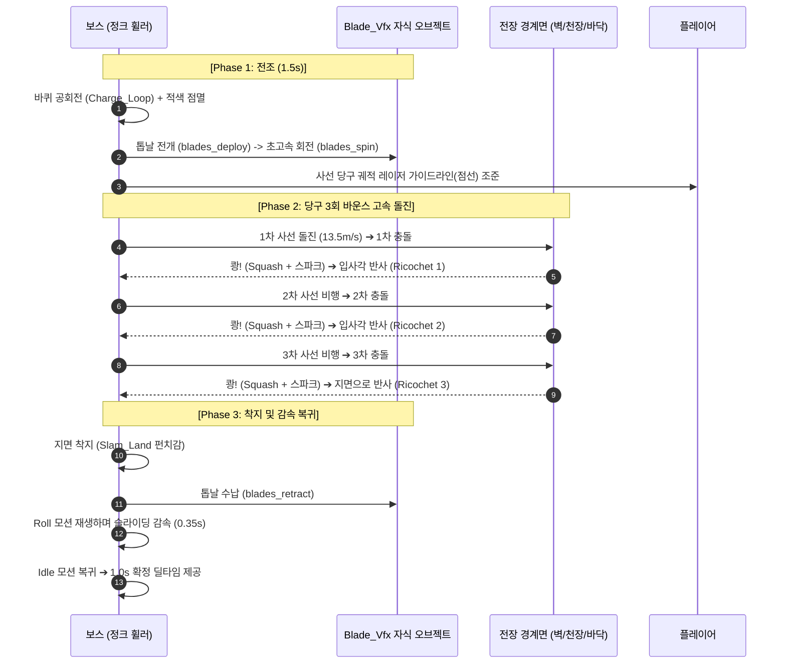
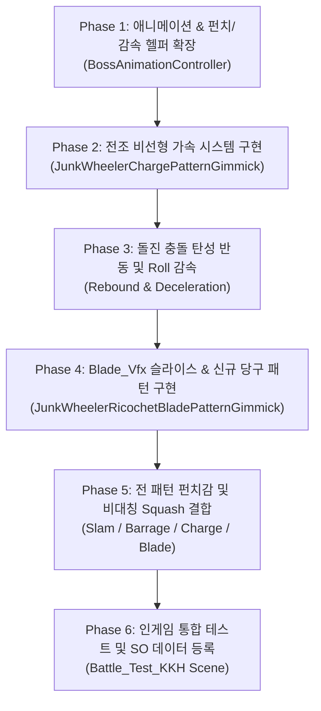

# [기획서] 지역 1 보스 '정크 휠러' 모션 피직스 & 탄성 연출 고도화 및 신규 패턴 기획서

| 문서 속성 | 상세 내용 |
| :--- | :--- |
| **프로젝트명** | 2026_Com2us_Project (RealSteel 2D Action) |
| **문서 번호** | SPEC-BOSS-JW-002 (Rev 3.0) |
| **기능명** | 정크 휠러(Junk Wheeler) 비선형 피직스·탄성 연출 & [신규] 톱날 당구 바운스 패턴 |
| **작성자** | 시스템/전투 기획 & 클라이언트 프로그래밍 |
| **문서 버전** | v3.0 (신규 패턴 '톱날 당구 돌진' 통합 개편) |
| **최종 수정일** | 2026-10-30 |
| **관련 에셋** | `1Boss_robot_dash_loop.png`, `Blade_Vfx/*.png`, `BossMasterData_JunkWheeler.asset` |

---

## 1. 기획 개요 (Overview)

### 1.1 기획 의도 및 배경 (Why)
- **현상 진단**:
  1. **선형(Linear) 제어로 인한 텐션 부재**: 전조(2.0초) 동안 동일한 속도로 깜빡이고 흔들려 폭발 직전의 긴장감(Crescendo)이 없음.
  2. **물리적 탄성 결여**: 11m/s로 벽에 격돌해도 벽에 달라붙어 멈춤. 거대 폐타이어 고무 소재 특유의 튕김(Rebound)이 전혀 없음.
  3. **회전 관성 삭제**: 돌진 주행 후 멈출 때 바퀴가 서서히 감속되는 과정 없이 즉시 `Idle`로 튀어 모션이 뚝 끊김.
  4. **신규 공중/공간 장악 패턴 필요**: 현재 보스는 지상 돌진, 제자리 탄막, 수직 내려찍기로 구성되어 있어, **전장 전체를 대각선 입체 궤적으로 휘젓는 공간 장악형 시그니처 패턴**이 요구됨.
- **개선 목표**:
  - **로그/지수 비선형 가속 곡선**을 적용하여 전조 텐션 극대화.
  - 벽 충돌 시 폐타이어 **탄성체 반동(Elastic Rebound)** 및 등속/관성 운동 구현.
  - `Roll` 스프라이트(12프레임)를 활용한 **자연스러운 관성 감속(Deceleration)** 확립.
  - **[신규 패턴] 회전 톱날 당구 돌진 (Ricochet Blade Rush)**: 보스 차체에 3날 회전 칼날(`Blade_Vfx`)을 전개하고, 당구 쿠션이나 윈도우 스크린세이버처럼 **카메라/전장 사방 경계를 3회 튕기며 사선으로 고속 바운스**하는 고난도 회피 패턴 신설.

---

## 2. 모션 피직스 & 탄성 연출 고도화 사양

### 2.1 [전조] 비선형 텐션 빌드업 시스템 ($T = 2.0\text{s}$)
- **진동 가속 모델**: 정규화 시간 $\tau = \frac{t}{T} \in [0, 1]$에 대해 지수 곡선 $\tau^{2.8}$ 적용.
  - `0.0s ~ 1.0s` (예열): 진폭 $0.03\text{m}$ / 주파수 $10\text{Hz}$ (엔진 시동 미세 진동)
  - `1.0s ~ 1.6s` (과열): 진폭 $0.08\text{m}$ / 주파수 $25\text{Hz}$ (차체 전체 떨림)
  - `1.6s ~ 2.0s` (임계 폭발): 진폭 $0.20\text{m}$ / 주파수 $50\text{Hz}$ (폭주 진동 후 순간 정적 ➔ 발사)
- **점멸 스트로보**: 등속(0.15s) 대신 주기가 $0.30\text{s} \rightarrow 0.12\text{s} \rightarrow 0.04\text{s}$로 점진 단축되며, 발사 직전 완전 적색 포화(Peak Saturation).

### 2.2 [돌진 및 충돌] 탄성체 반동 (Elastic Rebound) 물리
- 벽 충돌 시 단순 정지가 아닌, 반발 계수($e \approx 0.48$)를 적용하여 **반대 방향으로 $1.2\text{m} \sim 1.5\text{m}$ 튕겨 나오는 물리 이동** 구현 ($T = 0.24\text{s}$, `Ease.OutQuad`).

### 2.3 [감속 및 복귀] `Roll` 스프라이트 기반의 관성 소모 파이프라인
- 튕겨 나온 후 정지 모션으로 바로 점프하지 않고, 12프레임 `Roll` 스프라이트를 재생하며 회전 속도가 서서히 줄어드는 완충 구간($0.40\text{s}$)을 거친 후 `Idle`로 복귀.
  $$\mathbf{Charge\_Run\text{ (고속 주행)}} \xrightarrow{\text{벽 충돌}} \mathbf{Squash\text{ (압착)}} \xrightarrow{\text{탄성 반동}} \mathbf{Roll\text{ (바퀴 굴림 감속)}} \xrightarrow{\text{완전 정지}} \mathbf{Idle\text{ (호흡 대기)}}$$

### 2.4 [타격감] 비대칭 비선형 펀치감 (Squash & Stretch)
- **Fast-In ($0.04\text{s}$)**: 충돌 즉시 $0.04\text{초}$ 만에 가로 $0.55$, 세로 $1.45$로 초고속 압착.
- **Elastic-Out ($0.28\text{s}$)**: 로그 감쇠 진동(`Ease.OutElastic`)을 거치며 쫀득하게 원형 복원.

---

## 3. [신규 패턴] 회전 톱날 당구 돌진 (Ricochet Blade Rush)

### 3.1 패턴 개요 및 비주얼 컨셉
- **패턴 ID**: `PATTERN_BLADE_RICOCHET`
- **컨셉**: 보스 본체(`1Boss_robot_dash_loop`) 외곽에 거대한 3날 회전 칼날(`Blade_Vfx`)이 결합되어 고속 회전하며, 당구공이 테이블 쿠션을 맞고 튀듯이 **카메라 전장 4방향 경계(좌벽, 우벽, 바닥, 천장)를 정확히 3회 튕기며(3-Cushion Ricochet)** 사선으로 공간을 절단하는 고속 회피/위협 패턴.

```
       [천장 Boundary] ──────────────────────────┐
          ▲                                       │ (2차 바운스)
         / \                                      │
        /   \                                     ▼
       /     \                                  [우측 벽 Boundary]
      /       \                                   │
     /         \                                  │
    /           ▼                                 │
   /           [플레이어]                         │
  /                                               │
[좌측 벽] ◄───────────────────────────────────────┘
 (1차 바운스)         (3차 바운스 ➔ 지면 착지 안착)
```

### 3.2 `Blade_Vfx` 에셋 연동 및 파이프라인
프로젝트 내 `Assets/Sprites/1Boss_Robot/Blade_Vfx/` 에셋 3종을 자식 오브젝트(`BladeVFXHolder`)로 조합하여 시퀀스별로 전환:
1. **전개 단계 (`1Boss_robot_blades_deploy.png`, 4프레임, 160x112)**:
   - 전조(Tell) 시작 시 차체 내부에서 3날 톱날이 지잉- 튀어나옴.
2. **회전 단계 (`1Boss_robot_blades_spin.png`, 8프레임, 160x112)**:
   - 3회 바운스 돌진 비행 중 24 FPS 초고속 무한 루프 회전.
   - 휠 본체(`dash_loop`)와 톱날 회전 스프라이트가 동시 렌더링되며, 궤적을 따라 스파크 파티클 방출.
3. **수납 단계 (`1Boss_robot_blades_retract.png`, 3프레임, 160x112)**:
   - 3회 튕김 완료 후 지면에 착지하며 톱날이 차체 내부로 철컥 수납됨.

### 3.3 당구 반사(Ricochet Reflection) 물리 알고리즘

#### A. 전장 4방향 바운더리 Rect
전투 카메라의 시야 및 스테이지 충돌 콜라이더를 기준으로 2D 바운더리를 계산:
$$X \in [X_{min}, X_{max}], \quad Y \in [Y_{ground}, Y_{ceiling}]$$

#### B. 입사각 = 반사각 벡터 물리 공식
경계면과의 충돌 지점에서 노멀 벡터 $\vec{n}$에 대해 반사 방향 $\vec{v'}$ 계산:
$$\vec{v'} = \vec{v} - 2(\vec{v} \cdot \vec{n})\vec{n}$$
- **좌측 벽 충돌**: $\vec{n} = (1, 0) \implies v'_x = -v_x, \; v'_y = v_y$
- **우측 벽 충돌**: $\vec{n} = (-1, 0) \implies v'_x = -v_x, \; v'_y = v_y$
- **바닥 지면 충돌**: $\vec{n} = (0, 1) \implies v'_x = v_x, \; v'_y = -v_y$
- **천장 경계 충돌**: $\vec{n} = (0, -1) \implies v'_x = v_x, \; v'_y = -v_y$

#### C. 당구 각도 및 이동 속도
- **초기 발사 각도**: 플레이어의 현재 위치를 조준하는 사선 벡터 ($\pm 35^\circ \sim \pm 55^\circ$ 클램프).
- **돌진 속도**: $13.5\text{ m/s}$ (일반 돌진 11.0m/s보다 빠른 고속 탄환형 비행).
- **각 바운스 순간 연출**:
  - 충돌 즉시 $0.03\text{초}$ 극단적 Squash (`ImpactSquash`)
  - 충돌 벽면에서 금속 스파크 VFX 폭발
  - 화면 미세 진동(Screen Shake $0.08\text{m}$, $0.1\text{s}$)
  - 진행 방향으로 스프라이트 각도(Z 회전) 동기화

### 3.4 상태 전이 및 시퀀스 다이어그램 (Sequence)



### 3.5 플레이어 피격 및 공략 사양
1. **피격 판정**:
   - 보스 본체 콜라이더 반경 $1.2\text{m}$ 외곽에 회전 톱날 판정 반경 $1.6\text{m}$ 적용.
   - 피격 시 플레이어의 **LeftArm/RightArm 부위 내구도 25 타격 + 코어 40 피해**.
   - 다단 히트 방지: 단일 비행 스트로크당 플레이어 피격은 최대 1회로 제한 (`_hasHitThisStroke`).
2. **회피 공략**:
   - 보스가 발사되기 전 표시되는 사선 입사각을 보고 반사 궤적의 중심 사각지대(Safety Zone)로 대피.
   - 고속 궤적이 겹칠 때 타이밍에 맞춰 Space 무적 회피를 사용하여 관통 회피 가능.

---

## 4. 통합 세부 수치 파라미터 원장 (Parameter Table)

| 파라미터명 | 기본값 | 단위 | 역할 및 설명 |
| :--- | :---: | :---: | :--- |
| **[돌진]** `chargeSpeed` | `11.0` | m/s | 기본 맵 횡단 돌진 속도 |
| **[돌진]** `brokenTireSpeed` | `5.5` | m/s | 타이어 부위 파괴 시 영구 감속 속도 |
| **[돌진]** `reboundDistance` | `1.4` | m | 벽 충돌 후 반동으로 튕겨 나오는 후방 거리 |
| **[돌진]** `reboundDuration` | `0.24` | 초 | 벽 충돌 후 반동 이동 소요 시간 |
| **[당구]** `ricochetSpeed` | `13.5` | m/s | 톱날 당구 돌진 비행 속도 |
| **[당구]** `ricochetBounceCount`| `3` | 회 | 카메라/전장 경계 반사 횟수 (3회 쿠션) |
| **[당구]** `ricochetTellDuration`| `1.5` | 초 | 톱날 전개 및 사선 조준 전조 시간 |
| **[당구]** `bladeHitRadius` | `1.6` | m | 회전 톱날의 확장된 공격 판정 반경 |
| **[감속]** `rollDecelDuration` | `0.40` | 초 | 튕겨 나온 후 `Roll` 바퀴가 굴러가며 감속되는 시간 |
| **[펀치]** `impactSquashScale` | `(0.55, 1.45)` | Vector2 | 벽/경계 충돌 순간 극단적 가로 압착 비율 |
| **[펀치]** `landSquashScale` | `(1.45, 0.50)` | Vector2 | 지면 착지 순간의 바닥 압착 비율 |
| **[펀치]** `squashDuration` | `0.04` | 초 | 최대 압착에 도달하는 순간 시간 (Fast-In) |
| **[펀치]** `elasticRestoreDuration`| `0.28` | 초 | 압착 후 탄성 진동하며 원형으로 복원되는 시간 (Elastic-Out) |

---

## 5. 단계별 상세 작업 계획 (Detailed Execution Plan)



---

### Phase 1: 애니메이션 및 물리 헬퍼 코어 확장 (`BossAnimationController.cs`)
1. **비대칭 펀치 연출 API 구축**:
   - `PlayImpactSquashAndStretchAsync(Transform target, Vector2 squashScale, float inDur, float outDur, CancellationToken token)` 구현.
   - $0.04\text{s}$ 초고속 압착 ➔ $0.28\text{s}$ `Ease.OutElastic` 탄성 복원 결합 (좌우 반전 부호 보정 포함).
2. **`Roll` 감속 재생 지원**:
   - `PlayRollDecel()` 메서드를 추가하여 Animator 재생 속도를 점진적으로 줄이는 기능 추가.

---

### Phase 2: 전조(Tell) 비선형 가속 시스템 구현 (`JunkWheelerChargePatternGimmick.cs`)
1. **실시간 가속 루프 개편**:
   - 단순 `DOShake`/`DOColor` Yoyo 폐기, 프레임 단위 `UniTask.Yield` 루프 기반으로 개편.
   - $\tau = \frac{t}{T_{tell}}$ 비율에 따라 $t^{2.8}$ 지수 가속 함수 적용.
   - 프레임마다 진동 오프셋($S_{cur}$)과 점멸 스트로보 주기($\Delta t_{cur}$)를 실시간 계산하여 보스 트랜스폼/스프라이트에 반영.
2. **인터럽트 안전성 보장**:
   - DPS 저지 성공 시 $0\text{초}$ 만에 모든 진동/스케일 트윈 킬 및 본체 원상태(`Color.white`, `Vector3.one`) 복구.

---

### Phase 3: 돌진 충돌 탄성 반동 및 Roll 감속 파이프라인 구축
1. **벽 충돌 시퀀스 개편**:
   - 벽 도달 즉시: **[1]** 벽면 극단 가로 압착(`Squash`) 발동.
   - 반동 연산: **[2]** 충돌 반대 방향 좌표 `reboundX = wallHitX - (dirX * 1.4m)` 산출 (`ClampToCameraX` 적용).
   - 반동 이동: **[3]** `DOMoveX(reboundX, 0.24s).SetEase(Ease.OutQuad)`로 튕겨남 실행.
   - 관성 굴림: **[4]** 튕겨 나오는 즉시 `PlayRollBarrage()` 재생 ➔ $0.40\text{초}$ 후 `PlayIdle()`로 부드럽게 안착.
2. **충돌 후 플레이어 방향 반전(`FacePlayer`)**: 롤 감속이 완전히 끝나는 정지 시점에 정확히 연동.

---

### Phase 4: `Blade_Vfx` 에셋 슬라이스 & 신규 당구 패턴 구현
1. **`Blade_Vfx` 스프라이트 슬라이스 메타 및 애니메이션 클립 생성**:
   - `1Boss_robot_blades_deploy.png` (4프레임, 160x112, 12 FPS) ➔ `Boss_Blades_Deploy.anim`
   - `1Boss_robot_blades_spin.png` (8프레임, 160x112, 20 FPS 루프) ➔ `Boss_Blades_Spin.anim`
   - `1Boss_robot_blades_retract.png` (3프레임, 160x112, 12 FPS) ➔ `Boss_Blades_Retract.anim`
2. **`JunkWheelerRicochetBladePatternGimmick.cs` 신규 스크립트 작성**:
   - `BossPatternGimmickBase` 상속.
   - 카메라 뷰포트 월드 바운더리 렉트 계산 (`TargetCamera.ViewportToWorldPoint`).
   - 3회 연속 레이캐스트/이동 시퀀스 (`DOMove` + $\vec{v'} = \vec{v} - 2(\vec{v} \cdot \vec{n})\vec{n}$).
   - 각 바운스 순간마다 `ImpactSquash` + 스파크 VFX + 카메라 셰이크 트리거.
   - 3회 바운스 종료 후 바닥 착지 ➔ `retract` 수납 ➔ `Roll` 감속 ➔ `Idle` 복귀.
3. **보스 프리팹 및 컨트롤러 연동**:
   - `Boss1_JunkWheeler.prefab` 자식으로 `BladeVFX` 오브젝트(스프라이트 렌더러 + 애니메이터) 배치.
   - `JunkWheelerBossController.cs`에 `ricochetBladePatternGimmick` 컴포넌트 자동 등록.
   - `Pattern_04_BladeRicochet.asset` (ScriptableObject) 생성 및 `BossMasterData_JunkWheeler`의 4번째 패턴으로 등록.

---

### Phase 5: 전 패턴 펀치감(Squash & Stretch) 일괄 고도화
1. **`JunkWheelerSlamPatternGimmick.cs`**:
   - 3단 내려찍기 착지 충돌 시 바닥 극단 압착(`X: 1.45, Y: 0.50`, $0.04\text{s}$) 후 지면 파편 프레임과 싱크 복원.
   - 공중 도약 직전 수직 압축($Y: 0.7$) ➔ 솟구침 팽창($Y: 1.3$) 연출 적용.
2. **`JunkWheelerBarragePatternGimmick.cs`**: 탄막 종료 후 착지 순간의 펀치감 동일 적용.

---

### Phase 6: Unity 에디터 플레이 검증 및 QA
- `Battle_Test_KKH.unity` 플레이 모드에서 테스터 단축키를 추가하여 검증:
  - [ ] 전조 2초 동안 점멸과 진동이 폭발적으로 고조되는 텐션 체감.
  - [ ] 일반 돌진 시 벽 충돌 후 1.4m 튕겨 나오며 `Roll`을 거쳐 `Idle`로 자연스럽게 감속되는가?
  - [ ] **[신규 패턴]** 보스가 3날 칼날을 펼치고 카메라 범위를 당구공처럼 3회 튕기며 사선으로 회전 돌진하는가?
  - [ ] 3회 바운스 후 지면에 착지하며 칼날이 수납되고 딜타임으로 정상 복귀하는가?
  - [ ] 코너(모서리)에 갇히는 버그 없이 항상 매끄럽게 3회 튕김이 완수되는가?
