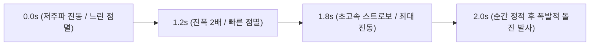
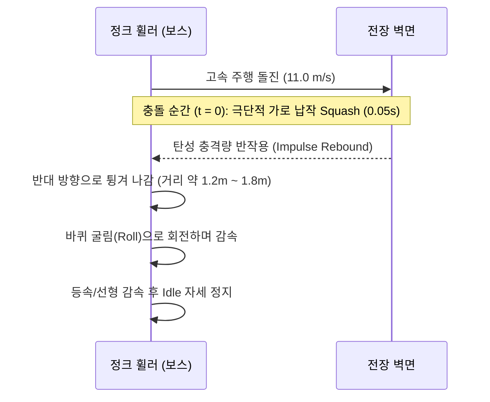

# [정크 휠러] 보스 모션·피직스·펀치감 개선 기획 및 기술 명세서

> **문서 버전**: v1.0  
> **작성일**: 2026-10-29  
> **상태**: 개선안 수립 및 구현 대기  
> **적용 대상**: `Assets/KKH/` 지역 1 보스 ("정크 휠러", First Boss Robot)

---

## 1. 개요 및 핵심 방향성

### 1.1 배경 및 문제 정의
현재 보스의 연출 및 물리 움직임은 대부분 **선형(Linear, 등속)**으로 구성되어 있어 액션 게임 특유의 텐션(긴장감)과 타격감, 물리적 질감(폐타이어 고무의 탄성)이 온전히 전달되지 못함.
- **전조 진동/점멸**: 시작부터 끝까지 동일한 속도와 강도로 작동하여 발사 직전의 폭발적 텐션 형성이 부족함.
- **돌진 충돌**: 벽에 부딪혔을 때 제자리에 정지(`PunchScale`만 제자리에서 작동)하여 탄성체가 부딪혀 튕겨 나가는 역동성이 결여됨.
- **모션 트랜지션**: 고속 돌진 후 정지할 때 바퀴가 서서히 감속되는 과정 없이 `ChargeRun`에서 곧바로 `Idle`로 전환되어 급제동된 느낌을 줌.

### 1.2 핵심 개선 패러다임
```
[기존] 등속/선형 (Linear) ➔ [개선] 비선형 가속 (Logarithmic / Exponential) + 탄성 물리 (Elastic Rebound)
```
1. **전조 진동 & 점멸의 로그/지수 가속**: 시간이 흐를수록 빈도와 진폭이 폭발적으로 급증하여 텐션 극대화.
2. **돌진 충돌 탄성 반동 (Elastic Rebound)**: 벽/오브젝트 충돌 시 물리 법칙에 따라 반대 방향으로 튕겨 나옴.
3. **`Roll` 스프라이트 기반의 점진적 관성 감속**: `고속 돌진` ➔ `충돌 튕김` ➔ `바퀴 굴림(Roll) 감속` ➔ `대기(Idle)` 복귀 파이프라인 확립.
4. **비선형 로그 커브 기반의 펀치감 (Punch Impact)**: 순간적 극단 압축(Squash) 후 로그 감쇠 복원으로 묵직하고 쫀득한 타격감 부여.

---

## 2. 전조(Tell) 시스템의 비선형 가속화

### 2.1 진동(Shake) 주기 & 진폭의 비선형 가속
- **개념**: 2.0초 전조 동안 처음에는 미세한 떨림으로 시작하여, 돌진 발사 직전(1.5s ~ 2.0s)에는 엔진이 터질 듯한 맹렬한 진동으로 가속됨.
- **수학적 모델**:
  $$\text{Progress } t \in [0, 1]$$
  $$\text{Strength}(t) = \text{BaseStrength} \times (1 + \alpha \cdot t^k) \quad (k \ge 2)$$
  $$\text{Vibrato}(t) = \text{BaseVibrato} \times (1 + \beta \cdot t^k)$$
- **파라미터 설계**:
  - `0.0s ~ 1.0s` (초기 예열): 진폭 `0.03m`, 빈도 `10Hz` (미세 엔진 진동)
  - `1.0s ~ 1.6s` (과열 단계): 진폭 `0.08m`, 빈도 `25Hz` (차체 들썩임)
  - `1.6s ~ 2.0s` (임계 폭발): 진폭 `0.18m`, 빈도 `45Hz` (화면을 찢을 듯한 극단적 헛돔 진동)

### 2.2 점멸(Flash) 스트로보의 가속화
- **개념**: 등속 왕복 깜빡임(현재 0.15s 주기) 대신, 발사 시점이 다가올수록 깜빡임 주기가 로그/지수적으로 짧아지며 최종 발사 직전에는 완전한 붉은 발광 상태로 포화됨.
- **점멸 주기($\Delta t_{flash}$) 변화 곡선**:
  - `0.0s`: $0.35\text{s}$ (천천히 붉은빛이 깜빡임)
  - `1.0s`: $0.15\text{s}$ (경고 점멸)
  - `1.7s`: $0.05\text{s}$ (초고속 스트로보 점멸)
  - `1.9s ~ 2.0s`: 완전 붉은색 고정 홀드 (Peak Heat Saturation) 후 발사!



---

## 3. 돌진 충돌 및 탄성체 반동(Elastic Rebound) 시스템

### 3.1 폐타이어 탄성체 물리 모델
보스는 거대한 고무 폐타이어를 외골격으로 장착한 로봇이므로, 단단한 강철 벽에 부딪혔을 때 운동 에너지가 반발 계수(Restitution Coefficient)에 의해 반대 방향 반작용으로 전환되어야 함.



### 3.2 튕겨 나오는 운동 그래프 (Elastic Bounce & Recoil)
1. **충돌 임팩트 (Impact Squash, $0.00\text{s} \sim 0.05\text{s}$)**:
   - 전방 속도 $0$으로 강제 차단.
   - 스케일이 진행 방향으로 납작하게 압착 ($X: 0.6$, $Y: 1.4$).
2. **탄성 튕겨남 (Elastic Ejection, $0.05\text{s} \sim 0.25\text{s}$)**:
   - 압축되었던 타이어가 팽창하며 반대 방향으로 반발 속도 부여 (초기 튕김 속도 약 $-6.0\text{ m/s}$).
   - 벽면에서 약 $1.2\text{m} \sim 1.5\text{m}$ 뒤로 튕겨 나감.
3. **반작용 궤적 감속 (Deceleration Track)**:
   - 튕겨 나온 후 미끄러지듯 등속/마찰 감속 곡선을 그리며 정지 지점에 안착.

---

## 4. `Roll` 스프라이트를 활용한 점진적 관성 복귀 시퀀스

### 4.1 문제점 및 재발견
- 기존 구현: 돌진(`Boss_Charge_Run`) 후 벽에 부딪히면 멈춘 뒤 곧바로 `Boss_Idle`로 점프하여 회전 관성이 부자연스럽게 삭제됨.
- **스프라이트 자원 분석**: 프로젝트에 존재하는 [`1Boss_robot_roll.png`](file:///d:/KDU/2026_Com2us_Project/Assets/Sprites/1Boss_Robot/1Boss_robot_roll.png) (12프레임)은 단순히 공중 탄막뿐만 아니라, **바퀴가 지면에서 천천히 구르며 정지 상태로 돌아가는 점진적 감속 과정(Deceleration Recovery)**에 최적화된 스프라이트임.

### 4.2 완성형 돌진 모션 파이프라인
```
[1. 전조] Charge_Start (예열) ➔ Charge_Loop (가속 공회전)
               ↓
[2. 발사] Charge_Release (스프링 팽창 튀어나감)
               ↓
[3. 주행] Charge_Run (고속 잔상 주행, 11m/s)
               ↓
[4. 충돌] Impact Hit (극단 Squash 압착)
               ↓
[5. 반동] Rebound (벽에서 1.5m 튕겨 나옴)
               ↓
[6. 감속] Roll (튕겨 나온 후 바퀴가 천천히 돌며 잔여 관성 소모, 12fps ➔ 6fps 감속)
               ↓
[7. 정지] Idle (완전 정지 및 호흡 모션 복귀)
```

---

## 5. 비선형 로그 커브 기반의 '펀치감(Punch)' 시스템

### 5.1 타격감의 본질: 비대칭 시간 곡선 (Fast In - Damped Out)
- **등속 펀치(현재)**: 찌그러지는 시간과 펴지는 시간이 같아 젤리처럼 흐물거림.
- **로그/지수 펀치(개선)**:
  - **압축 (Squash)**: 단 **0.03초 ~ 0.05초** 만에 최대 진폭으로 초고속 붕괴 (초강력 임팩트 전달).
  - **복원 (Stretch & Settle)**: 탄성 로그 감쇠 진동을 거치며 **0.25초 ~ 0.35초** 동안 쫀득하게 원형 복원.

```
스케일 변위
  ▲
  │     충돌 순간 (0.04s)
1.4│     ┌───┐ (Stretch)
1.0│─────┘   └───┬───────┬─────── 원형 복귀 (1.0)
  │               └───┘   └───┘ (로그 감쇠 진동)
0.6│ ┌───┐ (극단 Squash)
  └─┴─────┴───────────────────────► 시간(t)
     0.03s         0.30s
```

### 5.2 주요 액션별 펀치 파라미터 규격
1. **돌진 벽 충돌**:
   - Squash: `X = 0.55`, `Y = 1.35` (진행 방향에 수직 팽창)
   - 복원 커브: `Ease.OutElastic` / 로그 감쇠 계수 $\zeta = 0.4$
2. **3단 내려찍기 착지**:
   - Squash: `X = 1.45`, `Y = 0.50` (지면 충돌 바닥 찌그러짐)
   - 복원: 지면 파편 프레임(`jump_slam_11~14`)과 1:1 싱크 결합.
3. **공중 도약 발사**:
   - 점프 직전 `Y = 0.7` 압축 ➔ 발사 순간 `Y = 1.3` 수직 팽창.

---

## 6. 구현 설계 및 코드 반영 계획 (Implementation Plan)

### 6.1 `JunkWheelerChargePatternGimmick.cs` 개편
1. **전조 루프의 비선형 가속화 코루틴/UniTask**:
   ```csharp
   // 선형 DOColor/DOShake 대신 경과 시간 비율(t)에 따른 수식 적용
   float progress = elapsed / tellDuration; // 0 ~ 1
   float curvedT = Mathf.Pow(progress, 2.5f); // 비선형 지수 가속
   float curShake = Mathf.Lerp(minShake, maxShake, curvedT);
   float curFlashInterval = Mathf.Lerp(maxInterval, minInterval, curvedT);
   ```
2. **반동 운동 (Bounce Recoil) 시퀀스**:
   ```csharp
   // 충돌 후 뒤로 튕겨 나가는 이동 트윈
   float bounceDistance = 1.5f;
   float bounceTargetX = wallHitX - (_chargeDirection * bounceDistance);
   
   // 1. 임팩트 압착
   await PlayImpactSquashAsync();
   // 2. 탄성 튕김 이동
   await transform.DOMoveX(bounceTargetX, 0.25f).SetEase(Ease.OutQuad);
   // 3. Roll 감속 모션 재생
   OwnerBoss.Animation.PlayRollBarrage();
   await UniTask.Delay(TimeSpan.FromSeconds(0.4f));
   // 4. Idle 복귀
   OwnerBoss.Animation.PlayIdle();
   ```

### 6.2 `BossAnimationController.cs` 확장
- 비대칭 비선형 펀치 헬퍼 메서드 추가:
  - `PlayImpactPunch(Transform target, Vector2 punchScale, float duration, Ease inEase, Ease outEase)`
  - 스프라이트 좌우 반전 상태(`scale.x < 0`) 완벽 연동.

---

## 7. 단계별 작업 로드맵

- [ ] **Step 1. 전조 가속 시스템 구현**: 진동 진폭/빈도 및 점멸 주기의 비선형(Pow/Log) 실시간 업데이트 로직 적용.
- [ ] **Step 2. 돌진 벽 충돌 탄성 반동(Rebound) 물리 연산 추가**: 충돌 감지 시 반대 방향 역추진 이동 트윈 결합.
- [ ] **Step 3. `Roll` 감속 트랜지션 연결**: 반동 이동 구간에서 `Roll` 모션 재생 및 자연스러운 회전 감속 연출.
- [ ] **Step 4. 비선형 펀치감(Squash & Stretch) 일괄 고도화**: 착지, 도약, 충돌 시의 트윈 곡선을 Fast-In / Elastic-Out으로 교체.
- [ ] **Step 5. 인게임 튜닝 및 타격감 검증**: `Battle_Test_KKH.unity`에서 체감 템포 및 물리 질감 확인.

