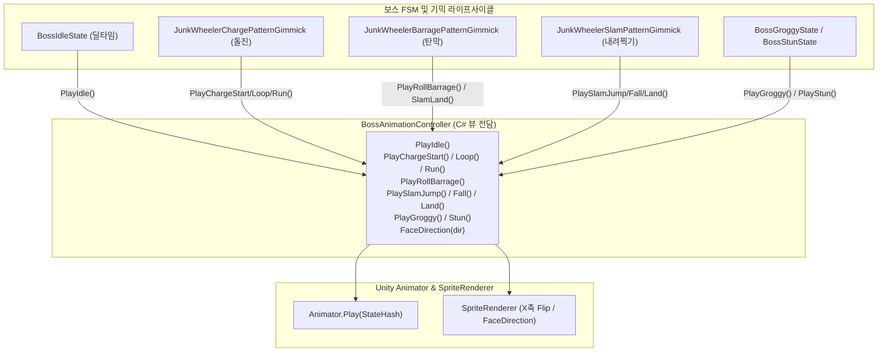
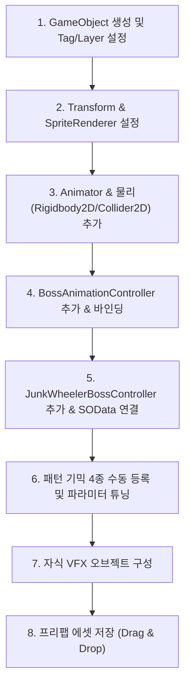

# 1Boss_Robot 애니메이션 제작 및 보스 프리팹 인스펙터 설정 가이드

본 문서는 지역 1 보스 **"정크 휠러 (1Boss_Robot)"**의 스프라이트 리소스를 유니티 애니메이션 클립(`.anim`)과 컨트롤러(`.controller`)로 제작하고, 보스 프리팹 오브젝트를 생성하여 전체 컴포넌트의 인스펙터를 설정하는 실무 전체 절차 가이드입니다.

---

## 1. 아키텍처 개요 (코드 주도형 애니메이션)

메카님(Mecanim) 내부에서 AnyState 전이선과 복잡한 파라미터(Trigger, Bool) 화살표를 거미줄처럼 연결하면 **비동기 기믹 타이밍과의 불일치, AnyState 무한 루프, 모션 씹힘** 버그가 발생하기 쉽습니다.

본 프로젝트는 **"Code-Driven Animation Architecture"**를 채택하여 다음과 같이 동작합니다:
1. **Animator Controller**: 복잡한 전이 화살표 없이 각 모션 노드만 독립적으로 배치.
2. **`BossAnimationController`**: 문자열 해시(`Animator.StringToHash`)를 캐싱하여 가비지 없이 `animator.Play(hash)` 즉시 호출.
3. **FSM & 기믹 시퀀스**: UniTask 비동기 시퀀스 및 FSM 상태 전이 시점에 정확히 애니메이션을 동기화하여 재생.



---

## 2. 스프라이트 리소스 현황

모든 원본 스프라이트는 [`Assets/Sprites/1Boss_Robot/`](file:///d:/KDU/2026_Com2us_Project/Assets/Sprites/1Boss_Robot/)에 위치하며, 이미 유니티의 `Multiple` 모드로 슬라이싱되어 있습니다.

| 스프라이트 파일명 | 규격 (WxH) | 슬라이스 프레임 수 | 주요 용도 |
| :--- | :---: | :---: | :--- |
| `1Boss_robot_dash_loop.png` | 160 x 160 | 4프레임 (`_0` ~ `_3`) | 돌진 고속 주행 루프 및 기본 Idle 자세 |
| `1Boss_robot_spindash_charge_start.png` | 160 x 160 | 4프레임 (`_0` ~ `_3`) | 돌진 전조 시작 시 웅크리기 |
| `1Boss_robot_spindash_charge_loop.png` | 160 x 160 | 8프레임 (`_0` ~ `_7`) | 돌진 전조 바퀴 공회전 진동 + DPS 300 저지 체크 |
| `1Boss_robot_spindash_release.png` | 160 x 160 | 3프레임 (`_0` ~ `_2`) | 돌진 발사 순간 튕겨나가는 가속 |
| `1Boss_robot_roll.png` | 160 x 160 | 12프레임 (`_0` ~ `_11`) | **탄막 기믹 도약 및 공중 체공 회전 난사** |
| `1Boss_robot_jump_slam.png` | 160 x 160 | 15프레임 (`_0` ~ `_14`) | 3단 내려찍기(도약, 급강하, 지면 슬램) 및 기절 자세 |
| `Blade_Vfx/` | 가변 | 칼날 회전 VFX | 2페이즈 및 돌진 칼날 연출 |

---

## 3. 애니메이션 클립(.anim) 제작 명세표

아래 표의 **"클립 이름"**은 C# 코드의 `Animator.StringToHash` 상수와 100% 일치해야 하므로 대소문자를 정확히 지켜야 합니다.

| 클립 이름 (State Name) | 원본 스프라이트 프레임 | Samples (FPS) | Loop Time | 연출 설명 및 매핑 시점 |
| :--- | :--- | :---: | :---: | :--- |
| `Boss_Idle` | `1Boss_robot_dash_loop_0` (1프레임) | 12 | **V** | 확정 딜타임 및 기본 대기 자세 (`BossIdleState`) |
| `Boss_Charge_Start` | `1Boss_robot_spindash_charge_start_0 ~ 3` | 12 | X | 돌진 전조 시작 웅크리기 (`OnTellStarted`) |
| `Boss_Charge_Loop` | `1Boss_robot_spindash_charge_loop_0 ~ 7` | 16 | **V** | 바퀴 공회전 진동 (2초 전조 및 DPS 300 저지 구간) |
| `Boss_Charge_Release` | `1Boss_robot_spindash_release_0 ~ 2` | 15 | X | 돌진 발사 순간 튕겨나감 (`ExecuteActionAsync` 시작) |
| `Boss_Charge_Run` | `1Boss_robot_dash_loop_0 ~ 3` | 16 | **V** | 맵을 가로지르는 고속 횡단 주행 |
| `Boss_Roll_Barrage` | `1Boss_robot_roll_0 ~ 11` | 16 | **V** | **공중 도약 및 체공 중 몸체를 회전하며 바이킹 탄막 난사** |
| `Boss_Slam_Jump` | `1Boss_robot_jump_slam_0 ~ 4` | 12 | X | 3단 내려찍기 공중 도약 및 체공 추적 |
| `Boss_Slam_Fall` | `1Boss_robot_jump_slam_8 ~ 9` | 12 | X | 지면을 향한 급강하 낙하 |
| `Boss_Slam_Land` | `1Boss_robot_jump_slam_10 ~ 14` | 15 | X | 지면 강타 충격파 및 슬램 착지 |
| `Boss_Groggy` | `1Boss_robot_jump_slam_13` (다운 1프레임) | 12 | **V** | 고철 못판 밟아 타이어 펑크 시 4초 그로기 |
| `Boss_Stun` | `1Boss_robot_jump_slam_13` (다운 1프레임) | 12 | **V** | DPS 저지 성공(3초) 또는 폭발 화물 충돌(2초) 스턴 |

---

## 4. 애니메이션 에셋 제작 절차

### STEP 1. 애니메이션 클립 생성
1. 프로젝트 창에서 클립을 저장할 폴더 생성 (`Assets/Sprites/1Boss_Robot/Animations` 폴더 권장).
2. 폴더 우클릭 ➔ **Create ➔ Animation** 선택.
3. 위의 명세표에 기재된 11개의 이름(`Boss_Idle`, `Boss_Charge_Start` 등)으로 클립을 각각 생성.
4. 각 클립을 더블 클릭하여 애니메이션 창(Animation Window)을 열고:
   - 해당 스프라이트 시트 화살표를 펼쳐 지정된 프레임들을 타임라인에 드래그 앤 드롭.
   - **Samples(FPS)** 값을 명세표대로 입력 (Animation 창 우측 점 세 개 ➔ *Show Sample Rate* 활성화).
   - Loop Time이 필요한 클립(`Boss_Idle`, `Boss_Charge_Loop`, `Boss_Charge_Run`, `Boss_Roll_Barrage`, `Boss_Groggy`, `Boss_Stun`)은 인스펙터에서 **Loop Time** 체크박스를 체크.

### STEP 2. Animator Controller 생성 및 배치
1. 폴더 우클릭 ➔ **Create ➔ Animator Controller** 선택 (이름: `Boss_Robot_Controller`).
2. `Boss_Robot_Controller`를 더블 클릭하여 **Animator 창**을 엽니다.
3. STEP 1에서 생성한 11개의 애니메이션 클립들을 창 위로 모두 드래그 앤 드롭합니다.
4. **`Boss_Idle` 노드를 우클릭 ➔ "Set as Layer Default State"**로 지정 (주황색 기본 상태로 변경).
5. **주의사항**: **스테이트 간에 Transition 화살표를 연결하지 않습니다!**
   - 모든 전이는 C# 코드([`BossAnimationController.cs`](file:///d:/KDU/2026_Com2us_Project/Assets/KKH/02.Scripts/03.Logic/Boss/Visual/BossAnimationController.cs))에서 `animator.Play(Hash)`를 통해 즉시 직접 호출됩니다.

```
[Animator Layer State Layout]
Entry ➔ [Boss_Idle] (Default State)

[Boss_Charge_Start]     [Boss_Charge_Loop]     [Boss_Charge_Release]     [Boss_Charge_Run]
[Boss_Roll_Barrage]
[Boss_Slam_Jump]        [Boss_Slam_Fall]       [Boss_Slam_Land]
[Boss_Groggy]           [Boss_Stun]
```

---

## 5. 보스 프리팹 생성 및 전체 인스펙터 설정 절차 (Step-by-Step)

보스 오브젝트를 씬에서 조립한 뒤 프리팹으로 패키징하는 10단계 절차입니다.



### [단계 1] 기본 게임오브젝트 생성 및 Tag/Layer 지정
1. 유니티 Hierarchy 창 빈 공간 우클릭 ➔ **Create Empty** 클릭.
2. 오브젝트 이름을 **`Boss_JunkWheeler`** (또는 `1Boss_Robot`)로 변경.
3. 인스펙터 최상단:
   - **Tag**: `Boss` 선택 (없을 경우 *Add Tag* ➔ `Boss` 등록 후 선택).
   - **Layer**: `Enemy` (또는 프로젝트 표준 레이어) 선택.

---

### [단계 2] Transform 컴포넌트 설정
* **Position**: `X: 0, Y: 0, Z: 0` (씬 테스트 지면 높이에 배치)
* **Rotation**: `X: 0, Y: 0, Z: 0`
* **Scale**: `X: 1, Y: 1, Z: 1`
  > [!NOTE]
  > 보스 진행 방향에 따라 X축 반전은 스크립트([`BossAnimationController.cs`](file:///d:/KDU/2026_Com2us_Project/Assets/KKH/02.Scripts/03.Logic/Boss/Visual/BossAnimationController.cs))가 `localScale.x`의 부호(+1 / -1)로 자동 제어하므로 기본 스케일은 반드시 `(1, 1, 1)`로 유지합니다.

---

### [단계 3] SpriteRenderer 컴포넌트 추가 및 설정
Hierarchy의 `Boss_JunkWheeler` 선택 ➔ **Add Component ➔ Sprite Renderer**:
* **Sprite**: `1Boss_robot_dash_loop_0` 드래그 할당 (기본 자세)
* **Color**: `RGBA(255, 255, 255, 255)` (흰색)
* **Flip**: X: `체크 해제`, Y: `체크 해제` (스케일로 반전하므로 Flip 체크 금지)
* **Sorting Layer**: `Characters` 또는 `Foreground` (플레이어와 동일 계층)
* **Order in Layer**: `0`

---

### [단계 4] Animator 컴포넌트 추가 및 설정
**Add Component ➔ Animator**:
* **Controller**: 위의 4절에서 제작한 **`Boss_Robot_Controller`** 드래그 할당.
* **Avatar**: `None`
* **Apply Root Motion**: **`체크 해제 (False)`**
  > [!IMPORTANT]
  > `Apply Root Motion`이 켜져 있으면 애니메이션이 트랜스폼 좌표를 덮어써서 DOTween 이동 및 FSM 좌표 제어와 충돌합니다. 반드시 체크 해제해야 합니다.
* **Update Mode**: `Normal`
* **Culling Mode**: `Always Animate` (보스가 공중으로 높이 점프하거나 화면 경계로 이동해도 애니메이션 연산이 정지되지 않도록 보장).

---

### [단계 5] 2D 물리 컴포넌트 (Rigidbody2D & BoxCollider2D) 설정
DOTween 기반 위치 연산 및 기물/투사체 충돌 감지를 위해 물리 컴포넌트를 설정합니다.

1. **Add Component ➔ Rigidbody 2D**:
   * **Body Type**: **`Kinematic`** (스크립트/트윈으로 이동 제어)
   * **Simulated**: `체크 (True)`
   * **Use Full Kinematic Contacts**: `체크 (True)` (트리거 및 충돌 검출 활성화)
   * **Constraints**: Freeze Rotation `Z 체크` (물리 충돌로 회전 방지)

2. **Add Component ➔ Box Collider 2D**:
   * **Is Trigger**: `체크 해제 (False)` (피격 및 장애물 감지)
   * **Offset**: `X: 0, Y: 0.8` (스프라이트 중심 높이)
   * **Size**: `X: 1.4, Y: 1.6` (160x160 로봇 바퀴 및 몸체 외곽선에 밀착)

---

### [단계 6] BossAnimationController 추가 및 바인딩
**Add Component ➔ Boss Animation Controller** ([`BossAnimationController.cs`](file:///d:/KDU/2026_Com2us_Project/Assets/KKH/02.Scripts/03.Logic/Boss/Visual/BossAnimationController.cs)):
* **Animator**: 자기 자신의 `Animator` 컴포넌트 연결 (비워둘 시 Awake 자동 탐색).
* **Sprite Renderer**: 자기 자신의 `SpriteRenderer` 컴포넌트 연결 (비워둘 시 Awake 자동 탐색).
* **Base Facing Sign**: **`1`** (원본 스프라이트가 우측을 바라보므로 `1`, 좌측을 보고 있다면 `-1`).

---

### [단계 7] JunkWheelerBossController (보스 총괄 제어기) 추가 및 원장 SO 할당
**Add Component ➔ Junk Wheeler Boss Controller** ([`JunkWheelerBossController.cs`](file:///d:/KDU/2026_Com2us_Project/Assets/KKH/02.Scripts/03.Logic/Boss/JunkWheeler/JunkWheelerBossController.cs)):
* **Master Data**: [`Assets/KKH/03.SOData/Boss/BossMasterData_JunkWheeler.asset`](file:///d:/KDU/2026_Com2us_Project/Assets/KKH/03.SOData/Boss/BossMasterData_JunkWheeler.asset) 드래그 할당 (**필수!**)
* **Clamp To Camera Bounds**: **`체크 (True)`** (보스가 카메라 화면 좌우 밖으로 나가지 않도록 투명 벽 제한).
* **Camera Edge Padding**: `0.65` (화면 테두리 안쪽 여백).
* **Target Camera**: `None` (비워두면 `Camera.main` 자동 탐색).
* **Animation Controller**: 단계 6에서 부착한 `BossAnimationController` 연결.
* **Phase 2 Fire VFX**: 자식 오브젝트의 파티클 연결 (단계 9 참조).
* **Defeat Explosion VFX**: 자식 오브젝트의 파티클 연결 (단계 9 참조).

---

### [단계 8] 패턴 기믹 컴포넌트 4종 사전 부착 및 파라미터 튜닝
> [!TIP]
> `JunkWheelerBossController`는 실행 시 누락된 기믹을 자동으로 `AddComponent`하지만, 프리팹에 미리 부착해두면 인스펙터에서 아래의 밸런스 파라미터를 직접 편집할 수 있습니다.

1. **`JunkWheelerTirePartGimmick` (타이어 부위 기믹)**:
   * **Gimmick ID**: `TIRE_PART`
   * **Require Pierce Tag**: `체크 (True)` (관통 속성 스킬에만 내구도 차감)

2. **`JunkWheelerChargePatternGimmick` (돌진 패턴)**:
   * **Charge Speed**: `11.0` (기본 돌진 속도 m/s)
   * **Broken Tire Speed**: `5.5` (타이어 펑크 시 영구 감속 속도 m/s)
   * **Anticipated Duration**: `0.2` (돌진 직전 뒤로 웅크리는 시간)
   * **Wall Stun Delay**: `0.3` (벽 충돌 후 반동 대기 시간)
   * **Max Map Distance**: `5.0`
   * **전조 점멸(Tell Flash) 파라미터**:
     - **Flash Color**: `RGBA(255, 0, 0, 255)` (점멸 색상, 외부/인스펙터 조정 가능)
     - **Flash Interval**: `0.15` (점멸 왕복 주기 초)
     - **Shake Strength**: `X: 0.08, Y: 0, Z: 0` (바퀴 헛돔 진동 세기)
     - **Shake Vibrato**: `20` (진동 빈도)
     - *외부 제어 메서드*: `public void OnTellStarted(Color, float)`, `SetFlashParameters()` 제공

3. **`JunkWheelerBarragePatternGimmick` (본체 도약 바이킹 탄막)**:
   * **Launch Height**: `1.7` (공중 도약 기준 높이 m, 타이어 파괴 시 1.19m로 자동 감축)
   * **Launch Duration**: `0.4` (공중 상승 시간)
   * **Land Duration**: `0.25` (지면 착지 급강하 시간)
   * **Bullet Interval**: `0.35` (탄환 발사 간격)
   * **Turnaround Delay**: `0.2` (바이킹 정점 반전 대기 시간)
   * **Sweep Rounds**: `1` (왕복 1세트)
   * **Bullet Speed**: `4.0` (탄환 이동 속도)
   * **Bullet Count Per Sweep**: `7` (30도 간격, 1스윕당 7발 투사)
   * **Bullet Prefab**: 비워두면 내장 원형 탄환 자동 생성 (원하는 투사체 프리팹 할당 가능)

4. **`JunkWheelerSlamPatternGimmick` (3단 내려찍기 & 못판 유도)**:
   * **Jump Height**: `3.0` (도약 높이)
   * **Jump Duration**: `0.4`
   * **Tracking Duration**: `1.0` (공중에서 플레이어 추적 시간)
   * **Hover Duration**: `0.4` (급강하 직전 공중 정지 예고)
   * **Slam Duration**: `0.22` (급강하 시간)
   * **Impact Radius**: `1.2` (피격 판정 반경)
   * **Nail Board Detect Radius**: `1.0` (고철 못판 상호작용 감지 반경)
   * **Slam Rounds**: `3` (총 3회 반복)

---

### [단계 9] 자식 오브젝트 (FX 계층) 구성 (선택)
`Boss_JunkWheeler` 하위에 자식 빈 게임오브젝트를 생성하여 연출용 파티클을 배치합니다:

1. `Boss_JunkWheeler` 우클릭 ➔ **Create Empty** ➔ 이름: **`VFX_Phase2_Fire`**
   - **Add Component ➔ Particle System**: 엔진 과열 불꽃 이펙트 설정.
   - `JunkWheelerBossController`의 **Phase 2 Fire VFX** 슬롯에 드래그 연결.
2. `Boss_JunkWheeler` 우클릭 ➔ **Create Empty** ➔ 이름: **`VFX_Defeat_Explosion`**
   - **Add Component ➔ Particle System**: 처치 토벌 사망 폭발 이펙트 설정.
   - `JunkWheelerBossController`의 **Defeat Explosion VFX** 슬롯에 드래그 연결.

---

### [단계 10] 프리팹 에셋 저장 및 씬 배치
1. 프로젝트 창에서 프리팹을 보관할 폴더로 이동 (예: `Assets/KKH/04.Prefabs/Boss/` 또는 `Assets/Prefabs/`).
2. Hierarchy 창의 **`Boss_JunkWheeler` 게임오브젝트를 프로젝트 폴더로 드래그 앤 드롭**합니다.
3. 팝업이 나타나면 **"Original Prefab"**을 선택합니다.
4. 이제 언제든지 이 프리팹을 씬에 배치하여 사용할 수 있습니다.

---

## 6. 인게임 검증 및 테스트 가이드

씬에 부착된 [`JunkWheelerGimmickTester.cs`](file:///d:/KDU/2026_Com2us_Project/Assets/KKH/02.Scripts/06.Test/JunkWheelerGimmickTester.cs)를 통해 유니티 플레이 모드에서 즉시 모션을 검증할 수 있습니다:

1. 씬에 빈 오브젝트 생성 ➔ `JunkWheelerGimmickTester` 부착.
2. `Target Boss` 슬롯에 씬의 `Boss_JunkWheeler` 드래그 연결 (비워두면 자동 탐색).
3. **Play 버튼 클릭 후 단축키 검증**:

| 단축키 | 실행 패턴 및 검증할 모션 |
| :---: | :--- |
| **`7`** | **돌진 패턴**: `Charge_Start` ➔ `Charge_Loop` (2초 전조) ➔ `Charge_Release` ➔ `Charge_Run` ➔ 벽 충돌 `Idle` |
| **`8`** | **탄막 패턴**: 본체 공중 도약 ➔ `Roll_Barrage` (공중 회전 난사) ➔ 급강하 `Slam_Land` ➔ `Idle` |
| **`9`** | **내려찍기 패턴**: `Slam_Jump` (공중 도약) ➔ `Slam_Fall` (급강하) ➔ `Slam_Land` (지면 슬램) x 3회 |
| **`0`** | **못판 착지 파훼**: 내려찍기 도중 못판 착지 ➔ `Boss_Groggy` (4초 다운 모션) |
| **`I`** | **폭발 화물 충돌**: 돌진 중 화물 폭발 ➔ `Boss_Stun` (2초 스턴 모션) |
| **`P`** | **타이어 1회 펑크**: 내구도 1 차감 |
| **`O`** | **타이어 영구 파괴**: 2회 펑크 누적 ➔ 돌진 50% 감속 & 탄막 도약 높이 30% 감축 검증 |
| **`U`** | **2페이즈 전환**: HP 50% 강제 차감 ➔ 엔진 과열 불꽃 VFX 가동 검증 |

---

## 7. 실시간 플레이어 자동 응시 (FacePlayer 시스템)

보스가 멍하니 허공이나 벽을 보지 않고 항상 플레이어를 주시하도록 `BossControllerBase.FacePlayer()` 메서드가 전역 FSM 및 기믹 라이프사이클에 연동되어 있습니다:

* **확정 딜타임 (`BossIdleState`)**:
  - 딜타임(1.0초) 진입 즉시 플레이어 응시.
  - 대기 중 플레이어가 회피/위빙으로 보스 등 뒤로 넘어가더라도 **0.1초 주기로 부드럽게 뒤돌아보며 플레이어를 실시간 추적**.
* **탄막 기믹 (`JunkWheelerBarragePatternGimmick`)**:
  - 공중 도약 직전 및 지면 착지 충격 직후 즉시 플레이어 쪽으로 몸을 정렬.
* **3단 내려찍기 (`JunkWheelerSlamPatternGimmick`)**:
  - 도약 직전 및 3회 슬램 최종 착지 직후 플레이어 방향 응시.
* **그로기 / 스턴 (`BossGroggyState` / `BossStunState`)**:
  - 무력화 시간이 종료되어 기절에서 깨어나는 순간(`Exit()`) 플레이어 쪽을 똑바로 쳐다봄.

---

## 8. 자주 묻는 질문 (FAQ & Troubleshooting)

**Q. 플레이 중에 애니메이션이 바뀌지 않고 한 모션에 멈춰 있습니다.**
* **A**: 유니티 Animator Controller 창에서 각 스테이트 노드의 이름이 명세표의 영문 이름(`Boss_Idle`, `Boss_Roll_Barrage` 등)과 정확히 일치하는지 대소문자를 확인하세요.

**Q. 보스가 왼쪽을 볼 때 스프라이트가 뒤집어지지 않습니다.**
* **A**: `BossAnimationController`의 `Base Facing Sign`이 `1`로 설정되어 있는지 확인하세요. 스프라이트의 기본 방향이 좌측인 에셋이라면 `-1`로 설정해야 정상 반전됩니다.

**Q. 보스가 도약하거나 돌진할 때 제자리에서 굳어 있습니다.**
* **A**: `Animator` 컴포넌트의 **`Apply Root Motion`**이 체크되어 있는지 확인하세요. 반드시 **체크 해제(False)**되어야 DOTween 위치 이동이 작동합니다.

**Q. 탄막을 쏠 때 보스가 회전하다가 착지한 뒤 기울어져 있습니다.**
* **A**: 기믹 완료 시 `OwnerBoss.transform.rotation = Quaternion.identity;` 복원 코드가 내장되어 있으므로 최신 스크립트가 컴파일되었는지 확인하세요.
