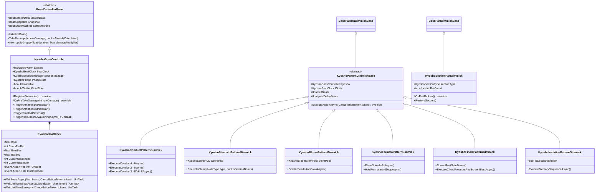
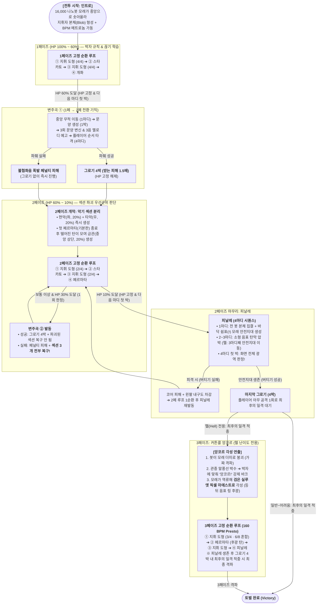

# 지역 3 보스 '쿄쇼 (Kyosho)' 구현 기획서
## (Region 3 Boss 'Kyosho' — NanoBot Orchestra Maestro Implementation Specification)

- **문서 버전**: v1.0.0
- **작성 일자**: 2026-11-12
- **원본 기획 근거**: [`D:\KDU\리얼스틸 기획서.md`](file:///D:/KDU/리얼스틸%20기획서.md) (§6.8 레이스 3 스탯, §10 길드 난이도 5단계, §16.5 지역 3 보스 '쿄쇼', §18.19 대사/부위 ID)
- **연동 아키텍처**:
  - **보스 코어 프레임워크**: [`BossControllerBase.cs`](file:///d:/KDU/2026_Com2us_Project/Assets/KKH/02.Scripts/03.Logic/Boss/Core/BossControllerBase.cs), [`BossPatternGimmickBase.cs`](file:///d:/KDU/2026_Com2us_Project/Assets/KKH/02.Scripts/03.Logic/Boss/Core/BossPatternGimmickBase.cs), [`BossPartGimmickBase.cs`](file:///d:/KDU/2026_Com2us_Project/Assets/KKH/02.Scripts/03.Logic/Boss/Core/BossPartGimmickBase.cs), [`BossFieldGimmickBase.cs`](file:///d:/KDU/2026_Com2us_Project/Assets/KKH/02.Scripts/03.Logic/Boss/Core/BossFieldGimmickBase.cs), [`CombatDataHub.cs`](file:///d:/KDU/2026_Com2us_Project/Assets/KKH/02.Scripts/02.Domain/Services/CombatDataHub.cs)
  - **나노봇 절차적 시뮬레이션 엔진**: [`RSNanoSwarm.cs`](file:///d:/KDU/2026_Com2us_Project/Assets/SYS/RS/NanoBoss/RSNanoSwarm.cs), [`RSNanoSim.cs`](file:///d:/KDU/2026_Com2us_Project/Assets/SYS/RS/NanoBoss/RSNanoSim.cs), [`RSNanoRig.cs`](file:///d:/KDU/2026_Com2us_Project/Assets/SYS/RS/NanoBoss/RSNanoRig.cs), [`RSNanoLimb.cs`](file:///d:/KDU/2026_Com2us_Project/Assets/SYS/RS/NanoBoss/RSNanoLimb.cs), [`RSNanoSpriteShape.cs`](file:///d:/KDU/2026_Com2us_Project/Assets/SYS/RS/NanoBoss/RSNanoSpriteShape.cs), [`RSNanoKnightMoves.cs`](file:///d:/KDU/2026_Com2us_Project/Assets/SYS/RS/NanoBoss/RSNanoKnightMoves.cs)

---

## 1. 보스 개요 및 핵심 설계 철학

### 1.1 보스 아이덴티티 (Identity)
| 항목 | 명세 내용 |
| :--- | :--- |
| **보스 ID** | `BOSS_REGION_03` (`Kyosho`) |
| **보스 명칭** | **쿄쇼 (Kyosho / 巨匠)** — 나노봇 오케스트라 마에스트로 |
| **소속 레이스 / 지역** | 지역 3 (레이스 3) / 권장 레벨 구간: `Lv.21 ~ Lv.30` (상한 `Lv.30`) |
| **핵심 컨셉** | 16,000개의 나노봇 군집(`RSNanoSwarm`)이 지휘자(본체), 악기 섹션(현악·타악·금관), 음표 탄막, 악상 문양으로 실시간 형상을 바꾸며 **BGM의 박자(BPM)에 맞춰** 공격하는 리듬·기믹 파훼형 보스 |
| **3페이즈 각성 (헬 전용)** | 피날레 생존 후 최후의 일격을 가하면 봇이 모래로 무너지며 가짜 격파 연출 발생 ➔ 관중석의 박수가 박자에 맞춰지며 **"앙코르!"** 강제 바크 출력 ➔ 모래가 역류해 등 뒤에 음표 링 후광(`HaloGuide`)을 두른 **검은 실루엣의 픽셀 마에스트로(`KnightGuide` SpriteMode)** 로 각성 |

### 1.2 핵심 레퍼런스 매핑
| 레퍼런스 게임 / 보스 | 차용 메커니즘 | 적용 시스템 / 패턴 |
| :--- | :--- | :--- |
| **Hi-Fi Rush** | 모든 공격 판정 시작 시점이 **박(Beat)의 경계**에 정확히 일치하여 피격 원인이 명확함 | `KyoshoBeatClock` 공통 박자 동기화 시스템 |
| **Cuphead / 캐그니 카네이션** | 지휘봉 파편(씨앗) 모양으로 개화 종류 사전 예고 ➔ 줄기 성장 중 타격하여 사전 차단 | **개화 (`PATTERN_KYOSHO_BLOOM`)** |
| **Cuphead / 힐다 버그 & AION2 / 로타르** | 보스가 경기장 중앙 이동 후 3개 문양으로 순차 변신(3음 멜로디 예고) ➔ 같은 순서로 문양 기물 타격 파훼 | **변주곡 (`PATTERN_KYOSHO_VARIATION`)** |
| **Cadence of Hyrule / 네크로댄서** | 직접 공격하지 않고 보스의 원본 패턴을 강화하는 **오케스트라 악기 섹션**을 파괴 가능한 기물로 배치 | **악기 섹션 파괴 (`SECTION_STRINGS`, `PERCUSSION`, `BRASS`)** |

### 1.3 4대 설계 원칙 (Design Pillars)
1. **예고는 모양으로 한다 (청각 장애인 및 음소거 플레이 완벽 대응)**:
   - 파편 모양(♩/나팔/원반), 문양 변신(𝄞/𝄢/♯/♭/쉼표/⌒), 머리 위 1마디 악보 UI, 늘임표(`⌒`) 기호, 지휘봉 움직임, 배경 조명 펄스, 하단 박 표시기 등 **소리 없이 시각 정보만으로도 100% 파훼 가능**해야 한다.
2. **실패 원인이 납득돼야 한다 (정박 원칙)**:
   - 박자 규칙은 헬(Presto, 160 BPM) 난이도에서도 절대 깨지지 않으며, 플레이어를 속이는 엇박 기습을 넣지 않는다.
3. **실수한 뒤에도 복구할 길이 있어야 한다**:
   - 변주곡이나 개화 기믹 파훼에 실패하더라도 즉사하거나 진행이 막히지 않으며, 명확한 페널티(불협화음 피해 / 섹션 복구) 후 다음 마디 전투 루프로 이어진다.
4. **새 패턴보다 변주(Variation)를 쓴다**:
   - 기본 패턴 수를 5종으로 압축하는 대신, **페이즈별 박자표 변주(4/4 ➔ 2/4 ➔ 3/4·6/8)**와 **악기 섹션 유무에 따른 추가 탄막/충격파 결합**으로 깊이 있는 전투 경험을 제공한다.

---

## 2. 공통 전투 규칙 및 시스템 명세

### 2.1 박자 클럭 (`KyoshoBeatClock`) 및 난이도별 BPM 규격
쿄쇼의 모든 전조(Tell), 공격 판정(Active), 패턴 간 회복(Post-Delay), 그로기 지속 시간은 고정 초(sec)가 아니라 **박(Beat)과 마디(Bar, 기본 4박) 단위**로 정의하고 런타임 BPM에서 초 단위로 환산한다.

$$\text{1박 시간 (초)} = \frac{60}{\text{BPM}}, \qquad \text{1마디 시간 (초, 4/4 기준)} = \frac{240}{\text{BPM}}$$

| 난이도 (`BossDifficulty`) | 악상 기호 (Tempo Marking) | BPM | 1박 (`BeatSec`) | 1마디 (`BarSec`, 4박) | `BossMasterData` 스탯 배율 (HP / ATK) |
| :---: | :---: | :---: | :---: | :---: | :---: |
| **아주 쉬움 (`VeryEasy`)** | *Andante* | **70** | `0.857초` (약 0.86초) | `3.429초` (약 3.43초) | HP `×0.6` / ATK `×0.6` |
| **쉬움 (`Easy`)** | *Moderato* | **88** | `0.682초` (약 0.68초) | `2.727초` (약 2.73초) | HP `×0.8` / ATK `×0.8` |
| **보통 (`Normal`)** | *Allegro* | **112** | `0.536초` (약 0.54초) | `2.143초` (약 2.14초) | HP `×1.0` / ATK `×1.0` |
| **어려움 (`Hard`)** | *Vivace* | **132** | `0.455초` (약 0.45초) | `1.818초` (약 1.82초) | HP `×1.5` / ATK `×1.3` |
| **헬 (`Hell`)** | *Presto* | **160** | `0.375초` | `1.500초` | HP `×2.2` / ATK `×1.6` |

#### 박자 시각화 3대 채널 (음소거 대응 필수 구현)
1. **지휘봉(줄기 A / 픽셀 마에스트로 팔) 예비 박동**: 매 박 경계마다 지휘봉 끝(`Tip`)이 박자 도형 꼭짓점을 찍으며 발광(`glow` 펄스).
2. **경기장 배경 조명 박 펄스**: `RSLighting` 또는 스테이지 라이트/네온 머티리얼의 Emission 강도가 매 박(`OnBeat`) 약하게, 매 마디 첫 박(`OnDownbeat`) 강하게 펄스.
3. **화면 하단 박 표시기 (`KyoshoBeatIndicatorHUD`)**: 설정에서 On/Off 가능한 하단 메트로놈 바 (4박 기준 `● ○ ○ ○` 진행 및 판정 박 하이라이트).

---

### 2.2 타격 부위 및 파츠 내구도 차감 규칙 (기획서 §16.5.2.3)

> [!IMPORTANT]
> **핵심 판정 원칙**: 플레이어의 파츠 내구도(`partDurabilityDamage`)는 **쿄쇼의 원본 공격 패턴 5종에 피격될 때만 감소**한다. 악기 섹션 강화로 인해 추가 생성된 공격 판정(충격파, 16분음표 추가 탄, 금관 수평 빔)은 **플레이어의 코어 HP만 깎고 파츠 내구도는 절대 깎지 않는다.**

| 패턴 명칭 | 패턴 ID | 타격 플레이어 부위 (`BodyPart`) | 내구도 피해 (Normal 기준) | 시각적 색상 구분 규칙 |
| :--- | :--- | :---: | :---: | :--- |
| **스타카토** | `PATTERN_KYOSHO_STACCATO` | **머리 (`BodyPart.Head`)** | `25` | **원본 탄**: 은백색/하늘색 금속 나노봇 (`partDurabilityDamage > 0`) |
| **피날레** | `PATTERN_KYOSHO_FINALE` | **왼팔 (`BodyPart.LeftArm`)** | `35` | **원본 전범위 파동**: 백색/금색 고밀도 파동 |
| **지휘 도형** | `PATTERN_KYOSHO_CONDUCT` | **오른팔 (`BodyPart.RightArm`)** | `25` | **원본 지휘봉**: 페이즈별 지휘봉 끝 색상 (흰색/노란색/하늘·보라) |
| **개화** | `PATTERN_KYOSHO_BLOOM` | **왼다리 (`BodyPart.LeftLeg`)** | `25` | 땅에서 솟아오르는 줄기·봉오리 공격 공통 |
| **페르마타** | `PATTERN_KYOSHO_FERMATA` | **오른다리 (`BodyPart.RightLeg`)** | `25` | 공중 정지 후 수직 낙하하는 원본 음표 탄 |
| *(섹션 강화 추가타)* | *(현악 16분음표 / 타악 충격파 / 금관 수평 빔)* | **코어 전용 (`BodyPart.Core`)** | **`0` (내구도 미차감)** | **섹션 전용 색상**으로 렌더링하여 "부위 내구도에 안 들어가는 공격"임을 즉시 식별 |
| *(변주곡 실패 페널티)* | `PATTERN_KYOSHO_VARIATION` | **코어 전용 (`BodyPart.Core`)** *(결정)* | **`0` (내구도 미차감)** | 기획서 미결 항목 확정: 기억 기믹 실패가 특정 파츠 파괴로 직결되면 과도하게 징벌적이므로 **안 A(불협화음 광역 폭발, 코어 HP 피해만 적용)** 로 확정 |

#### 섹션별 고유 컬러 팔레트 (가독성 규격)
- **원본 보스 패턴**: 백색 / 은청색 (`#E8F4FF`)
- **현악 섹션 (`SECTION_STRINGS`) 및 강화 탄(16분음표 ♬)**: 에메랄드 민트 (`#40FFAA`)
- **타악 섹션 (`SECTION_PERCUSSION`) 및 강화 충격파**: 앰버 오렌지 (`#FF8820`)
- **금관 섹션 (`SECTION_BRASS`) 및 강화 수평 빔**: 골든 마젠타 (`#FF44AA`)

---

### 2.3 피격 판정 및 페이즈 전환 HP 고정(HP Lock) 규칙 (기획서 §16.5.2.4)

| 항목 | 기술 구현 명세 |
| :--- | :--- |
| **개별 피격 대상 분리** | • **보스 본체(`KyoshoBossController`)**, **악기 섹션 3종(`KyoshoSectionPartGimmick`)**, **개화 줄기(`KyoshoBloomStemFieldGimmick`)**, **변주곡 문양(`KyoshoVariationSymbolObject`)** 은 각각 독립된 `Collider2D` (`BossHurtZone` / `IDamageable`)를 가진다.<br/>• 플레이어의 범위 스킬이 여러 대상을 동시에 타격하면 **각 대상마다 독립적으로 피해를 계산**한다. |
| **변주곡 문양 동시 파괴 방지** | • 플레이어의 단일 공격 인스턴스(같은 프레임/히트 스탬프 `attackInstanceId`)가 여러 변주곡 문양 범위에 닿더라도, **공격 인스턴스 1개당 가장 가까운 문양 1개만 파괴**되도록 `KyoshoVariationSequenceManager`에서 프레임/인스턴스 디바운스(`_lastHitFrame`, `_lastAttackId`)를 강제한다. |
| **페이즈 전환 및 기믹 HP 고정 (HP Gate Lock)** | • `OnPreTakeDamage` 및 `CombatDataHub` 연동 시 아래 임계치에 도달하면 초과 피해를 잘라내고 **HP를 해당 임계치에 고정(` Clamp`)**한 뒤, **다음 마디 첫 박(`NextDownbeat`)**에 전환 패턴을 발동한다:<br/>  1. **HP 60% 도달**: HP를 `60%`에 고정 ➔ 다음 마디 첫 박에 **변주곡 ①** 발동 후 2페이즈 진입<br/>  2. **HP 30% 도달 (보통 이상)**: HP를 `30%`에 고정 ➔ 다음 마디 첫 박에 **변주곡 ②** 발동<br/>  3. **HP 10% 도달 (2페이즈 마무리)**: HP를 `10%`에 고정 ➔ 다음 마디 첫 박에 **피날레** 발동<br/>  4. **피날레 버팀 후 최후의 일격**: 4박 그로기 중 플레이어가 **아무 공격 1회** 적중 시 즉시 격파(헬 이외) 또는 **3페이즈 앙코르 각성(헬 전용, 3페이즈 체력 풀 충전)** 으로 전이 |
| **회피 무적** | • 기존 `BossPatternGimmickBase.IsPlayerInvincible(playerObj)` (`ActionExecutor` Space 회피 Active 프레임 무적) 규칙을 100% 동일하게 적용한다. |

---

## 3. 시스템 아키텍처 및 클래스 설계 (`RealSteel.Boss.Kyosho`)

기존 KKH 보스 프레임워크(`BossControllerBase` + `BossGimmickBase`)와 SYS 나노봇 군집 엔진(`RSNanoSwarm` + `RSNanoRig`)을 브릿지 패턴으로 결합한다.



### 3.1 폴더 및 스크립트 구조
```
Assets/KKH/02.Scripts/03.Logic/Boss/Kyosho/
├── KyoshoBossController.cs                 # 지역 3 보스 메인 컨트롤러 (BossController 상속, RSNanoSwarm & BeatClock 제어)
├── KyoshoBeatClock.cs                      # BPM 기반 정박 타이머, 마디/박 이벤트 브로드캐스터, 비동기 박 대기 헬퍼
├── Data/
│   ├── KyoshoRhythmTableSO.cs              # 난이도별 스타카토 리듬 악보 풀 & 변주곡 문양/음계 매핑 SO
│   └── KyoshoSfxData.cs                    # 메트로놈, 현악/타악/금관, 6음계(도~라), 오케스트라 히트, 앙코르 사운드 SO
├── Gimmicks/
│   ├── KyoshoPatternGimmickBase.cs         # 박(Beat) 단위 전조/액션/후딜 동기화 추상 패턴 클래스
│   ├── KyoshoConductPatternGimmick.cs      # 패턴 1: 지휘 도형 (4/4, 2/4, 3/4·6/8 & 타악 충격파 연동)
│   ├── KyoshoStaccatoPatternGimmick.cs     # 패턴 2: 스타카토 (콜 & 리스폰스 악보 예고 & 현악 16분음표 강화 연동)
│   ├── KyoshoBloomPatternGimmick.cs        # 패턴 3: 개화 (파편 투척 -> 줄기 성장 -> 봉오리 공격)
│   ├── KyoshoFermataPatternGimmick.cs      # 패턴 4: 페르마타 (공중 음표 정지 ⌒ -> 일제 수직 낙하 & 금관 수평 빔 연동)
│   ├── KyoshoFinalePatternGimmick.cs       # 패턴 5: 피날레 (쉼표 모래 안전지대 + 전 화면 화음 폭발 + 4박 마지막 그로기)
│   ├── KyoshoVariationPatternGimmick.cs    # 패턴 6: 변주곡 ①·② (중앙 무적 이동 -> 3음 문양 변신 -> 순서 파괴 퍼즐)
│   ├── KyoshoSectionPartGimmick.cs         # 기믹 7: 오케스트라 악기 섹션 (현악·타악·금관 파괴/복구 및 봇 배분 제어)
│   ├── KyoshoBloomStemFieldGimmick.cs      # 전장 기물: 개화 줄기 (2타/스킬 1타 절단 가능 런타임 앵커 리그)
│   └── KyoshoVariationSymbolObject.cs      # 전장 기물: 변주곡 6종 음자리표/기호 타겟 오브젝트 (단일 타격 디바운스)
└── UI/
    ├── KyoshoBeatIndicatorHUD.cs           # 화면 하단 박자 표시기 (청각 접근성 & 지휘봉/조명 펄스 동기화)
    ├── KyoshoScorePreviewHUD.cs            # 보스 머리 위 1마디 악보 & 페르마타(⌒) 시각 예고 위젯
    └── KyoshoSectionStatusHUD.cs           # 2페이즈 현악/타악/금관 섹션 생존 및 체력 표시 위젯
```

---

## 4. 보스 스탯 및 난이도 레이어 수치 설계

### 4.1 레이스 3 (Lv.21 ~ Lv.30) 기준 스탯 산출 근거
- 기획서 §6.8.8~9에 따라 레이스 3의 기준가는 **`1,300G`**, 보통 승리 코어 EXP는 **`312 EXP`**, 플레이어 레벨 상한은 **`Lv.30` (HP 885, DEF 108, EHP 1,841)** 이다.
- 기획서 §6.8.7의 **"생존력: 보스 일반 피격 기준 6대(구간 시작 Lv.21, EHP 1,135) → 10대(구간 끝 Lv.30, EHP 1,841)에 사망"** 규칙을 역산하면:
  - 플레이어 Lv.21 (`DEF 72`, 피해 감소 `41.9%`)에서 6대 사망 ➔ 1타당 실피해 약 `110`, 보스 원시 공격력(`baseDamage`) = **`190`** (`190 × 100 / 172 = 110.4`).
  - 플레이어 Lv.30 (`DEF 108`, 피해 감소 `51.9%`)에서 `baseDamage 190` 피격 시 ➔ 1타당 실피해 `91.3` (`885 / 91.3 ≈ 9.7대`, 즉 **정확히 10대**에 사망!).
- 보스 기준 최대 체력(`maxHp`, 보통 난이도 기준): **`10,000`** (`baseDefense = 80`).
  - 각 악기 섹션 체력(기획서 §16.5.3.7.3: **보스 최대 HP의 약 8%**): 보통 기준 **`800`** (`10,000 × 0.08`).

### 4.2 난이도 5단계 종합 파라미터 매트릭스 (`BossMasterData_Kyosho`)

| 항목 | 아주 쉬움 (`VeryEasy`) | 쉬움 (`Easy`) | 보통 (`Normal`) | 어려움 (`Hard`) | 헬 (`Hell`) |
| :--- | :---: | :---: | :---: | :---: | :---: |
| **악상 / BPM** | *Andante* (**70**) | *Moderato* (**88**) | *Allegro* (**112**) | *Vivace* (**132**) | *Presto* (**160**) |
| **1박 / 1마디 시간** | `0.86s` / `3.43s` | `0.68s` / `2.73s` | `0.54s` / `2.14s` | `0.45s` / `1.82s` | `0.375s` / `1.50s` |
| **보스 본체 HP (`maxHp`)** | **6,000** (`×0.6`) | **8,000** (`×0.8`) | **10,000** (`×1.0`) | **15,000** (`×1.5`) | **22,000** (`×2.2` + 3페 별도) |
| **악기 섹션 1개당 HP (8%)** | **480** | **640** | **800** | **1,200** | **1,760** |
| **공격 배율 (`attackMultiplier`)** | `×0.6` (기본타 114) | `×0.8` (기본타 152) | `×1.0` (기본타 190) | `×1.3` (기본타 247) | `×1.6` (기본타 304) |
| **스타카토 리듬 풀** | 4분음표(♩), 쉼표 | 4분음표(♩), 쉼표 | 4분(♩), 8분(♪), 쉼표 | + 점음표 (`♩. ♪`) | + 셋잇단음표 (`3連`) |
| **개화 파편 수 / 동시 개화** | `3개` / `1개` | `3개` / `1개` | `4개` / `1개` | `5개` / `1개` | `6개` / `2개` + **줄기 휘두르기** |
| **페르마타 탄 수 (기본 / 금관 강화)** | `6발` / `-` | `6발` / `-` | `8발` / `12발` | `10발` / `14발` | `12발` / `16발` |
| **2페이즈 등장 섹션 수** | **2개** (현악·타악) | **2개** (현악·타악) | **3개** (현악·타악·금관) | **3개** (현악·타악·금관) | **3개** (현악·타악·금관) |
| **변주곡 발동 횟수** | **1회** (HP 60%) | **1회** (HP 60%) | **2회** (60%, 30%) | **2회** (60%, 30%) | **2회** (60%, 30%) |
| **변주곡 문양 수 / 변신 유지** | `4개` / `2박` | `4개` / `1.5박` | `6개` / `1박` | `6개` / `1박` (좌우 이동) | `6개(중복 허용)` / `0.5박` (이동+스타카토) |
| **변주곡 오답 허용** | **1회 리셋 허용** | **1회 리셋 허용** | **즉시 실패** | **즉시 실패** | **즉시 실패** |
| **피날레 안전지대 수** | **2곳** | **2곳** | **1곳** | **1곳** | **1곳 (3마디째 1회 이동)** |
| **3페이즈 (커튼콜 앙코르)** | 없음 | 없음 | 없음 | 없음 | **있음 (픽셀 마에스트로 각성)** |
| **토벌 점수 / 신청비 / 보상 골드** | `10점` / `0G` / `130G` | `30점` / `65G` / `325G` | `80점` / `130G` / `650G` | `200점` / `260G` / `1,170G` | `500점` / `390G` / `1,950G` |

> [!NOTE]
> **페이즈 진입 주의사항**: 기획서 §16.5.4에서 쿄쇼는 **모든 난이도에서 `1페이즈 ➔ 변주곡 ① ➔ 2페이즈 ➔ 피날레` 구조로 진행**하며, **헬(`Hell`) 난이도에서만 `3페이즈(커튼콜 앙코르)`가 추가 개방**된다. 따라서 `BossMasterData_Kyosho`에서는 `VeryEasy ~ Hell` 전 난이도의 `allowPhase2 = true`로 설정하고, 3페이즈 진입 여부만 `difficulty == BossDifficulty.Hell`로 분기한다.

---

## 5. 페이즈 진행 구조 및 순환 시퀀스

### 5.1 전체 전투 라이프사이클 다이어그램



### 5.2 페이즈별 패턴 순환 규칙 (`KyoshoBossController.GetNextPatternGimmick`)
기존 `BossControllerBase`의 단순 인덱스 순환을 오버라이드하여, **페이즈별 고정 순환 큐(Deterministic Musical Form)**를 구동한다.

1. **1페이즈 순환 (`지휘 도형 → 스타카토 → 지휘 도형 → 개화`)**:
   - 개화는 절대 연속으로 사용되지 않으며, 반드시 지휘 도형과 스타카토를 거친 뒤 4번째 순서에 발동한다.
2. **2페이즈 순환 (`지휘 도형 → 스타카토 → 지휘 도형 → 페르마타`)**:
   - 두 대형 탄막 패턴(`스타카토`와 `페르마타`) 사이에 항상 근접 패턴인 `지휘 도형`을 배치하여 화면에 탄막이 겹치는 불합리함을 원천 차단한다.
   - **다음 패턴 사전 예고**: `지휘 도형`의 마지막 회수 박(5박째)에 지휘봉 끝이 **왼쪽(현악)을 가리키면 다음은 `스타카토`**, **중앙 위(금관)를 가리키면 다음은 `페르마타`** 임을 시각적으로 예고한다.
3. **3페이즈 순환 (`지휘 도형 → 페르마타 → 지휘 도형 → 피날레`, 헬 전용)**:
   - 3페이즈에서는 `피날레`가 일반 순환 패턴의 4번째 마디로 편입된다. 피날레를 버텨내면 4박 그로기가 열리며, 이때 딜을 몰아넣거나 최후의 일격 조건(3페이즈 HP 소진 후 피날레 그로기 일격)으로 마무리한다.

---

## 6. 패턴 및 기믹별 상세 구현 명세

### 6.1 패턴 1: 지휘 도형 (`KyoshoConductPatternGimmick`)
- **식별 ID**: `PATTERN_KYOSHO_CONDUCT`
- **타격 부위**: **오른팔 (`BodyPart.RightArm`)** / 기본 피해: `190`, 내구도 피해: `25`
- **사용 페이즈**: 1 · 2 · 3페이즈 공통 주력 근접 패턴
- **컨셉**: 실제 오케스트라 지휘의 박자 도형(Beat Pattern) 궤적대로 나노봇 지휘봉을 휘두르는 근접 베기 공격.

#### 1) 박자별 진행 타임라인 (1페이즈 4/4박자 기준, 총 6박 = 1.5마디)
| 박 (`Beat`) | 단계 | 동작 및 판정 명세 | 판정 유무 |
| :---: | :---: | :--- | :---: |
| **0박** | **예고 (Tell)** | 본체(`G_Blob`)에서 봇 12%(약 1,920봇)가 `TubeA`로 흘러들며 지휘봉이 솟아오름. 지휘봉 끝(`Tip`)이 페이즈별 예고 색상으로 발광 | 없음 |
| **1박** | **1타 (Downbeat)** | **↓ 수직 내려찍기** (상단 ➔ 하단 중앙 바닥 타격) | **있음** |
| **2박** | **2타** | **← 좌측 횡베기** (중앙 ➔ 보스 기준 안쪽/좌측 수평 스윕) | **있음** |
| **3박** | **3타** | **→ 우측 횡베기** (좌측 ➔ 우측 넓게 수평 스윕) | **있음** |
| **4박** | **4타 (Upbeat)** | **↑ 대각 올려치기** (우측 하단 ➔ 상단 복귀 베기) | **있음** |
| **5박** | **회수 (Deal Time)** | 지휘봉의 봇이 본체(`G_Blob`)로 돌아감 (`Release`). **이 1박(+공통 후딜 박)이 확정 근접 딜 타이밍** | 없음 |

#### 2) 페이즈별 박자표 및 궤적 변주
| 페이즈 | 박자표 | 휘두르기 도형 궤적 | 지휘봉 끝(`Tip`) 시각 표시 (색상 + 형태) |
| :---: | :---: | :--- | :--- |
| **1페이즈** | **4/4박자** | `↓` (1박) ➔ `←` (2박) ➔ `→` (3박) ➔ `↑` (4박) | **흰색 (`#FFFFFF`)** + 둥근 구형 끝 (`Blob` 소형 부착) |
| **2페이즈** | **2/4박자** | `↓` (1박) ➔ `↑` (2박) ➔ `↓` (3박) ➔ `↑` (4박) (빠른 상하 왕복 2회 연타) | **노란색 (`#FFE033`)** + 뾰족한 창끝 (`r1 = 0.02f`) |
| **3페이즈** | **3/4 · 6/8 혼합** | • **3/4박자**: `↓` (1박) ➔ `→` (2박) ➔ `↑` (3박)<br/>• **6/8박자**: `↓` ➔ `←` ➔ `←` ➔ `→` ➔ `→` ➔ `↑` (0.5박 간격 6연타) | • **3/4**: **하늘색 (`#44DDFF`)** + 단일 링<br/>• **6/8**: **보라색 (`#BB55FF`)** + 이중 링 |

#### 3) 2페이즈 타악 섹션(`SECTION_PERCUSSION`) 생존 시 강화
- 매 휘두르기 타격이 바닥에 닿는 박(1박, 3박 등)마다 착지 지점에서 좌우로 퍼지는 **앰버 오렌지색(`#FF8820`) 바닥 충격파** 생성 (속도 `10m/s`, 높이 `0.6m`).
- **회피**: 점프로 회피. 피격 시 **코어 HP만 감소**하며 오른팔 내구도는 깎이지 않는다 (`partDurabilityDamage = 0`).

#### 4) 나노봇 엔진 구현 매핑 및 사슬 끝 늦음 보정 (`Lead Time Compensation`)
- **가이드 매핑**: `sw.TubeA` (`K = 16` 마디 사슬) + `TakeToTube(0.12f, Root(), RSNanoSwarm.G_TubeA, 120)`.
- **끝 늦음(Tip Lag) 보정 공식**:
  - `TubeGuide.ChainStep`은 뿌리(`nodes[0]`)가 움직인 뒤 끝(`Tip = nodes[15]`)이 스프링 지연(`stiff = 260f`)으로 인해 약 $\Delta t_{\text{lag}} \approx 0.08\text{초}$ 늦게 목표 지점에 도달한다.
  - 기획서의 **"끝의 판정이 정확히 박의 경계에 닿게 함"** 규칙을 달성하기 위해, 뿌리 회전 시작 시각을 $t_{\text{start}} = t_{\text{beat}} - \Delta t_{\text{lag}}$ 만큼 **선행 구동(Pre-swing)** 시켜 지휘봉 끝(`Tip`)이 정확히 정박(`t_beat`)에 타격점을 통과하도록 구현한다.

---

### 6.2 패턴 2: 스타카토 (`KyoshoStaccatoPatternGimmick`)
- **식별 ID**: `PATTERN_KYOSHO_STACCATO`
- **타격 부위**: **머리 (`BodyPart.Head`)** / 기본 피해: `160`, 내구도 피해: `25`
- **사용 페이즈**: 1 · 2페이즈 (헬 난이도에서는 변주곡 입력 중 기본판 동시 발사 포함)
- **컨셉**: **콜 & 리스폰스 (Call & Response)**. 1마디 동안 보스 머리 위 악보에 리듬을 먼저 시각·청각적으로 연주해 보여준 뒤, 2마디째에 똑같은 리듬으로 음표 나노봇 탄을 발사한다.

#### 1) 진행 시퀀스 (총 2마디 = 8박)
| 마디 | 단계 | 상세 동작 |
| :---: | :---: | :--- |
| **1마디 (1~4박)** | **예고 (Call)** | 보스 머리 위 소켓(`HeadAnchor`)에 1마디 오선지 악보 UI(`KyoshoScorePreviewHUD`)가 팝업됨. 박이 진행됨에 따라 각 음표 기호가 순서대로 빛나며 해당 음표의 실로폰/피아노 스타카토 가이드 음이 재생됨. |
| **2마디 (5~8박)** | **발사 (Response)** | 1마디에 예고된 것과 **100% 동일한 리듬 타이밍**에 보스 주변에서 음표 탄(`sw.Fire`) 발사. 각 탄은 **발사되는 그 박의 순간 플레이어 위치(`P`)를 향해 직선으로** 날아간다 (유도 없음). |

#### 2) 음표 종류별 물리 규격 (`RSNanoSwarm.Fire` 연동)
| 음표 종류 | 기호 | 탄 1개당 봇 뭉치 수 (`clump`) | 비행 속도 (`speed`) | 판정 반경 | 타격 속성 |
| :--- | :---: | :---: | :---: | :---: | :--- |
| **4분음표** | `♩` | **48봇** (`clump = 48`) | **4.0 m/s** | `0.55m` | 크고 느림. 적중 시 코어 HP + **머리 내구도 차감** |
| **8분음표** | `♪` | **24봇** (`bulletClump = 24` 기본값) | **7.0 m/s** | `0.38m` | 표준 크기 및 속도. 적중 시 코어 HP + **머리 내구도 차감** |
| **16분음표** | `♬` | **12봇** (`clump = 12`) | **10.0 m/s** | `0.25m` | **현악 섹션 강화 전용 (민트색 `#40FFAA`)**. 작고 빠름. **코어 HP만 차감 (내구도 0)** |
| **쉼표** | `𝄽` | `-` | `-` | `-` | 발사 없음 (플레이어가 숨을 돌리거나 반격하는 **안전 박**) |

#### 3) 난이도별 리듬 악보 풀 (`KyoshoRhythmTableSO`)
| 난이도 | 사용 음표 구성 | 대표 1마디(4박) 리듬 패턴 예시 (`1박 / 2박 / 3박 / 4박`) |
| :---: | :--- | :--- |
| **아주 쉬움 · 쉬움** | 4분음표(`♩`), 쉼표(`𝄽`) | • `[♩, ♩, 𝄽, ♩]`<br/>• `[♩, 𝄽, ♩, ♩]` |
| **보통 (`Normal`)** | 4분(`♩`), 8분(`♪`), 쉼표(`𝄽`) | • `[♩, ♪♪, 𝄽, ♩]`<br/>• `[♪♪, ♩, ♪♪, 𝄽]` |
| **어려움 (`Hard`)** | 4분(`♩`), 8분(`♪`), 점음표(`♩. ♪`) | • `[♩., ♪, ♪♪, ♩]` (1.5박 + 0.5박 + 0.5+0.5박 + 1박)<br/>• `[♪♪, ♩., ♪, ♩]` |
| **헬 (`Hell`)** | 4분, 8분, 점음표, **셋잇단음표(`♪♪♪`)** | • `[♪♪♪, ♩, ♪♪♪, 𝄽]` (1박을 3등분한 1/3박 간격 3연사)<br/>• `[♩., ♪, ♪♪♪, ♩]` |

#### 4) 2페이즈 현악 섹션(`SECTION_STRINGS`) 생존 시 강화
- 기존 리듬 사이사이에 **16분음표(`♬`, 0.25박 간격) 연사**가 추가되며, 전체 발사 탄 수가 **+50% 증가**한다.
- 추가된 50%의 탄은 **왼쪽 현악 섹션 위치에서 발사**되며, 민트색(`#40FFAA`)으로 칠해져 **체력(HP)만 깎는다**.
- **모래 변환 및 재흡수**: 플레이어를 맞히거나 바닥(`sw.floorY`)에 착탄한 음표 탄은 `sw.Drop()`을 통해 모래(`BotMode.Debris`)로 쏟아져 쌓였다가, 서서히 본체로 재흡수(`Absorb`)된다.

---

### 6.3 패턴 3: 개화 (`KyoshoBloomPatternGimmick`)
- **식별 ID**: `PATTERN_KYOSHO_BLOOM`
- **타격 부위**: **왼다리 (`BodyPart.LeftLeg`)** (땅에서 솟아오르는 공격이라는 설정으로 모든 개화 판정 공통) / 기본 피해: `180`, 내구도 피해: `25`
- **사용 페이즈**: **1페이즈 전용** (연속 사용 금지, 최소 1순환 간격 보장)
- **컨셉**: 지휘봉을 휘둘러 바닥에 파편(씨앗)을 흩뿌리고, 파편이 줄기로 자라나 봉오리에서 음표·악기가 피어나며 공격한다. 플레이어는 **파편 모양을 보고 위협을 읽은 뒤, 2~3박 줄기 성장 중에 때려서 미리 끊을 수 있다.**

#### 1) 박자별 진행 타임라인 (총 4박 = 1마디)
| 박 (`Beat`) | 단계 | 보스/기물 동작 | 플레이어 대처 |
| :---: | :---: | :--- | :--- |
| **1박** | **파편 살포** | 지휘봉을 크게 휘둘러 바닥 N곳에 나노봇 파편 투척 (`Fire` 탄 뭉치 ➔ 모래 칸 착지). **착지한 파편 아이콘 모양(♩ / 나팔 / 원반)이 개화 종류를 예고**함. | 착지 위치와 파편 모양 확인, 우선 제거할 줄기로 접근 |
| **2 ~ 3박** | **줄기 성장** | 착지 지점에서 리그 줄기(`LimbType.Chain`, `grow` 0 ➔ 1 애니메이션)가 위로 자라나고, 줄기 끝에 봉오리(`LimbType.Blob`)가 부풀어 오름. | **줄기를 타격하여 절단!**<br/>(**D 기본기 2타** 또는 **파츠 스킬 1타**로 즉시 파괴 가능) |
| **4박** | **만개 및 공격** | 끊기지 않고 살아남은 봉오리가 구운 스프라이트 모양(`LimbType.Sprite`)으로 활짝 열리며 고유 공격 시전 후 봇이 본체로 복귀. (**헬 난이도**: 최대 2개 봉오리가 동시 개화하며, 개화 직전 줄기 자체를 사슬 물리로 1회 휘두름) | 점프 / Space 무적 회피 또는 안전 거리 이탈 |

#### 2) 개화 종류별 공격 판정 (3종)
| 파편 예고 모양 | 개화 명칭 | 4박째 발동 공격 판정 | 회피 및 우선순위 팁 |
| :---: | :--- | :--- | :--- |
| **♩ (음표)** | **음표 봉오리** | 플레이어 현재 위치를 향해 조준탄 **3발** 연속 발사 (`Stream` 에미터) | 원거리에서도 날아오므로 **절단 1순위** |
| **🎺 (나팔)** | **트럼펫 봉오리** | 플레이어 방향으로 길이 **4m 짧은 직선 음파 빔** 발사 (`Line` 에미터) | 중거리 위협, 반대편 이동 또는 점프로 회피 |
| **💿 (원반)** | **심벌즈 봉오리** | 줄기 중심 반경 **2m 원형 충격파** 폭발 (`Ring` 에미터) | 근접 위협, 멀리 있으면 무시 가능 |

#### 3) 배치 제약 조건 및 오브젝트 풀링
- **플레이어와의 최소 이격 거리**: `3.0m` 이상 (플레이어 발밑에 바로 떨어져 억울하게 피격되는 현상 방지).
- **줄기 간 최소 간격**: `2.0m` 이상.
- **런타임 앵커 풀링 (`KyoshoBloomStemPool`)**:
  - `TubeGuide`(A·B)는 최대 2개까지만 표현 가능하므로, 개화 줄기는 **`RSNanoRig` 프리팹 인스턴스 6개를 시작 시 오브젝트 풀로 미리 생성**해 둔다.
  - 파편이 착지한 월드 X 좌표(`anchorX, floorY, 0`)에 풀링된 `RSNanoRig` 루트를 배치하고 `KyoshoBloomStemFieldGimmick` 콜라이더를 활성화한다.
  - 플레이어가 2~3박 내에 줄기를 타격해 끊으면(`TakeDamage`), 해당 리그에 배정된 봇들을 즉시 `sw.Drop()`으로 모래로 흩뿌리며 개화를 취소시킨다 (**대사 시스템 연동**: 부위 파괴 바크 `PART_KYOSHO_STEM` 트리거).

---

### 6.4 패턴 4: 페르마타 (`KyoshoFermataPatternGimmick`)
- **식별 ID**: `PATTERN_KYOSHO_FERMATA`
- **타격 부위**: **오른다리 (`BodyPart.RightLeg`)** (공중에서 바닥으로 내리꽂히는 충격 설정) / 기본 피해: `200`, 내구도 피해: `25`
- **사용 페이즈**: 2 · 3페이즈
- **컨셉**: 음악 기호 **늘임표(Fermata, `⌒`)** 연출. 공중 곳곳에 음표 탄을 배치한 뒤 시간을 멈춘 듯 정지시키고, 지휘자가 주먹을 쥐는 순간 일제히 바닥으로 수직 낙하시킨다.

#### 1) 박자별 진행 타임라인 (총 4박 = 1마디)
| 박 (`Beat`) | 단계 | 상세 동작 및 시각 연출 |
| :---: | :---: | :--- |
| **1박** | **공중 배치** | 보스 상단 링(**2페이즈는 본체 위 `RingGuide`**, **3페이즈는 등 뒤 `HaloGuide`**)에서 음표 탄 `N`발(난이도별 `6~16발`)을 경기장 상공(`y = floorY + 5.5m`) 전역에 흩어 배치함 (`sw.Fire`의 `hold` 좌표로 이동). |
| **2 ~ 3박** | **페르마타 정지 (`⌒`)** | 화면 상단 중앙에 거대한 **`⌒` (페르마타) 아이콘**이 점등됨. 공중의 **모든 탄이 완전 정지(`wait` 유지)**하고, 각 탄의 직하방 바닥(`floorY`)에 **수직 낙하 예고 표식(`GroundTelegraph`)**이 2박 동안 선명하게 표시됨. |
| **4박** | **일제 낙하 (Drop)** | 지휘자가 주먹을 꽉 쥐는 모션(또는 본체 급속 수축 `bind = 1`)과 함께 **모든 음표 탄이 동시에 바닥으로 수직 내리꽂힘** (`vel = Vector3.down * 28f`). |

#### 2) 난이도별 탄 수 및 금관 섹션(`SECTION_BRASS`) 강화
| 구분 | 아주 쉬움 | 쉬움 | 보통 (`Normal`) | 어려움 (`Hard`) | 헬 (`Hell`) |
| :--- | :---: | :---: | :---: | :---: | :---: |
| **기본판 탄 수** | `6발` | `6발` | `8발` | `10발` | `12발` |
| **금관 강화판 탄 수** | *(금관 없음)* | *(금관 없음)* | **`12발`** | **`14발`** | **`16발`** |

- **금관 섹션 생존 시 강화 효과**:
  1. 공중 배치 탄 수가 기본판 대비 `+4발` 증가 (추가 4발은 금관 섹션 색상 `#FF44AA`, **체력만 감소**).
  2. 4박째 탄들이 바닥에 내리꽂힌 직후(4.5박 시점), 중앙 상단 금관 섹션이 하단으로 내려와 **지면을 수평으로 훑는 골든 마젠타 빔 1줄**을 발사한다 (**점프로 회피, 체력만 감소**).
- **학습 순서 보장 규칙 (필수 구현)**:
  - **2페이즈 진입 후 첫 번째 페르마타는 무조건 '기본판'** 으로 발동한다.
  - 첫 번째 페르마타의 탄들이 바닥에 떨어져 모래가 된 직후, **그 떨어진 탄의 나노봇들이 중앙 상단으로 날아올라 모여 `금관 섹션(SECTION_BRASS)`을 생성**한다 (보통 난이도 이상). 이를 통해 플레이어는 "기본 페르마타 ➔ 탄이 모여 금관 생성 ➔ 다음부터 강화 페르마타"라는 인과관계를 눈으로 직접 학습한다.

---

### 6.5 패턴 5: 피날레 (`KyoshoFinalePatternGimmick`)
- **식별 ID**: `PATTERN_KYOSHO_FINALE`
- **타격 부위**: **왼팔 (`BodyPart.LeftArm`)** / 기본 피해: `260`, 내구도 피해: `35`
- **사용 페이즈**: **2페이즈 마무리 (HP 10% 도달 시 강제 발동)** · **3페이즈 정규 순환**
- **컨셉**: 교향곡의 마지막 화음(Grand Finale). 화면 전체를 뒤덮는 광역 전멸기급 판정이 내려지며, 바닥에 생성된 **쉼표(`𝄽`) 모양의 모래 안전지대** 위에 서 있어야만 생존할 수 있다.

#### 1) 마디별 진행 타임라인 (총 4마디 = 16박)
| 마디 | 단계 | 상세 동작 및 기믹 처리 |
| :---: | :---: | :--- |
| **1마디 (1~4박)** | **집결 & 안전지대 생성** | 필드에 흩어진 모든 나노봇(파괴되지 않은 섹션 봇 포함)이 보스 본체로 집결하며 거대한 오케스트라 구체를 형성함. 동시에 바닥 지정 위치에 **쉼표(`𝄽`) 모양으로 솟아오른 금빛 모래 안전지대(`SafeZone`, 폭 `2.2m`)** 가 생성됨. |
| **2 ~ 3마디 (5~12박)** | **화음 압박 & 안전지대 이동** | 보스가 웅장한 화음(Chord)을 쌓아 올리며 본체에서 소형 음표 탄막을 산발적으로 발사해 **플레이어가 안전지대로 이동하는 경로를 방해**함.<br/>• **난이도별 안전지대 수**: `아주 쉬움·쉬움`: **2곳** / `보통·어려움`: **1곳** / `헬`: **1곳 (단, 3마디째 첫 박에 안전지대가 반대편으로 1회 이동!)** |
| **4마디 첫 박 (13박)** | **전 화면 화음 폭발** | 4마디 첫 박 정각에 **화면 전체 광역 공격 판정** 발동! 오직 **쉼표 안전지대 위에 위치한 플레이어만 피해를 입지 않음** (또는 정확한 박에 맞춘 Space 회피 무적). |

#### 2) 결과 분기 처리 (생존 vs 피격)
| 결과 | 후속 상태 전이 |
| :--- | :--- |
| **버팀 성공 (안전지대 생존)** | • 보스가 에너지를 모두 소진하고 **마지막 그로기(`4박` 지속)** 상태에 빠짐 (`IsWaitingFinalBlow = true`).<br/>• 그로기 동안 **플레이어가 아무 공격이나 1회 적중시키면 즉시 마지막 일격(Final Blow) 성립!**<br/>  - `아주 쉬움 ~ 어려움`: 즉시 보스 토벌 승리!<br/>  - `헬 (Hell)`: 마지막 일격 적중 시 가짜 격파 ➔ **3페이즈 커튼콜 앙코르 각성** 시퀀스로 진입! |
| **피격 (안전지대 밖 피격)** | • 플레이어 코어 HP 피해 및 **왼팔(`LeftArm`) 내구도 차감**.<br/>• 보스는 그로기에 빠지지 않으며, HP 10% 고정 상태를 유지한 채 **2페이즈 일반 패턴을 1순환(`지휘→스타카토→지휘→페르마타`) 돌린 뒤 다시 피날레를 재발동**함 (실수 복구 기회 보장). |

---

### 6.6 패턴 6: 변주곡 ① · ② (`KyoshoVariationPatternGimmick`)
- **식별 ID**: `PATTERN_KYOSHO_VARIATION`
- **발동 시점**:
  - **변주곡 ①**: 1페이즈 ➔ 2페이즈 전환 시점 (**HP 60%** 도달 후 다음 마디 첫 박, 전 난이도 공통)
  - **변주곡 ②**: 2페이즈 중반 (**HP 30%** 도달 후 다음 마디 첫 박, **보통(`Normal`) 이상 난이도만 발동**)
- **컨셉**: 보스가 중앙으로 이동해 **음악 문양 3개로 차례대로 변신하며 3음 멜로디를 들려주면**, 플레이어가 그 순서를 기억했다가 필드에 떠 있는 문양 기물을 **같은 순서로 타격해 파괴**하는 기억력·순발력 시험 기믹.

#### 1) 단계별 진행 시퀀스
| 단계 | 소요 길이 | 상세 동작 및 판정 규칙 |
| :--- | :---: | :--- |
| **1. 중앙 이동** | `1마디` (4박) | 보스가 **완전 무적(`IsInvincible = true`)** 상태가 되어 경기장 정중앙(`ArenaCenterX`)으로 부드럽게 이동. |
| **2. 문양 기물 생성** | `1박` | 경기장 좌·우 공간에 파괴 가능한 문양 기물(`KyoshoVariationSymbolObject`) **4개(아주쉬움·쉬움) 또는 6개(보통 이상)** 가 일정 간격으로 생성됨. |
| **3. 3연속 변신 (문제 출제)** | `3회` × 유지 박 | 보스 본체(`RSNanoLimb` `Sprite` 모드)가 정답 문양 **3개로 차례대로 변신**함. 변신할 때마다 **해당 문양의 고유 계이름 음(도~라)이 또렷하게 울려 3음 멜로디**를 형성함.<br/>• **난이도별 변신 1회당 유지 시간**: `아주 쉬움`: **2박** / `쉬움`: **1.5박** / `보통·어려움`: **1박** / `헬`: **0.5박 (중복 문양 출제 가능)** |
| **4. 플레이어 입력** | `4마디` (16박) | 플레이어가 출제된 3개 문양을 **같은 순서대로 타격하여 파괴**함.<br/>• **정답 타격 시**: 해당 문양이 모래로 흩어지며 **출제 때와 동일한 계이름 음을 다시 연주** (쾌감 피드백).<br/>• **단일 타격 보호**: 범위 스킬로 2개 이상의 문양을 동시에 치더라도 **공격 인스턴스 1개당 1개의 문양만 판정**됨.<br/>• **난이도별 추가 압박**:<br/>  - `어려움`: 입력 시간 동안 문양 기물들이 좌우로 천천히 교차 이동함 (`1.5 m/s`).<br/>  - `헬`: 문양 좌우 이동 + **입력 시간 동안 보스가 `스타카토(기본판)` 탄막을 동시에 발사**하여 회피와 기믹 수행을 동시에 요구함. |
| **5. 결과 처리** | 즉시 | 3개 모두 순서대로 파괴 시 **성공**, 오답 초과 또는 4마디(16박) 시간 초과 시 **실패** 처리 후 무적 해제. |

#### 2) 6종 음악 문양 및 계이름(Pitch) 매핑 테이블
`RSNanoSpriteBaker`를 통해 6종 문양을 비트맵(`RSNanoSpriteShape`)으로 구워 보스 변신 및 문양 기물에 사용한다.

| 문양 번호 | 음악 문양 명칭 | 기호 | 대응 계이름 (주파수 기준) | 시각적 실루엣 특징 (색맹/음소거 구분용) |
| :---: | :--- | :---: | :---: | :--- |
| **0** | **높은음자리표 (Treble Clef)** | `𝄞` | **도 (C4, 261.6Hz)** | 세로로 길고 상하 고리가 말린 나선형 (하늘색 테두리) |
| **1** | **낮은음자리표 (Bass Clef)** | `𝄢` | **레 (D4, 293.7Hz)** | 왼쪽으로 굽은 귀 모양 + 오른쪽 점 2개 (초록색 테두리) |
| **2** | **샵 (Sharp)** | `♯` | **미 (E4, 329.6Hz)** | 우상향 기울어진 우물 정(`#`) 격자 (노란색 테두리) |
| **3** | **플랫 (Flat)** | `♭` | **파 (F4, 349.2Hz)** | 세로 기둥 + 아래쪽 뾰족한 반원 `b` 모양 (주황색 테두리) |
| **4** | **쉼표 (Quarter Rest)** | `𝄽` | **솔 (G4, 392.0Hz)** | 번개 모양 지그재그 세로 획 (보라색 테두리) |
| **5** | **페르마타 (Fermata)** | `⌒` | **라 (A4, 440.0Hz)** | 위쪽 둥근 무지개 호 + 아래 중앙 점 (분홍색 테두리) |

*(※ 아주 쉬움 · 쉬움 난이도에서는 0~3번 4종(`𝄞, 𝄢, ♯, ♭`)만 등장하며, 보통 이상에서 6종 전체가 등장한다.)*

#### 3) 변주곡 ① · ② 성공 및 실패 결과 처리 비교
| 결과 구분 | 변주곡 ① (HP 60%, 1페 ➔ 2페 전환) | 변주곡 ② (HP 30%, 2페 중반, 보통 이상) |
| :--- | :--- | :--- |
| **파훼 성공** | • 보스 **그로기 `4박` (받는 피해 1.5배)** 진입<br/>• 그로기 종료 후 2페이즈 개막 (현악·타악 분리) | • 보스 **그로기 `4박` (받는 피해 1.5배)** 진입<br/>• **이미 부서진 악기 섹션은 복구되지 않음!** (플레이어의 섹션 파괴 노력 보존) |
| **파훼 실패**<br/>*(오답 또는 4마디 시간 초과)* | • **오답 기준**: `아주쉬움·쉬움`은 1회 오답 시 문양 리셋 후 재시도 허용, 2회 오답 시 실패 / `보통~헬`은 1회 오답 즉시 실패<br/>• **[페널티 확정 - 안 A 채택]**: **"불협화음(Dissonance)" 광역 음파 폭발**로 플레이어에게 1회 강한 코어 피해(`baseDamage = 240`, 파츠 내구도 차감 없음, 정확한 박에 Space 회피는 허용) 후 그로기 없이 즉시 2페이즈 시작 | • **[페널티 확정 - 안 A 채택]**: **"불협화음" 광역 폭발 피해** + **파괴했던 악기 섹션 3종(현악·타악·금관)이 전부 100% 체력으로 즉시 재소환/복구됨!** |

> [!TIP]
> **기획서 §16.5.3.6.5 실패 페널티 제작자 선택 사항 명시**:
> 기획서의 `안 A ("불협화음" 폭발로 한 방 피해)`와 `안 B (맞는 문양을 부술 때까지 지속 피해)` 중, 본 구현 기획서에서는 **안 A ("불협화음" 광역 폭발 1회 피해)** 를 채택합니다.
> **채택 이유**: 쿄쇼는 박자(BPM) 기반으로 패턴이 끊임없이 순환하는 리듬 보스이므로, 기믹 종료 후에도 문양이 필드에 남아 지속 도트 피해를 주는 안 B는 2페이즈의 악기 섹션 타겟팅 및 다음 패턴(지휘 도형/페르마타) 시인성과 충돌합니다. 반면 안 A는 불협화음 화음 사운드와 함께 즉각적인 피드백을 주고 깔끔하게 다음 마디 전투로 복귀할 수 있어 리듬 액션 템포에 훨씬 부합합니다.

---

### 6.7 기믹 7: 오케스트라 악기 섹션 파괴 (`KyoshoSectionPartGimmick`)
- **사용 페이즈**: **2페이즈 전용**
- **컨셉**: 2페이즈에서 보스의 나노봇 군집(`16,000봇`)이 본체와 3개의 오케스트라 악기 섹션 기물로 분할 배치된다. 섹션들은 직접 공격하지 않지만 **살아 있는 동안 대응하는 보스 원본 패턴을 강력하게 강화**한다. 플레이어는 자신의 파츠 빌드와 회피 숙련도에 따라 **어떤 섹션부터 먼저 부술지 전략적으로 선택**해야 한다.

#### 1) 나노봇 군집 배분 및 섹션별 규격 (총 16,000봇 기준)
| 구분 | 기믹 ID | 경기장 배치 위치 | 나노봇 배분 비율 (봇 수) | 섹션 체력 (보스 MaxHP의 8%) | 강화 대상 패턴 | 생존 시 강화 효과 (모두 코어 체력만 피해) |
| :--- | :--- | :---: | :---: | :---: | :---: | :--- |
| **보스 본체** | `(Kyosho Core)` | 중앙 상단 부유 (자유 이동) | **40% (`6,400봇`)** | 본체 HP 공유 | - | - |
| **현악 섹션** | `SECTION_STRINGS` | **경기장 왼쪽 (`x = ArenaMinX + 2.5m`)** | **20% (`3,200봇`)** | Normal `800` | **스타카토** | 16분음표(`♬`) 고속 연사 추가 + 전체 탄 수 **+50%** |
| **타악 섹션** | `SECTION_PERCUSSION` | **경기장 오른쪽 (`x = ArenaMaxX - 2.5m`)** | **20% (`3,200봇`)** | Normal `800` | **지휘 도형** | 지휘봉 매 휘두르기 착지마다 좌우 **바닥 충격파** 발생 |
| **금관 섹션** | `SECTION_BRASS` | **경기장 중앙 위 (`x = 0, y = floorY + 3.2m`)** | **20% (`3,200봇`)** | Normal `800` | **페르마타** | 공중 탄 수 `+4발` 증가 + 낙하 직후 **수평 빔 1줄** 발사 |

*(※ `아주 쉬움` · `쉬움` 난이도에서는 금관 섹션이 등장하지 않으며 현악·타악 2개 섹션만 생성된다. 금관에 할당될 20%의 봇은 본체에 남아 본체가 60%(`9,600봇`)를 유지한다.)*

#### 2) 섹션 파괴 및 전부 파괴 보상 규칙
1. **개별 섹션 파괴 시**:
   - 해당 섹션 리그(`RSNanoLimb` `Sprite` 모드: 바이올린/팀파니/호른 형상)에 묶여 있던 `3,200봇`이 `sw.Drop()`으로 일제히 바닥에 모래로 쏟아져 내리며, **대응하는 패턴 강화 효과가 즉시 꺼진다**.
   - 대사 시스템에 부위 파괴 이벤트(`PART_KYOSHO_STRINGS`, `PART_KYOSHO_PERCUSSION`, `PART_KYOSHO_BRASS`)를 통보하여 주인공 전투 바크를 출력한다.
2. **복구 조건**:
   - 시간 경과에 따른 자동 복구는 **없다**.
   - 오직 **변주곡 ② (HP 30%) 파훼에 실패했을 때만** 바닥의 모래가 다시 솟아올라 3개 섹션이 전부 복구된다.
3. **활성 섹션 전부 파괴 시 보너스 (All Sections Broken Bonus)**:
   - 필드의 모든 악기 섹션(아주쉬움·쉬움 2개, 보통 이상 3개)을 전부 파괴해도 즉시 그로기가 걸리지는 않는다.
   - 대신 남은 2페이즈 동안:
     1. **보스 본체 피격 판정 크기(Hurtbox Radius) `+30%` 확대**
     2. **보스 패턴 사이 회복 간격(Post-Delay) `+1박` 증가** (딜타임 연장 보상)

---

### 6.8 헬(Hell) 전용 3페이즈: 커튼콜 앙코르 & 픽셀 마에스트로 (`Phase 3 Encore`)

#### 1) 앙코르 각성 연출 시퀀스 (`TriggerHellEncoreAwakeningAsync`)
1. **가짜 격파 (Fake Death)**:
   - 2페이즈 마지막 피날레를 버틴 뒤 4박 그로기 중에 플레이어가 최후의 일격을 가하면, 쿄쇼의 16,000개 나노봇이 일제히 결속(`bind = 0`)을 잃고 바닥에 모래 더미(`ScatterOnFloor`)로 무너져 내린다. BGM이 멈추고 정적이 흐른다 (`1.5초`).
2. **관중 박수 및 강제 바크 ("앙코르!")**:
   - 관중석 말풍선 시스템(`AudienceBark`)을 통해 산발적인 박수 소리와 말풍선이 출력된다.
   - 박수 소리가 점점 **160 BPM (*Presto*) 정박**으로 정렬되며, 4박째에 관중석 전체에서 **"앙코르!! (ENCORE!!)"** 강제 연출 대사가 터져 나온다 (기획서 §18.19.3: *쿨다운 및 동시 3개 말풍선 제한을 받지 않는 연출용 강제 대사*).
3. **픽셀 마에스트로 각성 (`RSNanoKnightMoves`)**:
   - 바닥의 모래가 중앙으로 폭풍처럼 역류하며, **`RSNanoSwarm.Knight` (`SpriteMode`, 검은 실루엣 + 흰색 림 라이트 `rimColor`)** 기반의 **픽셀 마에스트로**로 일어난다.
   - 등 뒤에는 `HaloGuide`가 **회전하는 음표 링 후광** 형태로 자리 잡으며, 3페이즈 전용 Presto 오케스트라 BGM과 함께 3페이즈 체력(`MaxHP의 45% = 9,900 HP`)이 채워진다.

#### 2) 3페이즈 동작 시트 규격 (`RSNanoKnightMoves`, 총 15장 — 20장 한도 내 여유 5장)
| 분류 | 동작 시트 명칭 (`KnightMove` 매핑) | 용도 및 연출 설명 |
| :--- | :--- | :--- |
| **이동 (필수 5장)** | `RunIn`, `Running`, `RunOut`, `Dash`, `BackDash` | 박자에 맞춘 스텝 이동 및 거리 조절 대시 |
| **대기 (1장)** | `Idle` | 지휘봉을 들고 박자에 맞춰 고개와 망토가 흔들리는 대기 포즈 |
| **공격 (6장)** | `Conduct3_4` (지휘 3/4), `Conduct6_8` (지휘 6/8), `FermataHold` (페르마타 정지), `FermataDrop` (페르마타 발사), `FinaleCharge` (피날레 차지), `FinaleBlast` (피날레 발사) | 3페이즈 순환 3대 패턴(`지휘 도형 → 페르마타 → 지휘 도형 → 피날레`) 전용 픽셀 스프라이트 모션 |
| **연출 (3장)** | `CurtainCallBow` (커튼콜 인사), `EncoreAwaken` (앙코르 등장), `Groggy` (그로기) | 각성 등장 인사, 피날레 후 4박 그로기, 최종 격파 시 정중하게 허리 숙여 인사(`CurtainCallBow`)하며 모래로 흩어지는 퇴장 연출 |

---

## 7. 대사 시스템 및 튜토리얼 연동 규격 (기획서 §18.19)

대화 시스템(`DialogueManager` / 전투 바크 시스템)과 연동하기 위해 아래 보스 ID 및 부위 파괴 ID 상수를 표준화한다.

### 7.1 보스 및 부위 식별자 (Dialogue & Bark IDs)
| 구분 | 식별자 상수 (`string`) | 발생 조건 및 연출 비고 |
| :--- | :--- | :--- |
| **보스 ID** | `"BOSS_REGION_03"` (`"KYOSHO"`) | 진입 대사(초회/재도전/헬), 3패 후 기믹 힌트, 패배 반응 말풍선 조건 키 |
| **부위 파괴 ID 1** | `"PART_KYOSHO_STRINGS"` | 2페이즈 현악 섹션 파괴 시 (Reactive 전투 바크) |
| **부위 파괴 ID 2** | `"PART_KYOSHO_PERCUSSION"` | 2페이즈 타악 섹션 파괴 시 (Reactive 전투 바크) |
| **부위 파괴 ID 3** | `"PART_KYOSHO_BRASS"` | 2페이즈 금관 섹션 파괴 시 (Reactive 전투 바크) |
| **부위 파괴 ID 4** | `"PART_KYOSHO_VARIATION_SYMBOL"` | 변주곡 순서에 맞춰 문양 기물 정답 파괴 시 (쿨다운 적용) |
| **부위 파괴 ID 5** | `"PART_KYOSHO_BLOOM_STEM"` | 1페이즈 개화 줄기 성장 중 절단 성공 시 (쿨다운 적용) |
| **연출 강제 바크** | `"BARK_KYOSHO_ENCORE"` | 헬 난이도 3페이즈 진입 직전 관중석 **"앙코르!"** 합창 (쿨다운·최대 3개 제한 무시 강제 출력) |

---

## 8. 사운드(BGM / SFX) 및 VFX 연동 명세

### 8.1 BGM 및 박자 동기화 (`AudioSettings.dspTime` 기반)
- `KyoshoBeatClock`은 프레임 드랍에 의해 박자가 밀리지 않도록 `Time.deltaTime` 누적 대신 **`AudioSettings.dspTime` (또는 BGM `AudioSource.timeSamples / clip.frequency`)** 를 기준으로 현재 박(`CurrentBeat`)과 마디(`CurrentBar`)를 산출한다.
- 난이도별 BPM(70 / 88 / 112 / 132 / 160)은 아래 두 방식 중 하나로 대응한다:
  1. **권장안**: 기준 BPM(112 BPM) 오케스트라 트랙 + 난이도별 템포 변주 트랙(또는 `AudioMixer` Pitch Shifter 보정 없는 박자 동기화 스템).
  2. **폴백안**: BGM과 별개로 매 박 정각에 명확한 오케스트라 타악/우드블록 어택 큐(`SFX_KS_Beat_Tick`, `SFX_KS_Bar_Downbeat`)를 `KyoshoBeatClock`이 정확히 출력하여 청각 리듬 가이드를 보장.

### 8.2 핵심 SFX 큐 리스트 (`KyoshoSfxData.cs`)
| 카테고리 | 큐 필드명 | 사운드 연출 설명 |
| :--- | :--- | :--- |
| **박자 / 공통** | `beatDownbeat`, `beatSub` | 마디 첫 박(강박) 팀파니/우드블록 어택 및 2·3·4박 약박 틱 |
| **지휘 도형** | `conductWhoosh`, `conductTipFlash`, `percussionShockwave` | 지휘봉 베기 풍절음, 박자 꼭짓점 스냅음, 타악 강화 바닥 충격파 |
| **스타카토** | `staccatoCallNote`, `staccatoFire`, `stringsRapidFire` | 1마디 악보 예고 음, 2마디 음표 탄 발사음, 현악 16분음표 바이올린 피치카토 연사음 |
| **개화** | `bloomSeedToss`, `bloomStemGrow`, `bloomStemCut`, `bloomOpenNote`, `bloomOpenTrumpet`, `bloomOpenCymbal` | 파편 투척, 줄기 성장 스르륵 음, 줄기 절단 파열음, 개화 3종(음표/트럼펫/심벌즈) 공격음 |
| **페르마타** | `fermataSpawn`, `fermataHoldChord`, `fermataSlamDrop`, `brassBeam` | 공중 배치음, `⌒` 정지 서스펜스 현악 화음, 일제 낙하 굉음, 금관 호른 수평 레이저 빔 |
| **변주곡** | `variationMelodyNotes[6]` (`도~라`), `variationCorrect`, `variationFailDissonance` | 6종 문양 고유 계이름(C4, D4, E4, F4, G4, A4) 벨/피아노 음, 정답 타격 화음, 실패 시 불협화음 폭발음 |
| **피날레 & 3페** | `finaleGather`, `finaleFullBlast`, `encoreApplause`, `encoreAwaken` | 전 봇 집결 오케스트라 튜닝음, 4마디 전 화면 화음 폭발음, 관중 박수 및 3페이즈 마에스트로 각성음 |

---

## 9. 단계별 구현 로드맵 (Implementation Checklist)

### Phase 1: 코어 박자 클럭 및 보스 컨트롤러 뼈대 구축
- [ ] `KyoshoBeatClock.cs` 구현: 난이도별 BPM(70/88/112/132/160) 설정, `OnBeat`/`OnDownbeat` 이벤트, `WaitBeatsAsync(float beats, CancellationToken token)` UniTask 헬퍼.
- [ ] `BossMasterData_Kyosho.asset` 생성: `regionIndex = 3`, `regionBasePrice = 1300`, `regionLevelCap = 30`, `maxHp = 10000`, `baseDefense = 80`, 5단계 난이도 레이어 설정.
- [ ] `KyoshoBossController.cs` 구현: `BossController` 상속, `RSNanoSwarm` 연동, HP 60% / 30% / 10% 게이트 고정(`OnPreTakeDamage`) 및 다음 마디 첫 박 전환 트리거, 페이즈별 고정 패턴 순환 큐 구현.

### Phase 2: 1페이즈 패턴 3종 및 개화 줄기 풀 구현
- [ ] `KyoshoConductPatternGimmick.cs` 구현: `TubeA` 사슬 기반 4/4(↓←→↑), 2/4(↓↑×2), 3/4·6/8 휘두르기 + 사슬 끝 늦음(`Lead Time`) 선행 보정 + 오른팔 내구도 타격.
- [ ] `KyoshoStaccatoPatternGimmick.cs` + `KyoshoScorePreviewHUD.cs` 구현: 1마디 머리 위 악보 예고 ➔ 2마디 직선 음표 탄(`♩` 48봇 4m/s, `♪` 24봇 7m/s) 발사 + 머리 내구도 타격.
- [ ] `KyoshoBloomPatternGimmick.cs` + `KyoshoBloomStemFieldGimmick.cs` 구현: 파편 3종(♩/나팔/원반) 살포(플레이어 최소 거리 3m, 줄기 간격 2m) ➔ 6개 런타임 앵커 리그 풀에서 줄기 성장(2~3박 내 기본기 2타/스킬 1타 절단 가능) ➔ 4박째 봉오리 개화 공격 + 왼다리 내구도 타격.

### Phase 3: 변주곡(①·②) 및 2페이즈 오케스트라 섹션 구현
- [ ] 6종 음악 문양(`𝄞, 𝄢, ♯, ♭, 𝄽, ⌒`) 및 3종 악기 섹션(`현악, 타악, 금관`) 스프라이트를 `RSNanoSpriteBaker`로 `RSNanoSpriteShape` 에셋으로 베이킹.
- [ ] `KyoshoVariationPatternGimmick.cs` + `KyoshoVariationSymbolObject.cs` 구현: 중앙 무적 이동(1마디) ➔ 4/6개 문양 생성(1박) ➔ 3회 변신 및 3음 멜로디 예고 ➔ 4마디 입력(공격 인스턴스당 1개 문양 파괴 디바운스) ➔ 성공(4박 그로기) / 실패(안 A 불협화음 폭발 + 변주곡 ②는 섹션 전원 복구).
- [ ] `KyoshoSectionPartGimmick.cs` 구현: 본체 40%(6,400봇) / 현악 20%(3,200봇) / 타악 20%(3,200봇) / 금관 20%(3,200봇) 배분, 섹션 체력(보스 MaxHP 8%), 파괴 시 강화 해제, 전부 파괴 시 본체 피격 반경 +30% 및 패턴 간격 +1박 적용.
- [ ] `KyoshoFermataPatternGimmick.cs` 구현: 1박 공중 배치(`RingGuide`/`HaloGuide`) ➔ 2~3박 `⌒` 정지 및 바닥 낙하 표시 ➔ 4박 수직 일제 낙하(오른다리 내구도 타격) + 2페 첫 기본판 종료 후 떨어진 탄이 모여 금관 섹션 생성 시퀀스.

### Phase 4: 피날레, 헬 3페이즈 앙코르 각성 및 UI/사운드 폴리싱
- [ ] `KyoshoFinalePatternGimmick.cs` 구현: HP 10% 고정 발동, 1마디 봇 집결 및 바닥 쉼표(`𝄽`) 모래 안전지대 생성(헬: 3마디째 이동) ➔ 2~3마디 압박 탄막 ➔ 4마디 첫 박 전 화면 판정(왼팔 내구도 타격) ➔ 생존 시 4박 마지막 그로기 및 최후의 일격 대기.
- [ ] 헬 난이도 3페이즈 앙코르 각성 연출 및 `RSNanoKnightMoves` 픽셀 마에스트로 15장 시트 연동 (` 지휘 도형 → 페르마타 → 지휘 도형 → 피날레` 160 BPM 루프).
- [ ] `KyoshoBeatIndicatorHUD.cs` (하단 박 표시기 + 배경 조명 펄스) 및 `KyoshoSfxData` 사운드 큐 바인딩, `Battle_Stage3` 씬 통합 테스트.
