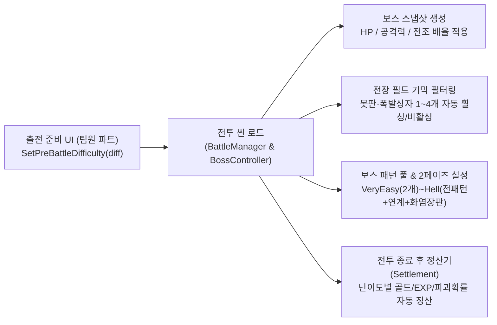

# 전투 진입 전 보스 난이도 선택 & 연동 가이드 (`Pre-Battle Difficulty Integration Guide`)

## 1. 개요
본 문서는 **로비 / 월드맵 / 출전 준비(배팅) UI 파트**에서 플레이어가 **보스전 진입 전에 난이도(5단계)를 선택**하고, 해당 난이도를 전투 씬(`BattleManager` 및 `BossControllerBase`)에 전달하여 **보스 스탯, 패턴 수, 필드 기믹 수, 2페이즈 개방 여부, 토벌 보상 및 하드코어 패널티**가 자동 적용되도록 연동하는 표준 방법을 안내한다.

---

## 2. 난이도 5단계 열거형 (`BossDifficulty`) 및 상세 스펙

`BossDifficulty` 열거형은 전역(Global Namespace)에 선언되어 있어 별도의 `using` 없이 프로젝트 어디서나 즉시 참조할 수 있다.
- **정의 위치**: [`Assets/KKH/02.Scripts/01.Data/BossMasterData.cs`](../02.Scripts/01.Data/BossMasterData.cs)

```csharp
public enum BossDifficulty
{
    VeryEasy = 0, // 아주 쉬움
    Easy     = 1, // 쉬움
    Normal   = 2, // 보통 (기본값)
    Hard     = 3, // 어려움 (2페이즈 개방 + 과열 가속 패시브)
    Hell     = 4  // 헬 (2페이즈 개방 + 초고속 패턴 연계 + 배기 잔화 화염 장판)
}
```

### 난이도별 자동 반영 수치 요약표 (지역 1 기준가 500G 기준)

| 난이도 (`BossDifficulty`) | 정수값 (`int`) | 보스 HP 배율 | 보스 공격력 배율 | 사용 패턴 수 | 필드 기믹 수 (못판/폭발상자) | 2페이즈 / 패시브 | 신청비 (Entry Fee) | 승리 보상 골드 | 승리 코어 EXP | 패배 시 영구 파괴 / 코어 불안정 |
|---|---|---|---|---|---|---|---|---|---|---|
| **`VeryEasy` (아주 쉬움)** | `0` | `0.6x` | `0.6x` (전조 1.5배 김) | 2종 | 1개 | 없음 | **0 G** (`0%`) | **50 G** (`0.1x`) | **+50 EXP** | **영구 파괴 없음 (`0x`)** / 코어 정상 유지 |
| **`Easy` (쉬움)** | `1` | `0.8x` | `0.8x` | 3종 | 1개 | 없음 | **25 G** (`5%`) | **125 G** (`0.25x`) | **+80 EXP** | 파괴 확률 50% 감쇄 (`0.5x`) / 코어 정상 유지 |
| **`Normal` (보통)** | `2` | `1.0x` | `1.0x` | 4종 (전부) | 2개 | 없음 | **50 G** (`10%`) | **250 G** (`0.5x`) | **+120 EXP** | 표준 파괴 확률 (`1.0x`) / 코어 불안정 발생 |
| **`Hard` (어려움)** | `3` | `1.5x` | `1.3x` | 4종 (전부) | 3개 | **2페이즈 ON** + 과열 가속 | **100 G** (`20%`) | **450 G** (`0.9x`) | **+180 EXP** | 표준 파괴 확률 (`1.0x`) / 코어 불안정 발생 |
| **`Hell` (헬)** | `4` | `2.2x` | `1.6x` | 4종 + **연속 연계** | 4개 (전부) | **2페이즈 ON** + 과열 가속 + **배기 잔화** | **150 G** (`30%`) | **750 G** (`1.5x`) | **+300 EXP** | **파괴 확률 1.3배 증폭** / 코어 불안정 발생 |

---

## 3. 상황별 연동 방법 (총 3가지 방식 지원)

### 방법 A. [가장 권장] 전투 씬 로드 전(로비/월드맵/배팅 씬)에서 코드 한 줄로 예약하기

아직 전투 씬(`Battle` / `Battle_Boss_Test`)이 로드되기 전이라 씬에 `BattleManager`나 `BossController`가 존재하지 않더라도, **`BattleManager.SetPreBattleDifficulty(...)` 정적(static) 메서드**를 호출하면 정적 메모리에 난이도가 예약되며, 이후 전투 씬이 열리는 즉시(`Awake`) 보스와 매니저가 이 값을 자동으로 읽어 세팅한다.

```csharp
using UnityEngine;
using UnityEngine.SceneManagement;

public class PreBattleEntryUI : MonoBehaviour
{
    private BossDifficulty _selectedDiff = BossDifficulty.Normal;

    // 1. 난이도 버튼 클릭 시 호출 (예: 0=아주쉬움, 1=쉬움, 2=보통, 3=어려움, 4=헬)
    public void OnSelectDifficulty(int difficultyIndex)
    {
        _selectedDiff = (BossDifficulty)Mathf.Clamp(difficultyIndex, 0, 4);

        // ★ 핵심: 정적 브릿지에 난이도 예약 (전투 씬 로드 전에도 언제든 호출 가능!)
        BattleManager.SetPreBattleDifficulty(_selectedDiff);
    }

    // 2. [출전하기] 버튼 클릭 시 전투 씬으로 이동
    public void OnClickStartBossBattle(string battleSceneName = "Battle_Boss_Test")
    {
        // 난이도를 확정 예약한 뒤 씬 전환
        BattleManager.SetPreBattleDifficulty(_selectedDiff);
        SceneManager.LoadScene(battleSceneName);
    }
}
```

---

### 방법 B. 같은 씬(전투 씬 내부의 출전 준비 오버레이 패널)에서 실시간 변경하기

전투 씬 안에서 시작 전 UI 패널을 띄워두고 난이도를 바꾸거나, 이미 생성된 보스의 난이도를 즉시 변경할 때 사용한다.

```csharp
// 1. Enum으로 변경
BattleManager.Instance.SetBossDifficulty(BossDifficulty.Hard);

// 2. 또는 정수 인덱스(0 ~ 4)로 변경
BattleManager.Instance.SetBossDifficultyByIndex(3); // 3 = Hard
```
- **유니티 인스펙터 Button / TMP_Dropdown 직접 연결 시**:
  - `Button.OnClick` 또는 `TMP_Dropdown.OnValueChanged` 이벤트 슬롯에 씬의 **`BattleManager`** 오브젝트를 드래그한 뒤,
  - **`BattleManager.SetBossDifficultyByIndex(int)`** 함수를 선택하고 `0`(VeryEasy) ~ `4`(Hell) 숫자를 입력하면 별도 스크립트 작성 없이도 작동한다.

---

### 방법 C. 난이도 선택 UI에 "신청비 / 예상 보상 / 보스 스펙" 미리보기 텍스트 띄우기

난이도 버튼을 클릭했을 때 UI 화면에 해당 난이도의 신청비, 보상 골드, 코어 EXP, 위험도 설명을 표시하고 싶다면 **`BossDifficultyLayer.GetDefault(difficulty)`**를 호출하여 기획서 수치를 그대로 가져올 수 있다.

```csharp
public void UpdateDifficultyPreviewUI(BossDifficulty diff)
{
    // 해당 난이도의 기획서 데이터 레이어 즉시 조회 (지역 1 기준가 500G)
    BossDifficultyLayer layer = BossDifficultyLayer.GetDefault(diff);
    int regionBasePrice = 500;

    int entryFee    = Mathf.RoundToInt(regionBasePrice * layer.entryFeeMultiplier); // 신청비 (0G ~ 150G)
    int rewardGold  = Mathf.RoundToInt(regionBasePrice * layer.killGoldMultiplier); // 처치 골드 (50G ~ 750G)
    int rewardExp   = Mathf.RoundToInt(regionBasePrice * 0.2f * layer.coreExpMultiplier); // 승리 EXP (50 ~ 300)

    txtDifficultyName.text = diff.ToString();
    txtEntryFee.text       = $"신청비: {entryFee:N0} G";
    txtRewardGold.text     = $"토벌 보상: +{rewardGold:N0} G";
    txtRewardExp.text      = $"코어 경험치: +{rewardExp} EXP";
    txtBossSpec.text       = $"보스 체력 {layer.hpMultiplier * 100f:F0}% / 공격력 {layer.attackMultiplier * 100f:F0}% / 기믹 {layer.maxActiveGimmicks}개";
    txtHardcoreWarning.text = layer.destructionMultiplier <= 0f
        ? "<color=#34D399>안전: 패배 시 부품 영구 파괴 없음</color>"
        : $"<color=#F87171>주의: 패배 시 부품 영구 파괴 확률 {layer.destructionMultiplier * 100f:F0}% 적용</color>";
}
```

---

## 4. 내부 동작 흐름도 (전투 파트 자동 처리 내역)

팀원이 `BattleManager.SetPreBattleDifficulty(diff)` 또는 `SetBossDifficulty(diff)`만 호출해주면, 전투 씬에서는 다음 항목들이 **전부 자동으로 처리**되므로 추가 작업을 할 필요가 없다.



1. **보스 체력 및 공격력 스케일링**: `BossControllerBase.SetupSnapshot()`에서 `hpMultiplier`, `attackMultiplier`, `tellDurationMultiplier` 자동 반영.
2. **전장 기믹(못판/폭발상자) 개수 자동 조절**: `JunkWheelerBossController.ApplyDifficultyToGimmicks()`에서 씬 내 배치된 못판/폭발상자를 `maxActiveGimmicks` 개수만큼만 켜고 나머지는 자동 비활성화.
3. **2페이즈 및 패시브 제어**: `Hard`/`Hell`에서만 HP 50% 이하 시 2페이즈 엔진 과열(`Overheat`) 진입, `Hell`에서는 돌진 시 화염 장판(`FireTrailHazard`) 생성.
4. **전투 종료 정산 연동**: `BattleManager`가 전투 종료 시 `BattleSettlementProcessor.ProcessBossBattleSettlement(..., difficulty: activeDifficulty)`에 선택된 난이도를 넘겨 결과 UI(`BattleResultUI`)까지 난이도별 보상과 패널티가 정확히 전달됨.

