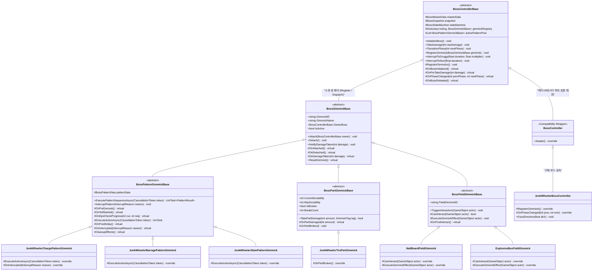
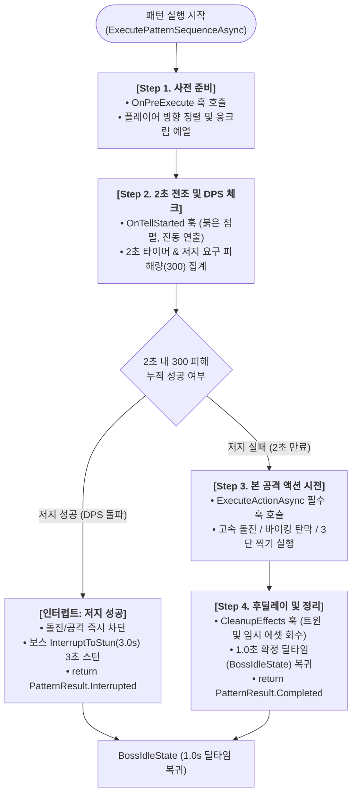
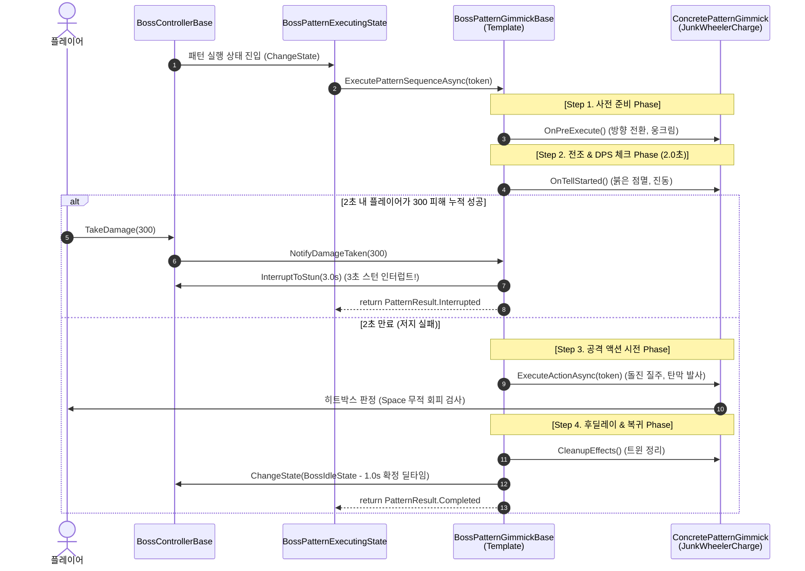
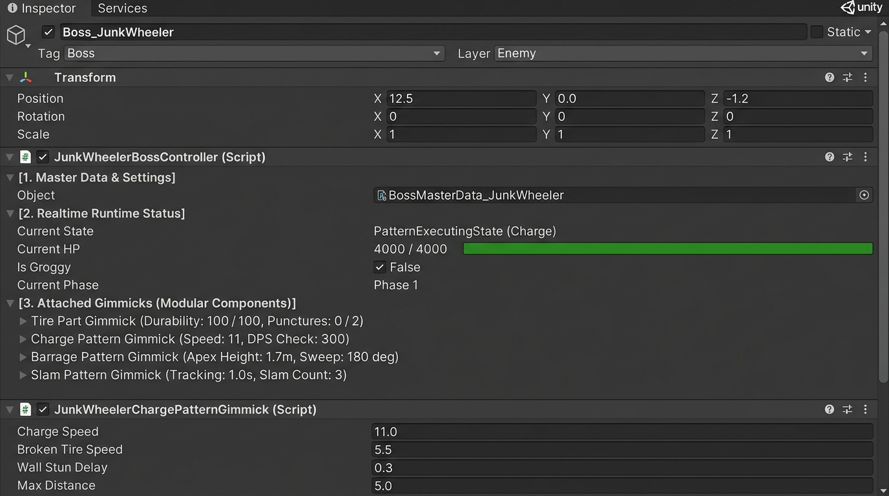
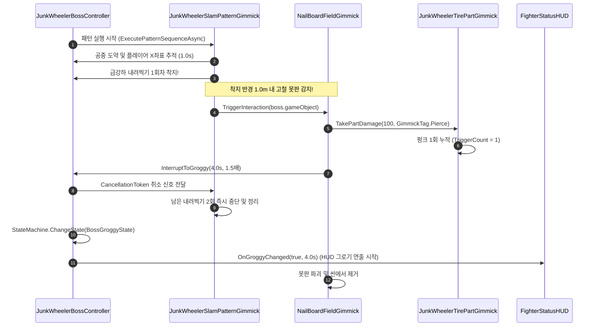

# 보스 시스템 아키텍처 리팩토링 기획서
## (Boss System Architecture & Template Method Refactoring Plan)

- **문서 버전**: v2.1.0 (현재 프로젝트 코드베이스 정합성 및 4대 충돌 보완 반영)
- **작성 일자**: 2026-10-26
- **담당 파트**: 전투 데이터 허브 & 보스 시스템 (KKH)
- **대상 모듈**: 보스 코어 프레임워크(`BossControllerBase` / `BossController`), 기믹 제어기(`BossGimmickBase`), 계층형 FSM(`BossStateMachine`), 전장 상호작용 기물
- **핵심 디자인 패턴**: 템플릿 메서드 패턴 (Template Method Pattern) + 컴포지션 (Composition) + 옵저버 (Observer) + 단일 진실 원천 (SSOT)

---

## 1. 리팩토링 배경 및 목적

### 1.1 현행 보스 시스템(v1.0)의 한계와 기술적 부채
현재 구현된 보스 시스템은 지역 1 보스 "정크 휠러"의 핵심 메커니즘을 성공적으로 시뮬레이션하고 있으나, 다음과 같은 구조적 한계와 결합도 문제를 안고 있습니다:

1. **단일 보스 종속 및 단일체(Monolithic) 결합**:
   - `BossController`가 정크 휠러의 스탯, 기믹 상태, FSM 상태 전이를 모두 직접 처리하며, 개별 State(`BossChargeState`, `BossJumpBarrageState`, `BossPatternTellState`) 내부에 보스의 물리 이동, 스프라이트 반전, 충돌 판정, 기믹 검사가 뒤섞여 있습니다.
2. **개방-폐쇄 원칙(OCP) 위반 및 신규 보스 확장 불가**:
   - 향후 지역 2, 지역 3 등 새로운 보스나 신규 기믹(독가스 방출, 보호막 생성, 부하 소환, 천장 낙하 등)을 추가할 때 기존 컨트롤러와 State를 뜯어고쳐야 하거나 코드를 대량 복제해야 합니다.
3. **하드코딩된 기믹 판정**:
   - 상태 클래스 내부에서 `hit.CompareTag("ExplosiveBox")`나 `boss.Snapshot.GetGimmick("TIRE_PART")`와 같은 하드코딩된 문자열 검사로 기믹을 직접 조회하여, 기믹 로직의 재사용과 독립적 단위 테스트가 어렵습니다.
4. **패턴 생명주기 규격화 부재**:
   - 모든 보스 공격 패턴은 공통적으로 `전조 연출(2초) ➔ 저지(DPS 체크) 판정 ➔ 본 공격 시전 ➔ 충돌/피격 판정 ➔ 후딜(1.0초 딜타임) ➔ 정리`라는 일관된 흐름을 가집니다. 그러나 현재는 각 State마다 비동기 딜레이와 트윈 처리가 개별적으로 작성되어 유지보수 위험이 큽니다.

### 1.2 리팩토링 핵심 목표
1. **보스 베이스 프레임워크 구축 (`BossControllerBase`)**:
   - 체력(HP), 방어력, 페이즈 전환, 피격/사망 판정, 그로기/스턴 인터럽트, 1.0초 확정 딜타임 등 보스의 '기본적인 틀과 파라미터'를 완벽히 캡슐화.
2. **기믹 모듈화 및 플러그형 부착(Attach) 구조**:
   - 공격 패턴, 보스 약점 부위, 전장 설치물 기믹을 독립적인 컴포넌트로 분리하고, 보스 본체에 자유롭게 부착 및 제어할 수 있는 컴포지션 구조 수립.
3. **템플릿 메서드 패턴(Template Method Pattern) 전면 적용**:
   - 보스 생명주기 및 기믹 실행 시퀀스의 전체 골격(스켈레톤)을 상위 추상 클래스에 고정하고, 구체적인 연출/동작/파훼 반응은 하위 클래스의 훅(Hook) 메서드로 위임.
4. **FSM(상태 머신)의 초경량화**:
   - 상태 머신이 거대한 패턴 로직을 직접 품지 않고, 현재 선택된 `PatternGimmick`을 실행하는 단일 '패턴 실행기(Executor)'로 역할을 슬림화하여 결합도 최소화.
5. **기존 시스템과의 100% 무결성 유지**:
   - `CombatDataHub`, `CombatantSnapshot`, `BattleManager`, `BossFSMTester`와의 API 호환성을 유지하여 기존 씬(`Battle_Test_KKH.unity`)에서 즉각 검증 가능하도록 설계.

---

## 2. 시스템 아키텍처 및 템플릿 메서드 설계

### 2.1 전체 아키텍처 다이어그램 (Architecture Diagram)



---

### 2.2 템플릿 메서드 패턴(Template Method Pattern) 적용 상세

#### [A] 보스 본체 생명주기 템플릿 (`BossControllerBase.InitializeBoss`, `TakeDamage`)
보스 본체는 전체 전투 라이프사이클의 '뼈대(Skeleton)'를 관리하며, 하위 구체 보스 클래스는 훅(Hook)을 통해서만 고유 동작을 주입합니다.

```csharp
// 1. 초기화 템플릿 메서드 (알고리즘의 불변 골격)
public void InitializeBoss()
{
    // Step 1: 원장 SO 로드 및 런타임 스냅샷 구축
    SetupSnapshot();

    // Step 2: CombatDataHub에 보스 스냅샷 자동 등록 (SSOT 동기화)
    if (CombatDataHub.Instance != null)
    {
        CombatDataHub.Instance.InitializeBossBattle(CombatDataHub.Instance.PlayerSnapshot, Snapshot);
    }

    // Step 3: 상태 머신(FSM) 초기화
    SetupStateMachine();

    // Step 4: [Hook] 구체 보스별 고유 기믹 등록 (하위 클래스 오버라이드)
    RegisterGimmicks();

    // Step 5: 1페이즈 사용 가능 패턴 풀 구성
    BuildPhasePatternPool(Snapshot.currentPhase);

    // Step 6: [Hook] 보스 고유 초기화 연출 및 리스너 등록
    OnBossInitialized();

    // Step 7: 초기 딜타임(1.0s IdleState) 진입하여 전투 루프 개시
    StartCombatLoop();
}

// 2. 피격 처리 템플릿 메서드 (CombatCalculator SSOT 연동 및 이중 차감 방지)
public void TakeDamage(int rawDamage, bool isAlreadyCalculated = false)
{
    if (Snapshot == null || !Snapshot.IsAlive) return;

    // Step 1: [Hook] 피격 직전 보스 고유 실드/패링 훅
    int adjustedDamage = OnPreTakeDamage(rawDamage);

    // Step 2: 방어력 감쇄(CombatCalculator.CalculateDamage) 및 그로기 배율(1.5배) 단일 연산
    // (CombatDataHub.ProcessHit에서 이미 연산된 최종 피해량이 넘어온 경우 중복 계산 생략)
    int finalDamage;
    if (isAlreadyCalculated)
    {
        finalDamage = adjustedDamage;
    }
    else
    {
        float multiplier = Snapshot.isGroggy ? Snapshot.currentDamageMultiplier : 1.0f;
        finalDamage = CombatCalculator.CalculateDamage(adjustedDamage * multiplier, Snapshot.baseDefense);
        Snapshot.currentHp = Mathf.Max(0, Snapshot.currentHp - finalDamage);
    }

    // Step 3: HUD 및 CombatDataHub 브로드캐스팅 통보
    OnHpChanged?.Invoke(Snapshot.currentHp, Snapshot.maxHp);

    // Step 4: 부착된 모든 기믹 및 현재 FSM 상태에 피격 통보 (300 DPS 저지 체크, 부위 내구도 차감)
    StateMachine?.OnDamageTaken(finalDamage);
    NotifyGimmicksDamageTaken(finalDamage);

    // Step 5: 페이즈 체력 임계치 도달 검사 및 전이 템플릿 호출
    CheckPhaseTransition();

    // Step 6: 사망 판정 및 BattleManager 승리 정산 연동
    if (Snapshot.currentHp <= 0)
    {
        OnBossDefeated();
        BattleManager.Instance?.OnFighterKilled(Snapshot.bossID);
    }
}
```

#### [B] 공격 패턴 기믹 실행 템플릿 (`BossPatternGimmickBase.ExecutePatternSequenceAsync`)

모든 보스 공격 패턴은 상위 추상 클래스에 정의된 **템플릿 메서드(`ExecutePatternSequenceAsync`)**를 따라 실행되며, 하위 구체 클래스는 복잡한 타이머나 저지 로직을 직접 작성할 필요 없이 세부 훅(`ExecuteActionAsync` 등)만 오버라이드합니다.

##### 1) 템플릿 메서드 실행 흐름 순서도 (Flowchart)



##### 2) 클래스 간 상호작용 시퀀스 다이어그램 (Sequence Diagram)



##### 3) 템플릿 단계별 메서드 및 훅(Hook) 역할 요약표

| 단계 | 실행 메서드 | 분류 | 책임 및 수행 작업 | 오버라이드 |
| :--- | :--- | :--- | :--- | :---: |
| **Step 1. 사전 준비** | `OnPreExecute()` | Virtual Hook | 공격 개시 전 플레이어 추적, 바라보는 방향(Scale.x) 정렬, 뒤로 웅크리기 예열 | 선택 |
| **Step 2. 전조 (Tell)** | `ExecuteTellPhaseAsync()` | **Template Method** | 2.0초 비동기 타이머 구동, 피해 누적(DPS 체크) 집계, 점멸 연출 및 머리 위 게이지 관리 | **불가 (고정)** |
| | `OnTellStarted()` | Virtual Hook | 바퀴 헛돔 진동, 엔진 과열 붉은색 점멸 등 보스별 고유 전조 시각 효과 개시 | 선택 |
| | `InterruptPattern()` | **Template Method** | 저지 성공 또는 기믹 피격 시 진행 중이던 비동기 흐름 즉시 취소 및 상태 전이 | **불가 (고정)** |
| **Step 3. 액션 시전** | `ExecuteActionAsync()` | **Abstract Hook** | 실제 물리 이동, 탄막 투사, 도약 찍기 등 보스 패턴 고유의 공격 실행 | **필수 구현** |
| **Step 4. 후딜 & 정리** | `ExecutePostDelayPhaseAsync()` | **Template Method** | 패턴 종료 후 공통 규칙인 1.0초 확정 딜타임(BossIdleState) 자동 복귀 | **불가 (고정)** |
| | `CleanupEffects()` | Virtual Hook | 잔여 DOTween 킬, 공중 사출 타이어 회수, 동적 생성 투사체 정리 | 선택 |


---

### 2.3 유니티 인스펙터(Inspector) 시각적 제어 구조 및 컴포넌트 레이아웃

리팩토링된 보스 시스템은 모듈식 컴포지션(Composition) 구조를 채택하여, **유니티 인스펙터 창에서 보스의 기본 상태와 부착된 각 기믹들을 직관적으로 확인하고 실시간 제어/튜닝**할 수 있습니다.



#### 인스펙터 제어 영역별 상세 해설:
1. **GameObject 헤더 & 계층 (Hierarchy & Tags)**:
   - 오브젝트명: `Boss_JunkWheeler`
   - `Tag`: `Boss` / `Layer`: `Enemy`
   - `Transform`: 보스의 2D 월드 좌표, 방향 반전용 Scale(`-1` or `1`) 제어.

2. **`JunkWheelerBossController (Script)` (최상위 보스 제어기)**:
   - **`[1. Master Data & Settings]` (원장 데이터 바인딩)**:
     - `Object`: `BossMasterData_JunkWheeler` (ScriptableObject 에셋 드래그앤드롭 슬롯)
   - **`[2. Realtime Runtime Status]` (실시간 런타임 모니터링 / 디버그)**:
     - `Current State`: 현재 FSM 상태명 실시간 표시 (예: `PatternExecutingState (Charge)`)
     - `Current HP`: 인스펙터 프로그레스 바 형태로 실시간 체력 표시 (`4000 / 4000`)
     - `Is Groggy`: 기믹 파훼 무력화 여부 체크박스 (`False` / `True`)
     - `Current Phase`: 현재 전투 페이즈 (`Phase 1`)
   - **`[3. Attached Gimmicks (Modular Components)]` (부착된 기믹 폴드아웃 목록)**:
     - `Tire Part Gimmick`: 타이어 내구도(100/100) 및 누적 펑크 횟수(0/2) 모니터링
     - `Charge Pattern Gimmick`: 돌진 속도(11m/s), 300 저지 DPS 체크 파라미터
     - `Barrage Pattern Gimmick`: 타이어 사출 높이(1.7m), 180도 스윕 발사
     - `Slam Pattern Gimmick`: 플레이어 추적 시간(1.0s), 3단 급강하

3. **`JunkWheelerChargePatternGimmick (Script)` (개별 기믹 모듈 컴포넌트)**:
   - 기획자가 보스 본체 코드를 건드리지 않고 개별 기믹 컴포넌트의 수치를 실시간 튜닝 가능:
     - `Charge Speed`: 돌진 속도 (기본 11.0 m/s)
     - `Broken Tire Speed`: 타이어 2회 펑크 시 감속 속도 (5.5 m/s)
     - `Wall Stun Delay`: 반대편 벽 충돌 후 반동 스턴 시간 (0.3s)
     - `Max Distance`: 최대 맵 횡단 거리 (5.0m)

---

### 2.4 보스 기본 파라미터 규격 명세표 (Base Parameters Table)

보스 시스템의 모든 파라미터는 **1) 불변 원장 에셋(ScriptableObject)**, **2) 인메모리 런타임 상태(DTO)**, **3) 컨트롤러 런타임 제어 변수**, **4) 공격 패턴 기믹 파라미터**로 엄격히 역할이 분리되어 관리됩니다.

#### [A] 보스 본체 핵심 파라미터 (Core Base Parameters)

| 분류 | 파라미터명 (C#) | 데이터 타입 | 정의 위치 | 기본값 (정크 휠러) | 상세 기능 및 역할 해설 |
| :--- | :--- | :---: | :---: | :---: | :--- |
| **식별 정보** | `bossID` | `string` | `BossMasterData` | `"BOSS_REGION_01"` | 보스 고유 식별 키 (세이브 파일, 데이터 허브, 퀘스트 판정 등에 사용) |
| | `bossName` | `string` | `BossMasterData` | `"정크 휠러"` | HUD 대형 보스 체력바 및 보스 조우 시 화면에 표시되는 공식 명칭 |
| **전투 수치** | `maxHp` | `int` | Master & Snapshot | `4000` | 보스의 최대 코어 체력. 피격 시 `CombatDataHub` 및 HUD와 동기화 |
| | `currentHp` | `int` | `BossSnapshot` | `4000` | 보스의 실시간 잔여 체력. `0` 이하 도달 시 보스 토벌 및 전투 승리 판정 |
| | `baseDefense` | `int` | Master & Snapshot | `40` | 방어 감쇄 연산 공식(`피해 * 100 / (100 + 방어력)`)에 사용되는 기본 방어력 |
| | `IsAlive` | `bool` | `BossSnapshot` | `true` | 보스 생존 여부 프로퍼티 (`currentHp > 0`) |
| **전투 템포** | `patternPostDelay` | `float` | `BossMasterData` | `1.0f` | **[기획서 공통 딜타임]** 모든 공격 패턴 종료 후 확정적으로 부여되는 무방비 대기시간 |
| | `currentPhase` | `int` | `BossSnapshot` | `1` | 현재 전투 페이즈 (체력 임계치 도달 시 다음 페이즈로 전이) |
| | `phases` | `List<BossPhaseData>` | `BossMasterData` | Phase 1~2 설정 | 페이즈 단계 번호, 진입 체력 비율(1.0, 0.5 등), 해당 페이즈 사용 패턴 ID 목록 |
| **상태 이상** | `isGroggy` | `bool` | `BossSnapshot` | `false` | 기믹 파훼(못판 착지 등)로 인한 **4초 무력화** 상태 플래그 |
| | `currentDamageMultiplier` | `float` | `BossSnapshot` | `1.0f` (그로기 시 `1.5f`) | 보스 피격 대미지 증폭 배율 (그로기 상태 진입 시 1.5배로 상승) |
| **보상 정산** | `rewardGold` | `int` | `BossMasterData` | `1500` | 보스 토벌 완료 시 승리 정산창(`BattleResultUI`)을 통해 지급되는 골드 |
| | `rewardCoreExp` | `int` | `BossMasterData` | `500` | 보스 토벌 완료 시 코어 성장에 누적되는 경험치 |

---

#### [B] 기믹 및 컴포넌트 제어 파라미터 (Gimmick & Component Parameters)

| 분류 | 파라미터명 (C#) | 데이터 타입 | 정의 위치 | 기본값 | 상세 기능 및 역할 해설 |
| :--- | :--- | :---: | :---: | :---: | :--- |
| **기믹 레지스트리** | `gimmickRegistry` | `Dictionary<string, BossGimmickBase>` | `BossControllerBase` | 런타임 자동 바인딩 | 보스에 부착된 모든 기믹(패턴, 부위, 전장) 컴포넌트 컬렉션 |
| | `activePatternPool` | `List<BossPatternGimmickBase>` | `BossControllerBase` | 페이즈별 동적 구성 | 현재 페이즈에서 보스가 순환 또는 추첨하여 시전할 수 있는 유효 공격 패턴 풀 |
| | `currentPatternIndex` | `int` | `BossControllerBase` | `0` | 공격 패턴 순환 선택을 위한 인덱스 카운터 |
| **기믹 런타임** | `gimmickStates` | `Dictionary<string, BossGimmickRuntimeState>` | `BossSnapshot` | ID별 인스턴스 | 각 기믹의 고유 ID, 실시간 내구도(`currentDurability`), 누적 파훼 횟수 관리 |
| | `sealedSkills` | `HashSet<string>` | `BossSnapshot` | 비어 있음 | 기믹 파훼(부위 파괴 등)로 인해 영구적으로 사용 금지된 패턴 ID 목록 |
| **비동기 토큰** | `_stateCts` | `CancellationTokenSource` | `BossControllerBase` | 상태 진입 시 갱신 | 기믹 파훼, 스턴, 사망 시 진행 중이던 비동기 패턴을 즉각 안전하게 취소하는 토큰 |
| **인스펙터 디버그** | `currentStateName` | `string` | `BossControllerBase` | `""` | 유니티 에디터 인스펙터에서 현재 실행 중인 FSM 상태명을 실시간 모니터링 |
| | `currentHpView` | `int` | `BossControllerBase` | `4000` | 인스펙터에서 실시간 잔여 체력을 직관적으로 확인하기 위한 직렬화 뷰 |
| | `isGroggyView` | `bool` | `BossControllerBase` | `false` | 인스펙터에서 실시간 그로기 플래그를 체크박스로 모니터링 |

---

#### [C] 공격 패턴 기믹 공통 파라미터 (`BossPatternGimmickBase` & `BossPatternData`)

| 파라미터명 (C#) | 데이터 타입 | 정의 위치 | 기본값 (돌진 기준) | 상세 기능 및 역할 해설 |
| :--- | :---: | :---: | :---: | :--- |
| `patternID` | `string` | `BossPatternData` | `"PATTERN_CHARGE"` | 패턴 고유 식별자 |
| `patternName` | `string` | `BossPatternData` | `"돌진 패턴"` | 패턴 표시 명칭 |
| `tellDuration` | `float` | `BossPatternData` | `2.0f` | **[기획서 공통 전조 시간]** 공격 시전 전 붉은 점멸 및 바퀴 헛돔 진동 시간 |
| `hasDpsCheck` | `bool` | `BossPatternData` | `true` | 전조 시간 동안 플레이어의 피해 누적을 통한 저지 가능 여부 |
| `requiredDamageToInterrupt` | `int` | `BossPatternData` | `300` | **[기획서 저지 요구 피해량]** 2.0초 내 누적 시 공격을 차단하고 스턴을 유발하는 피해량 |
| `interruptStunDuration` | `float` | `BossPatternData` | `3.0f` | **[기획서 저지 스턴 시간]** 저지 성공 시 보스가 무방비로 정지하는 시간 |
| `postDelay` | `float` | `BossPatternData` | `1.0f` | 공격 시전 완료 후 확정 딜타임 (미지정 시 보스 기본 1.0초 승계) |
| `baseDamage` | `int` | `BossPatternData` | `50` | 패턴 적중 시 플레이어가 입는 기본 코어 피해량 (`damageRatio` 계수 연산 기준치) |
| `damageRatio` | `float` | `BossPatternData` | `100f` | 패턴 기본 피해량 계수 (%) |
| `targetPlayerPart` | `BodyPart` | `BossPatternData` | `BodyPart.Core` (내려찍기는 `LeftLeg`) | **[기획서 §12.7]** 보스 스킬 피격 시 내구도를 차감할 대상 플레이어 부위 |
| `partDurabilityDamage` | `int` | `BossPatternData` | `0` (내려찍기는 `30`) | 피격 시 차감할 플레이어 대상 부위 내구도 수치 (`CombatDataHub.ApplyPartHit` 연동) |
| `actionData` | `ActionData` | `BossPatternData` | `null` (선택) | NYH 프레임 타임라인 액션 데이터 연동 (히트박스/모션 프레임) |

---

## 3. 스크립트별 상세 기능 명세 및 해설

시스템을 총 3개 패키지(Core Framework, Concrete Boss & Gimmicks, Refactored FSM & Helpers)로 분할 구성합니다.

```
Assets/KKH/02.Scripts/03.Logic/Boss/
├── BossController.cs                   # [레거시/테스터 하위 호환 클래스] BossControllerBase 상속
├── Core/                               # [코어 프레임워크]
│   ├── BossControllerBase.cs           # 보스 기본 틀, 스탯, 공통 로직, 기믹 레지스트리
│   ├── BossGimmickBase.cs              # 모든 기믹의 최상위 추상 클래스
│   ├── BossPatternGimmickBase.cs       # 공격 패턴 템플릿 (전조 -> 저지 -> 시전 -> 후딜 & 플레이어 파츠 피격 표준화)
│   ├── BossPartGimmickBase.cs          # 보스 약점 부위 및 내구도 파괴 템플릿 (선택적 스킬 봉인 vs 스펙 약화 지원)
│   ├── BossFieldGimmickBase.cs         # 전장 설치형 기물 인터랙션 템플릿
│   └── BossGimmickContext.cs          # 기믹 실행 컨텍스트 및 결과 열거형
├── JunkWheeler/                        # [지역 1 보스: 정크 휠러 구현체]
│   ├── JunkWheelerBossController.cs    # 정크 휠러 구체 컨트롤러 (BossController 상속, 기믹 부착 및 비주얼 제어)
│   ├── Gimmicks/
│   │   ├── JunkWheelerTirePartGimmick.cs      # 타이어 부위 기믹 (2회 펑크 시 영구 감속)
│   │   ├── JunkWheelerChargePatternGimmick.cs # 패턴 2: 횡단 돌진 패턴 기믹
│   │   ├── JunkWheelerBarragePatternGimmick.cs# 패턴 1: 바이킹 순차 반원 탄막 기믹
│   │   ├── JunkWheelerSlamPatternGimmick.cs   # 패턴 3: 3단 내려찍기 & 못판 유도 기믹
│   │   ├── NailBoardFieldGimmick.cs           # 전장 기물: 고철 못판 (펑크 & 4초 그로기)
│   │   └── ExplosiveBoxFieldGimmick.cs        # 전장 기물: 폭발 상자 (자폭 & 2초 스턴)
└── FSM/                                # [경량화된 상태 머신 계층]
    ├── BossStateMachine.cs             # FSM 제어기
    ├── BossStateBase.cs                # 상태 기본 클래스
    └── States/
        ├── BossIdleState.cs            # 1.0초 확정 딜타임 대기 상태
        ├── BossPatternExecutingState.cs# 부착된 Pattern Gimmick을 실행하는 단일 범용 실행 상태
        ├── BossGroggyState.cs          # 4초 무력화 (받는 피해 1.5배) 상태
        └── BossStunState.cs            # 저지 성공(3초) 또는 상자 자폭(2초) 스턴 상태
```

---

### 3.1 Core Framework (코어 프레임워크)

#### 1) `BossControllerBase.cs`
- **역할**: 보스의 최상위 추상 기반 MonoBehaviour 컴포넌트.
- **책임**:
  - `BossMasterData`(원장 SO)로부터 `BossSnapshot`(런타임 DTO) 생성 및 수명주기 관리.
  - 기믹 레지스트리(`Dictionary<string, BossGimmickBase>`) 관리: 기믹의 등록(`RegisterGimmick`), 조회(`GetGimmick<T>`), 생명주기 이벤트 디스패치.
  - 페이즈 전환 템플릿(`TransitionPhase`): 체력 임계치 감지 및 사용 가능 패턴 풀 동적 갱신.
  - 외부 피격 진입점(`TakeDamage`) 및 인터럽트 API(`InterruptToGroggy`, `InterruptToStun`) 제공.
  - 비동기 상태 취소 토큰(`CancellationTokenSource`)의 안전한 재생성 및 회수.
- **주요 템플릿 메서드 & 훅**:
  - `InitializeBoss()`: 보스 기동 템플릿 메서드.
  - `RegisterGimmicks()`: `[protected abstract]` 하위 구체 보스에서 필요한 기믹들을 `RegisterGimmick()`으로 등록하는 필수 훅.
  - `OnBossInitialized()`: `[protected virtual]` 구체 보스 초기화 완료 훅.
  - `OnPreTakeDamage(int rawDamage)`: `[protected virtual]` 피해 감쇄/무적 훅.
  - `OnPhaseChanged(int prevPhase, int newPhase)`: `[protected virtual]` 페이즈 전환 시 연출 및 외형 변화 훅.
  - `OnBossDefeated()`: `[protected virtual]` 사망 연출 훅.

#### 2) `BossGimmickBase.cs`
- **역할**: 보스에 부착되는 모든 기믹의 최상위 추상 클래스.
- **책임**:
  - 소유자 보스(`OwnerBoss`) 참조 유지 및 기믹 식별자(`GimmickID`, `GimmickName`) 정의.
  - 보스에 부착(`Attach`)되거나 분리(`Detach`)될 때의 공통 수명주기 캡슐화.
  - 보스 피격 대미지 수신(`NotifyDamageTaken`) 및 전달.
- **주요 템플릿 메서드 & 훅**:
  - `Attach(BossControllerBase owner)`: 소유권 할당 후 `OnAttached()` 훅 호출.
  - `OnAttached()`: `[protected virtual]` 부착 시 이벤트 구독 및 초기화 훅.
  - `OnDetached()`: `[protected virtual]` 해제 시 리소스 해제 훅.
  - `OnDamageTaken(int damage)`: `[protected virtual]` 보스 피격 시 기믹별 반응 훅.

#### 3) `BossPatternGimmickBase.cs`
- **역할**: 공격 패턴을 수행하는 기믹의 추상 기반 클래스 (`BossGimmickBase` 상속).
- **책임**:
  - 2초 전조(Tell), DPS 체크 저지 판정, 비동기 시전, 확정 딜타임 복귀로 이어지는 **패턴 실행 템플릿 메서드** 제공.
  - 기믹 파훼(못판 착지 등)나 스턴에 의한 즉각적인 인터럽트(`InterruptPattern`) 안전 처리.
- **주요 템플릿 메서드 & 훅**:
  - `ExecutePatternSequenceAsync(CancellationToken token)`: **[Template Method]**
    - Step 1: `OnPreExecute()` (방향 정렬, 웅크림)
    - Step 2: `ExecuteTellPhaseAsync(token)` (전조 연출 및 2초 타이머/DPS 체크)
    - Step 3: 저지 성공 시 `InterruptPattern` 호출 및 탈출 / 저지 실패 시 `ExecuteActionAsync(token)` 호출
    - Step 4: `ExecutePostDelayPhaseAsync(token)` (1.0초 딜타임 복귀)
    - Step 5: `CleanupEffects()`
  - `ExecuteActionAsync(CancellationToken token)`: `[protected abstract]` 구체적인 돌진/탄막/도약 공격 로직을 구현하는 필수 훅.
  - `OnTellStarted()` / `OnTellEnded()`: `[protected virtual]` 전조 비주얼(점멸, 진동) 시작/종료 훅.
  - `OnDpsCheckProgress(int current, int required)`: `[protected virtual]` 머리 위 게이지 갱신 훅.
  - `OnInterrupted(InterruptReason reason)`: `[protected virtual]` 인터럽트 발생 시 고유 정리 훅.

#### 4) `BossPartGimmickBase.cs`
- **역할**: 보스의 신체 부위 또는 약점 파괴 기믹 추상 기본 클래스 (`BossGimmickBase` 상속).
- **책임**:
  - 부위별 내구도(`CurrentDurability`, `MaxDurability`), 파손 여부(`IsBroken`), 누적 파훼 횟수(`BreakCount`)를 `BossSnapshot.gimmickStates`와 양방향 동기화 관리.
  - **스킬 봉인 vs 스펙 약화(Degradation) 분기 처리**:
    - `BossGimmickPartData.targetSkillIDToSeal` 문자열이 지정된 경우에만 `OwnerBoss.Snapshot.SealSkill(targetSkillIDToSeal)`을 호출하여 패턴을 영구 봉인함.
    - 정크 휠러의 폐타이어(`TIRE_PART`)처럼 스킬을 봉인하지 않고 **스펙 약화(돌진 속도 감속, 탄막 사출 높이 30% 감축)**만 적용하는 부위는 `targetSkillIDToSeal`을 비워두어(`""`), 파괴 후에도 약화된 패턴이 정상 순환되도록 보장함.
- **주요 템플릿 메서드 & 훅**:
  - `TakePartDamage(int amount, GimmickTag tag)`: **[Template Method]** 유효 태그 검사 ➔ 내구도 차감 ➔ `OnPartDamaged()` ➔ 내구도 0 도달 시 `ExecutePartBreak()` (선택적 스킬 봉인 + `OnPartBroken()` 호출).
  - `OnPartBroken()`: `[protected abstract]` 부위 파괴 시 파티클 방출, 스펙 디버프(속도/높이 감축 등) 적용을 구현하는 필수 훅.

#### 5) `BossFieldGimmickBase.cs`
- **역할**: 전장에 배치되어 보스 또는 플레이어와 상호작용하는 기물 컴포넌트 (`MonoBehaviour`).
- **책임**:
  - 충돌 및 인터랙션 판정의 템플릿 제공.
  - 1회용 소멸, 재사용 쿨다운, 시각적 상태(점멸, 파괴 등) 관리.
- **주요 템플릿 메서드 & 훅**:
  - `TriggerInteraction(GameObject actor)`: **[Template Method]** 조건 검사(`CanInteract`) ➔ 기믹 효과 발동(`ExecuteGimmickEffect`) ➔ 후처리(`OnPostInteract`).
  - `CanInteract(GameObject actor)`: `[protected abstract]` 상호작용 대상 검증 훅.
  - `ExecuteGimmickEffect(GameObject actor)`: `[protected abstract]` 보스 그로기/스턴 유도 또는 폭발 대미지 적용 필수 훅.

#### 6) `BossGimmickContext.cs`
- **역할**: 기믹 실행 및 인터럽트 정보를 전달하는 DTO 및 열거형 정의.
- **주요 내용**:
  - `PatternExecutionResult`: `Completed`(정상 완료), `Interrupted`(기믹/스턴 파훼 중단), `Cancelled`(사망/씬 전환).
  - `InterruptReason`: `DpsCheckStun`(300 저지 스턴), `GimmickGroggy`(못판 유도 그로기), `ExplosiveStun`(상자 충돌 스턴), `PhaseTransition`(페이즈 전환 강제 컷신).

---

### 3.2 Concrete Implementation (지역 1 보스: 정크 휠러 구현체)

#### 1) `JunkWheelerBossController.cs`
- **역할**: `BossControllerBase`를 상속받은 정크 휠러 구체 구현 클래스.
- **구현 내용**:
  - `RegisterGimmicks()` 오버라이드:
    - `JunkWheelerTirePartGimmick` 등록
    - `JunkWheelerChargePatternGimmick` 등록
    - `JunkWheelerBarragePatternGimmick` 등록
    - `JunkWheelerSlamPatternGimmick` 등록
  - 정크 휠러 스프라이트 방향 전환(`FaceDirection`) 및 엔진 과열 연출 제어.
  - 페이즈 전환 시(`OnPhaseChanged`) 엔진 불꽃 VFX 추가 활성화.

#### 2) `JunkWheelerTirePartGimmick.cs`
- **역할**: 정크 휠러의 '폐타이어' 부위 기믹 (`BossPartGimmickBase` 상속).
- **구현 내용**:
  - 고철 못판에 착지할 때마다 펑크(`BreakCount++`) 발생.
  - `OnPartBroken()` 훅:
    - 펑크 2회 누적 시: 타이어 영구 파괴 플래그 활성화.
    - 돌진 패턴 기믹(`JunkWheelerChargePatternGimmick`)에 감속 통보 (11.0m/s ➔ 5.5m/s).
    - 탄막 패턴 기믹(`JunkWheelerBarragePatternGimmick`)에 사출 높이 감축 통보 (1.7m ➔ 1.19m).

#### 3) `JunkWheelerChargePatternGimmick.cs`
- **역할**: 기획서 §18 패턴 2 (돌진 및 300 저지 체크) 구현체 (`BossPatternGimmickBase` 상속).
- **구현 내용**:
  - `OnPreExecute()`: 플레이어 위치를 확인하여 돌진 방향(-1.0 또는 +1.0) 결정 및 정면 주시 정렬.
  - `ExecuteActionAsync()`:
    - 뒤로 살짝 웅크리는 예열 모션 (0.2s).
    - 타이어 파괴 상태에 따른 돌진 속도(11m/s 또는 5.5m/s)로 반대편 벽까지 `DOMoveX` 등속 이동.
    - 이동 중 `Physics2D.OverlapCircle`로 충돌 검사:
      - 폭발 상자(`ExplosiveBoxFieldGimmick`) 충돌 시: 상자 자폭 및 보스 2초 스턴 인터럽트.
      - 플레이어 충돌 시: `ActionExecutor`의 Space 무적 회피 검사 ➔ 무적이면 회피 통과, 아니면 50 피해.
    - 반대편 벽 충돌 시 `DOPunchScale` 벽 충돌 반동 연출.
    - 충돌 완전 종료 확인 후 플레이어를 향해 스프라이트 반전(Flip).

#### 4) `JunkWheelerBarragePatternGimmick.cs`
- **역할**: 기획서 §18 패턴 1 (바이킹 순차 반원 탄막) 구현체 (`BossPatternGimmickBase` 상속).
- **구현 내용**:
  - `ExecuteActionAsync()`:
    - 등 뒤의 타이어를 [보스와 플레이어의 중간 상단]으로 사출 (타이어 파괴 시 1.19m, 정상 시 1.7m).
    - 사출된 타이어에서 180도 지상 반원을 따라 15도 간격(0~12번)으로 순차적 탄환 발사 (틱-틱-틱 발사 ➔ 정점 0.2초 딜레이 ➔ 역순 복귀 발사).
    - 타이어 회수 후 장착 찌그러짐(Squash) 연출.

#### 5) `JunkWheelerSlamPatternGimmick.cs`
- **역할**: 기획서 §18 패턴 3 (3단 내려찍기 및 못판 유도) 구현체 (`BossPatternGimmickBase` 상속).
- **구현 내용**:
  - `ExecuteActionAsync()`:
    - 공중으로 높이 도약(Jump) ➔ 1초간 플레이어의 X좌표를 실시간 추적(그림자 타겟팅) ➔ 0.5초 정지 후 급강하 내려찍기 (총 3회 반복).
    - 착지 지점 반경 1.0m 내에 고철 못판(`NailBoardFieldGimmick`)이 감지되면:
      - 못판 상호작용 트리거 ➔ 타이어 펑크 발생 ➔ 남은 2/3회 내려찍기 즉시 취소!
      - 보스 본체를 **4초 그로기 (받는 피해 1.5배)**로 전이시키며 패턴 즉각 종료.

#### 6) `NailBoardFieldGimmick.cs`
- **역할**: 전장 좌/우 1/3 지점에 배치되는 고철 못판 오브젝트 (`BossFieldGimmickBase` 상속).
- **구현 내용**:
  - 보스가 내려찍기(Slam)로 착지할 때만 반응(`CanInteract`).
  - 보스의 타이어 부위 기믹(`JunkWheelerTirePartGimmick`) 내구도 깎기 및 펑크 카운트 증가.
  - 보스 컨트롤러의 `InterruptToGroggy(4.0f, 1.5f)`를 호출하여 확정 그로기 유도.
  - 1회용 소멸 연출 후 파괴.

#### 7) `ExplosiveBoxFieldGimmick.cs`
- **역할**: 필드에 떨어지는 빨간 폭발 화물 상자 (`BossFieldGimmickBase` 상속).
- **구현 내용**:
  - 플레이어가 타격 시: 1.5초간 붉은색 점멸 후 자폭 (광역 80 피해 및 2초 스턴).
  - 보스가 돌진(`Charge`) 중 부딪히면: 즉시 자폭하여 보스에게 150 대미지 및 `InterruptToStun(2.0f)` (2초 스턴) 유발.

---

### 3.3 Refactored FSM & States (경량화된 상태 머신 계층)

기존에는 개별 공격마다 거대한 State 클래스를 유지했으나, 리팩토링 후에는 **단일 범용 실행기(`BossPatternExecutingState`)**로 통합됩니다.

| State 클래스 | 역할 및 실행 로직 |
| :--- | :--- |
| **`BossIdleState`** | • 기획서 공통 규칙인 **1.0초 확정 딜타임**을 보장하는 대기 상태.<br/>• 1.0초 경과 후 `BossControllerBase.SelectNextPattern()`을 호출하여 다음 공격 기믹을 획득하고 `BossPatternExecutingState`로 전이. |
| **`BossPatternExecutingState`** | • 현재 선택된 `BossPatternGimmickBase`를 주입받아 `ExecutePatternSequenceAsync(token)`을 구동하는 **단일 패턴 실행 상태**.<br/>• 패턴 내부에서 전조, 저지 체크, 본 공격, 트윈 처리를 모두 캡슐화하므로 FSM은 실행 및 취소 상태 관리만 전담 (SRP 원칙 준수). |
| **`BossGroggyState`** | • 기믹 파훼(못판 착지 등) 시 진입하는 **4초 무력화** 상태.<br/>• 받는 피해 1.5배 증폭 플래그(`isGroggy = true`) 유지, 4초 만료 후 1.0초 딜타임(`BossIdleState`) 복귀. |
| **`BossStunState`** | • 300 DPS 저지 성공(3초) 또는 폭발 상자 충돌(2초) 시 진입하는 무력화 상태.<br/>• 기획서에 따라 피해 배율 증폭 없이 단순 행동 정지, 만료 후 딜타임 복귀. |

---

## 4. 핵심 메커니즘 템플릿 실행 시퀀스

### 4.1 시나리오: 3단 내려찍기 & 못판 유도 착지 (기믹 파훼 ➔ 4초 그로기)



---

## 5. 기존 시스템과의 하위 호환성 및 4대 아키텍처 충돌 보완 설계 (Compatibility & Conflict Resolution)

현행 프로젝트(`Assets/KKH/02.Scripts/`)의 코드베이스를 정밀 분석하여 식별된 **4가지 잠재적 충돌 포인트**와 이에 대한 아키텍처적 해결 방안입니다.

### 5.1 [보완 1] `BossController` 타입 참조 및 유니티 직렬화 하위 호환성 보장
- **충돌 원인**:
  - 현재 `BossFSMTester.cs`, `BossInstantKillTester.cs`, `BossStateBase.cs`, 그리고 `Battle_Test_KKH.unity` 씬의 인스펙터 슬롯은 모두 구체 타입인 `BossController`를 직접 참조하고 있습니다.
  - 만약 `BossController`를 삭제하고 `BossControllerBase`로 이름을 바꾸면 기존 테스터 스크립트에서 컴파일 에러가 발생하고 씬의 직렬화 레퍼런스가 유실(Missing Reference)됩니다.
- **해결 설계 (3계층 호환 상속 구조)**:
  - `BossControllerBase` (추상 코어 프레임워크) ➔ `BossController : BossControllerBase` (레거시/테스터 호환 클래스) ➔ `JunkWheelerBossController : BossController` (지역 1 정크 휠러 구체 구현체) 구조로 설계합니다.
  - `BossStateBase`는 `BossControllerBase`를 참조하되 생성자 오버로드로 `BossController`도 그대로 수용하며, `BossFSMTester`와 `BossInstantKillTester`는 단 한 줄의 수정 없이 `BossController` 타입으로 `JunkWheelerBossController`까지 다형성(Polymorphism)으로 완벽히 제어합니다.

### 5.2 [보완 2] `CombatDataHub.ProcessHit` ↔ `BossControllerBase.TakeDamage` 피격 연산 단일화 (SSOT)
- **충돌 원인**:
  - 기존 코드에서는 `CombatDataHub.ProcessHit` 내부의 `CombatCalculator.EvaluatePlayerAttackOnBoss`가 보스의 방어력 감쇄 및 그로기 1.5배 연산을 수행해 `BossSnapshot.currentHp`를 깎는 반면, `BossController.TakeDamage`도 독자적으로 `Snapshot.currentHp`를 깎고 있었습니다.
  - 이로 인해 NYH 파트의 `HitDetection`이 `CombatDataHub.ProcessHit`을 호출할 때 보스 컨트롤러의 **전조 중 300 DPS 저지 집계(`OnDamageTaken`)**나 **페이즈 전환 체크**가 누락되거나, 반대로 양쪽을 모두 호출하면 **체력이 이중 차감**되는 문제가 있었습니다.
- **해결 설계 (단일 진실 원천 파이프라인)**:
  1. `BossControllerBase.InitializeBoss()` 시점에 `CombatDataHub.Instance.InitializeBossBattle(player, Snapshot)`을 호출하여 컨트롤러의 `Snapshot` 인스턴스를 허브의 `BossSnapshot`과 동일 참조로 바인딩합니다.
  2. 방어력 감쇄 연산은 무조건 `CombatCalculator.CalculateDamage(rawDamage * multiplier, baseDefense)` 공식을 단일 진실 원천(SSOT)으로 사용합니다.
  3. `CombatDataHub`에서 보스 피격이 발생하면 `BossControllerBase.NotifyDamageFromHub(int finalDamage)`를 호출하거나, 컨트롤러의 `TakeDamage(int rawDamage, bool isAlreadyCalculated = false)`를 통해 **체력 차감은 1회만 수행하되 FSM 전조 저지 게이지(`OnDamageTaken`)와 기믹 내구도 통보(`NotifyGimmicksDamageTaken`), 사망 시 `BattleManager.Instance.OnFighterKilled(Snapshot.bossID)` 호출이 100% 동기화**되도록 일원화합니다.

### 5.3 [보완 3] `BossPatternData` 필드 정합성 및 플레이어 부위 내구도 타격(`ApplyPartHit`) 표준화
- **충돌 원인**:
  - 기존 `BossPatternData.cs`에는 기본 공격력 정수 필드가 없고 `damageRatio`, `targetPlayerPart`, `partDurabilityDamage`만 존재했습니다.
  - 또한 기존 `BossChargeState.cs`는 플레이어 피격 시 `CombatDataHub.Instance.ApplyCoreDamage("Player", 50)`만 호출하여, 기획서 §12.7의 **"보스 특정 스킬(내려찍기 등) 피격 시 플레이어 대상 부위(LeftLeg 등) 내구도 동시 차감"** 규칙이 누락되어 있었습니다.
- **해결 설계**:
  - `BossPatternData.cs`에 기본 코어 피해량 필드(`public int baseDamage = 50;`)를 명시적으로 추가합니다.
  - `BossPatternGimmickBase`에 공통 타격 헬퍼 메서드 `ApplyDamageToPlayer()`를 제공하여, 플레이어가 무적 회피(`IsInvincibleDuringActive`) 상태가 아닐 때:
    - `patternData.targetPlayerPart != BodyPart.Core && patternData.partDurabilityDamage > 0`이면 `CombatDataHub.Instance.ApplyPartHit("Player", patternData.targetPlayerPart, patternData.partDurabilityDamage, patternData.baseDamage)`를 호출해 **파츠 내구도와 코어 HP를 동시에 타격**하고,
    - 일반 코어 공격이면 `CombatDataHub.Instance.ApplyCoreDamage("Player", patternData.baseDamage)`를 호출하도록 표준화합니다.

### 5.4 [보완 4] 부위 파괴 시 '스킬 영구 봉인' vs '스펙 약화(Degradation)' 분리 (`BossAssetFactory` 정합성)
- **충돌 원인**:
  - 현재 `BossAssetFactory.cs`의 97번 라인에는 폐타이어 부위(`TIRE_PART`)의 `targetSkillIDToSeal = "PATTERN_JUMP_BARRAGE"`로 설정되어 있습니다.
  - 만약 `BossPartGimmickBase`가 부위 파괴 시 무조건 `Snapshot.SealSkill(targetSkillIDToSeal)`을 실행하면, 타이어 2회 펑크 시 바이킹 탄막 패턴 자체가 영구 봉인되어 더 이상 발동하지 않게 됩니다. 이는 **"타이어 파괴 시 돌진 속도 감속(11 ➔ 5.5m/s) 및 탄막 타이어 사출 높이 30% 감축(1.7m ➔ 1.19m)"**이라는 기획 의도와 충돌합니다.
- **해결 설계**:
  - `BossPartGimmickBase`에서 부위 파괴 시 `!string.IsNullOrEmpty(partData.targetSkillIDToSeal)`인 경우에만 스킬을 영구 봉인하도록 조건부 처리합니다.
  - `BossAssetFactory.cs`에서 정크 휠러의 `TIRE_PART` 생성 시 `targetSkillIDToSeal = ""` (빈 문자열)로 수정하여, 타이어가 2회 터져 파괴되더라도 탄막 패턴이 봉인되지 않고 **감속된 돌진 및 낮아진 사출 높이의 약화된 패턴으로 정상 동작**하도록 정합성을 맞춥니다.

---

### 5.5 연동 모듈별 호환성 매트릭스 요약

| 연동 모듈 | 호환성 보장 방안 |
| :--- | :--- |
| **`BossFSMTester.cs` & `BossInstantKillTester.cs`** | • `BossController : BossControllerBase` 계층을 유지하므로 기존 테스터의 `bossController.TakeDamage(50)`, `InterruptToGroggy(4.0f, 1.5f)`, `InterruptToStun(3.0f)` API 및 F1~F6, K키 즉사 기능이 코드 수정 없이 100% 작동함. |
| **`CombatDataHub.cs` & `CombatCalculator.cs`** | • 컨트롤러 초기화 시 허브에 `BossSnapshot`을 자동 바인딩하고, 방어력 감쇄 및 부위 타격(`ApplyPartHit`) 파이프라인을 단일화하여 데이터 불일치 원천 차단. |
| **`BattleManager.cs` & `BattleResultUI.cs`** | • 보스 체력 0 도달 시 `OnBossDefeated()`에서 `BattleManager.Instance.OnFighterKilled(Snapshot.bossID)`를 자동 호출하여 승리 정산 및 결과 UI 팝업이 즉시 연동됨. |
| **`ActionExecutor.cs` (NYH)** | • 플레이어 충돌 시 Space 무적 회피 판정(`executor.State.CurrentAction.IsInvincibleDuringActive`)을 `BossPatternGimmickBase.IsPlayerInvincible()` 공통 헬퍼로 승격하여 돌진/내려찍기/탄막 전 패턴에서 일관되게 판정. |

---

## 6. 단계별 리팩토링 구현 로드맵 (Migration Roadmap)

### Phase 1: 데이터 정합성 보완 및 Core Framework 구축
- [x] `BossPatternData.cs` & `BossAssetFactory.cs`: `baseDamage` 필드 추가 및 `TIRE_PART`의 `targetSkillIDToSeal` 빈 문자열 보정.
- [x] `BossGimmickContext.cs`: 기믹 실행 결과(`PatternExecutionResult`) 및 인터럽트 사유(`InterruptReason`) 정의.
- [x] `BossControllerBase.cs` & `BossController.cs`: 공통 스탯, `CombatDataHub` 자동 연동, SSOT 피격 처리, 상태머신 루프, 템플릿 메서드 및 레거시 호환 래퍼 구현.
- [x] `BossGimmickBase.cs`, `BossPatternGimmickBase.cs`: 기믹 및 패턴 실행 템플릿 클래스(전조 ➔ 300 DPS 체크 ➔ 본 액션 ➔ 1.0초 후딜, 플레이어 무적 판정 및 `ApplyPartHit` 헬퍼) 구현.
- [x] `BossPartGimmickBase.cs`, `BossFieldGimmickBase.cs`: 부위 파괴(선택적 봉인/약화) 및 전장 기물 템플릿 구현.
- [x] `BossPatternExecutingState.cs`: 단일 범용 패턴 실행 FSM State 구현 및 기존 FSM States(`BossIdleState`, `BossGroggyState`, `BossStunState`) 연동.

### Phase 2: 지역 1 "정크 휠러" 기믹 분리 및 신규 패턴 구현
- [x] `JunkWheelerTirePartGimmick.cs`: 타이어 내구도 및 펑크 2회 누적 시 돌진 감속/탄막 높이 감축 디버프 분리.
- [x] `JunkWheelerChargePatternGimmick.cs`: 돌진 패턴 로직 분리 (템플릿 훅 오버라이드).
- [x] `JunkWheelerBarragePatternGimmick.cs`: 바이킹 반원 순차 탄막 로직 분리.
- [x] `JunkWheelerSlamPatternGimmick.cs`: 기획서 패턴 3(3단 내려찍기, 다리 파츠 내구도 30 타격, 못판 착지 유도) 신규 모듈 구현.
- [x] `NailBoardFieldGimmick.cs` & `ExplosiveBoxFieldGimmick.cs`: 전장 기물 상호작용 컴포넌트화.
- [x] `JunkWheelerBossController.cs`: 모든 기믹을 조립/부착하는 구체 컨트롤러 완성.

### Phase 3: 테스트 씬 바인딩 및 단위 검증
- [ ] `Battle_Test_KKH.unity` 씬의 보스 오브젝트에 신규 아키텍처 적용 및 호환성 확인.
- [ ] `BossFSMTester.cs` 단축키(F1~F6, K)를 통해 일반 피격, 300 저지 스턴, 못판 그로기, 즉사 및 승리 정산 정상 동작 검증.
- [ ] 신규 구현된 내려찍기 및 못판 유도 착지 시 4초 그로기 전이 인터럽트 검증.

### Phase 4: 개발일지 업데이트 및 문서화
- [ ] `Assets/KKH/06.Document/개발일지.md`에 리팩토링 설계 결정, 발생한 이슈, 해결 과정 상세 기록.
- [ ] Git 커밋 가이드 준수하여 한글 커밋 진행.
