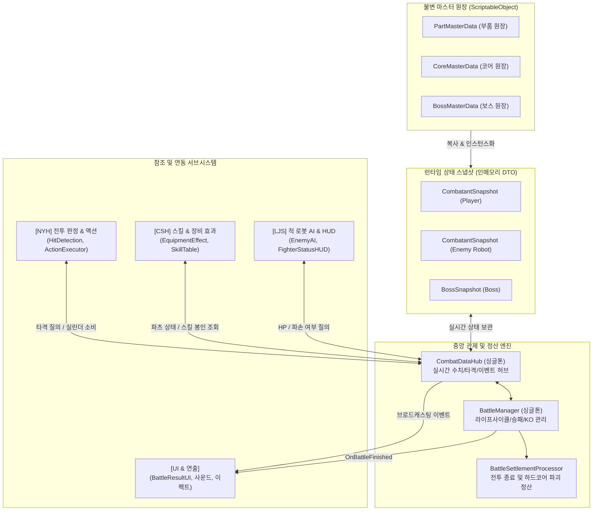

# 리얼스틸 전투 데이터(Combat Data) 접근 및 참조 가이드

> **작성자**: KKH (전투 데이터 매니지먼트 & 보스 시스템 총괄)  
> **대상**: NYH(전투 액션/판정), CSH(장비/스킬), LJS(적 AI/HUD), LHM(다이얼로그) 및 팀원 전원  
> **버전**: v1.0 (최신 1:1 로봇 대전 & 보스 토벌전 통합 아키텍처 대응)  
> **기준 일자**: 2026-10-20

---

## 1. 전투 데이터 아키텍처 개요

본 프로젝트의 전투 데이터는 **불변 마스터 원장(ScriptableObject)**과 **가변 런타임 스냅샷(DTO)**이 엄격하게 분리되어 있으며, 모든 접근과 변경은 **`CombatDataHub`**와 **`BattleManager`**를 통해 단일 창구로 관제됩니다.



### 1:1 대전 모드 구분 (`BattleMode`)
* **`BattleMode.RobotVsRobot`**: 일반 적(NPC A·B·C)과의 1:1 로봇 대전 (`PlayerSnapshot` vs `EnemySnapshot`)
* **`BattleMode.RobotVsBoss`**: 거대 보스(정크 휠러 등)와의 1:1 토벌전 (`PlayerSnapshot` vs `BossSnapshot`)

---

## 2. 핵심 데이터 구조 요약 (DTO Cheat Sheet)

### 2.1 플레이어 및 적 로봇 스냅샷 (`CombatantSnapshot`)
로봇의 체력(HP)은 오직 **코어(Core)**만 소유하며, 5개 부위 파츠는 **런타임 내구도(Durability)**만 독립 관리합니다.

| 필드 / 프로퍼티 | 타입 | 설명 |
|---|---|---|
| `fighterID` | `string` | 전투원 식별자 (`"Player"`, `"NPC_A"` 등) |
| `isPlayer` | `bool` | 플레이어 여부 (`true`: 플레이어, `false`: AI 적 로봇) |
| `currentHp` / `maxHp` | `int` | 코어 현재 체력 / 최대 체력 (0 도달 시 즉시 KO 패배) |
| `currentCylinder` | `int` | 현재 가용 실린더 탄 수 (0 ~ 3발, 양팔 공용 스킬 자원) |
| `totalAttackPower` | `int` | 복합 공격력: `기본Atk + (왼팔Atk + 오른팔Atk) / 2` |
| `finalMoveSpeed` | `float` | 복합 이동속도: `(왼다리Speed + 오른다리Speed) / 2` |
| `partStates` | `Dictionary<BodyPart, PartRuntimeState>` | 5개 부위(Head, LeftArm, RightArm, LeftLeg, RightLeg) 실시간 내구도 |
| `IsAlive` | `bool` | 생존 여부 (`currentHp > 0`) |

### 2.2 부위별 런타임 상태 (`PartRuntimeState`)
| 필드 / 프로퍼티 | 타입 | 설명 |
|---|---|---|
| `partID` | `string` | 부품 고유 ID (DB 및 인벤토리 연동 키) |
| `partType` | `BodyPart` | 장착 부위 (`Head`, `LeftArm`, `RightArm`, `LeftLeg`, `RightLeg`) |
| `currentDurability` | `int` | 현재 내구도 (`0 ~ maxDurability`) |
| `maxDurability` | `int` | 최대 내구도 |
| `isBroken` | `bool` | **부품 파손 여부** (`currentDurability <= 0`). `true` 시 해당 부위 스킬 영구 봉인 |

### 2.3 보스 스냅샷 (`BossSnapshot`)
보스는 부품 조립체가 아니므로 **본체 HP + 페이즈 + 기믹 상태 딕셔너리**로 동작합니다.

| 필드 / 프로퍼티 | 타입 | 설명 |
|---|---|---|
| `bossID` / `bossName` | `string` | 보스 식별자 (`"BOSS_REGION_01"`), 보스 명칭 (`"정크 휠러"`) |
| `currentHp` / `maxHp` | `int` | 보스 현재 체력 / 최대 체력 |
| `currentPhase` | `int` | 현재 보스 페이즈 (1 ~ 3 페이즈) |
| `isGroggy` | `bool` | 기믹 파훼로 인한 그로기(무력화) 상태 여부 (받는 피해 1.5배) |
| `gimmickStates` | `Dictionary<string, BossGimmickRuntimeState>` | 전장 기물 및 보스 약점 부위 실시간 내구도 |
| `sealedSkills` | `HashSet<string>` | 기믹 파훼로 영구 봉인된 보스 공격 패턴 목록 |

---

## 3. 데이터 조회 방법 (Read Guide)

어디서든 `CombatDataHub.Instance` 싱글톤을 통해 안전하게 데이터를 읽을 수 있습니다.

```csharp
using UnityEngine;

public class ExampleDataReader : MonoBehaviour
{
    private void CheckCombatStatus()
    {
        var hub = CombatDataHub.Instance;
        if (hub == null) return;

        // 1. 현재 대전 모드 확인
        if (hub.CurrentBattleMode == BattleMode.RobotVsRobot)
        {
            Debug.Log("일반 로봇 1:1 대전 진행 중");
        }
        else if (hub.CurrentBattleMode == BattleMode.RobotVsBoss)
        {
            Debug.Log($"보스전 진행 중 - 보스 이름: {hub.BossSnapshot?.bossName}");
        }

        // 2. 플레이어 코어 체력 및 생존 조회
        int playerHp = hub.GetCurrentHp("Player");
        int playerMaxHp = hub.GetMaxHp("Player");
        bool isOpponentDead = hub.IsOpponentDead;

        // 3. 실린더(탄환) 잔여량 확인
        int currentCylinders = hub.PlayerSnapshot != null ? hub.PlayerSnapshot.currentCylinder : 0;
        bool canFireSkill = hub.CanSpendCylinder("Player", 2); // 2발 소비 가능 여부

        // 4. 부위별 내구도 및 파손(스킬 봉인) 여부 조회
        int leftArmDur = hub.GetPartDurability("Player", BodyPart.LeftArm);
        bool isRightLegBroken = hub.IsPartBroken("Player", BodyPart.RightLeg);

        // 5. 복합 연산 스탯 조회
        float moveSpeed = hub.GetFinalMoveSpeed("Player");
        int attackPower = hub.GetTotalAttackPower("Player");
    }
}
```

### 빠른 질의 메서드 요약
| 질의 목적 | 호출 메서드 | 반환값 |
|---|---|---|
| 코어 현재 체력 | `hub.GetCurrentHp(fighterId)` | `int` |
| 코어 최대 체력 | `hub.GetMaxHp(fighterId)` | `int` |
| 부위 현재 내구도 | `hub.GetPartDurability(fighterId, bodyPart)` | `int` |
| 부위 최대 내구도 | `hub.GetPartMaxDurability(fighterId, bodyPart)` | `int` |
| 부위 파손 여부 (스킬 봉인) | `hub.IsPartBroken(fighterId, bodyPart)` | `bool` |
| 실린더 소비 가능 여부 | `hub.CanSpendCylinder(fighterId, cost)` | `bool` |
| 최종 이동 속도 | `hub.GetFinalMoveSpeed(fighterId)` | `float` |
| 상대방 사망 여부 | `hub.IsOpponentDead` | `bool` |

---

## 4. 실시간 전투 조작 및 판정 API (Write / Action Guide)

### 4.1 타격 판정 및 대미지 계산 ([NYH] HitDetection 연동)
히트박스/허트박스 충돌 시 직접 체력을 깎지 말고 **`CombatDataHub.Instance.ProcessHit`**를 호출하십시오. 방어 감쇄, 가드/위빙 판정, 부위 내구도 차감, KO 처리가 원스톱으로 계산됩니다.

```csharp
// 방법 A: ActionData 기반 호출 (NYH 표준)
HitResolutionResult result = CombatDataHub.Instance.ProcessHit(
    attackerId: "Player",
    defenderId: "Enemy",
    attackAction: actionData,     // 사용된 액션 데이터
    isGuarding: defenderIsGuarding, // 방어자가 가드 중인지
    isWeaving: defenderIsWeaving,   // 방어자가 위빙(회피) 중인지
    hitPart: BodyPart.LeftArm       // 타격된 부위 (기본값: Core)
);

// 결과 활용
Debug.Log($"가해진 대미지: {result.FinalCoreDamage}, 파츠 피해: {result.PartDamage}");
if (result.IsPartDestroyed)
{
    Debug.Log("<color=red>피격된 부품이 완전히 파손되었습니다!</color>");
}
```

### 4.2 실린더 소비 ([NYH] ActionExecutor 스킬 발동 연동)
스킬 발동 시 실린더를 직접 깎으면 UI 갱신 이벤트가 누락됩니다. 반드시 **`TrySpendCylinder`**를 통해 소비하십시오.

```csharp
// 스킬 발동 시도: 실린더 1발 필요
int cylinderCost = 1;
if (CombatDataHub.Instance.TrySpendCylinder("Player", cylinderCost))
{
    // 소비 성공: 스킬 발동 애니메이션 및 판정 진행
    ExecuteSkillAction();
}
else
{
    // 탄 부족: 발동 실패 효과음 또는 안내 출력
    PlayDryFireSound();
}
```

### 4.3 액션 실행 가능 여부 게이트 (`CanExecuteAction`)
다리 파손 시 위빙 실패 확률(50%), 팔 파손 시 가드 불가 판정을 사전에 검사할 수 있습니다.

```csharp
// 특정 행동(ActionData)을 실행할 수 있는 상태인지 검사
bool canExecute = CombatDataHub.Instance.CanExecuteAction("Player", attackAction);
if (!canExecute)
{
    Debug.LogWarning("필요 부위가 파손되어 액션을 실행할 수 없습니다!");
}
```

### 4.4 직접 대미지 적용 (특수 기믹 및 테스트 전용)
```csharp
// 특정 전투원에게 코어 대미지 직접 부여 (사망 시 KO 자동 처리됨)
CombatDataHub.Instance.ApplyCoreDamage("Player", 50);

// 특정 부위에 내구도 및 코어 동반 피해 부여
CombatDataHub.Instance.ApplyPartHit("Enemy", BodyPart.Head, partDamage: 40, coreDamage: 20);

// 전투원 스탯 풀 복구 (체력 100%, 실린더 1발, 부품 내구도 100%)
CombatDataHub.Instance.ResetFighter("Player");
```

---

## 5. 이벤트 구독 가이드 (Event / Notification Guide)

`CombatDataHub`와 `BattleManager`는 수치가 변할 때마다 실시간 브로드캐스팅 이벤트를 발행합니다. UI, 사운드, 이펙트 파트는 `Update()`에서 매 프레임 검사할 필요 없이 **이벤트를 구독**하여 반응형으로 작업하십시오.

```csharp
using UnityEngine;

public class BattleEventSubscriber : MonoBehaviour
{
    private void OnEnable()
    {
        // ==========================================
        // 1. CombatDataHub 인스턴스 이벤트 구독
        // ==========================================
        if (CombatDataHub.Instance != null)
        {
            // 플레이어 체력 변경 (현재 HP, 최대 HP)
            CombatDataHub.Instance.OnPlayerHpChanged += HandlePlayerHpChanged;

            // 플레이어 실린더(탄) 변경 (현재 탄 수, 최대 3발)
            CombatDataHub.Instance.OnPlayerCylinderChanged += HandlePlayerCylinderChanged;

            // 플레이어 특정 부위 내구도 변경 (부위, 현재 내구도, 최대 내구도)
            CombatDataHub.Instance.OnPlayerPartDurabilityChanged += HandlePlayerPartDurabilityChanged;

            // 플레이어 부품 파손/스킬 봉인 발생 (파손된 부위)
            CombatDataHub.Instance.OnPlayerPartBroken += HandlePlayerPartBroken;

            // 일반 적 로봇 체력 변경
            CombatDataHub.Instance.OnEnemyHpChanged += HandleEnemyHpChanged;

            // 보스 체력 변경 (현재 HP, 최대 HP, 현재 페이즈)
            CombatDataHub.Instance.OnBossHpChanged += HandleBossHpChanged;

            // 보스 기믹 발동 / 그로기 무력화 (기믹 ID, 그로기 여부)
            CombatDataHub.Instance.OnBossGimmickTriggered += HandleBossGimmickTriggered;
        }

        // ==========================================
        // 2. BattleManager 정적(Static) 이벤트 구독
        // ==========================================
        // 전투 종료 및 정산 완료: (플레이어 승리 여부, 승자 ID, 정산 DTO)
        BattleManager.OnBattleFinished += HandleBattleFinished;
    }

    private void OnDisable()
    {
        // 이벤트 구독 해제 (메모리 릭 방지)
        if (CombatDataHub.Instance != null)
        {
            CombatDataHub.Instance.OnPlayerHpChanged -= HandlePlayerHpChanged;
            CombatDataHub.Instance.OnPlayerCylinderChanged -= HandlePlayerCylinderChanged;
            CombatDataHub.Instance.OnPlayerPartDurabilityChanged -= HandlePlayerPartDurabilityChanged;
            CombatDataHub.Instance.OnPlayerPartBroken -= HandlePlayerPartBroken;
            CombatDataHub.Instance.OnEnemyHpChanged -= HandleEnemyHpChanged;
            CombatDataHub.Instance.OnBossHpChanged -= HandleBossHpChanged;
            CombatDataHub.Instance.OnBossGimmickTriggered -= HandleBossGimmickTriggered;
        }

        BattleManager.OnBattleFinished -= HandleBattleFinished;
    }

    private void HandlePlayerHpChanged(int currentHp, int maxHp)
    {
        float ratio = (float)currentHp / maxHp;
        // 체력바 슬라이더 갱신
    }

    private void HandlePlayerCylinderChanged(int currentCylinder, int maxCylinder)
    {
        // 실린더 UI 탄창 아이콘 On/Off
    }

    private void HandlePlayerPartDurabilityChanged(BodyPart part, int currentDur, int maxDur)
    {
        // 부위별 내구도 게이지 갱신
    }

    private void HandlePlayerPartBroken(BodyPart brokenPart)
    {
        // 부품 파괴 경고음 재생, 스킬 버튼 슬롯 자물쇠(비활성화) 잠금 연출
        Debug.LogWarning($"[UI] {brokenPart} 파손! 연동 스킬이 봉인되었습니다.");
    }

    private void HandleEnemyHpChanged(int currentHp, int maxHp)
    {
        // 적 체력바 갱신
    }

    private void HandleBossHpChanged(int currentHp, int maxHp, int phase)
    {
        // 상단 거대 보스 체력바 및 페이즈 아이콘 갱신
    }

    private void HandleBossGimmickTriggered(string gimmickId, bool isGroggy)
    {
        if (isGroggy)
        {
            // 보스 4초 그로기 안내 텍스트 출력 및 다운 연출
        }
    }

    private void HandleBattleFinished(bool playerWon, string winnerId, BattleSettlementResult result)
    {
        Debug.Log($"전투 종료! 승리: {playerWon}, 판돈 정산: {result.GoldDelta} G");
        // 결과창 UI 활성화
    }
}
```

---

## 6. 팀원별 실전 연동 레시피 (Role-Based Recipes)

### 6.1 [NYH 파트] 전투 판정 및 액션 실행
* **공격 적중 시**: `CombatDataHub.Instance.ProcessHit(...)` 호출하여 최종 대미지 및 넉백 거리 수령.
* **실린더 소비 스킬 발동 시**: `CombatDataHub.Instance.TrySpendCylinder("Player", cost)` 검사 후 동작 시작.
* **회피/위빙 시도 시**: `CombatDataHub.Instance.CanExecuteAction("Player", ActionSource.CoreFixed, BodyPart.LeftLeg)` 질의 ➔ 양다리 파손 시 50% 실패 확률 적용.

### 6.2 [CSH 파트] 장비 & 스킬 연동
* **스킬 사용 가능 여부 검사**:
  ```csharp
  // 특정 장비 부품이 파손(내구도 0)되었는지 검사
  bool isBroken = CombatDataHub.Instance.IsPartBroken("Player", partMasterData.targetPart);
  if (isBroken)
  {
      // 스킬 봉인: UI 쿨다운/발동 차단
  }
  ```
* **전투 후 부품 영구 소멸 반영**:
  `BattleManager.OnBattleFinished` 수신 ➔ `result.DestroyedPartIDs` 목록에 포함된 부품을 플레이어 인벤토리 원장에서 영구 삭제.

### 6.3 [LJS 파트] 적 AI & HUD 연동
* **적 AI 패턴 전환**:
  - `CombatDataHub.Instance.GetCurrentHp("Enemy")`가 30% 이하일 때 방어적 회피/가드 빈도 상향.
  - `CombatDataHub.Instance.IsPartBroken("Enemy", BodyPart.RightArm)` 감지 시 오른팔 주먹 공격 패턴을 AI 공격 큐에서 자동 배제.
* **적 HUD 갱신**:
  `OnEnemyHpChanged`, `OnEnemyPartDurabilityChanged` 이벤트에 HUD 슬라이더를 바인딩하여 60fps 무부하 갱신.

---

## 7. 반드시 지켜야 할 협업 수칙 (Caution)

> [!CAUTION]
> 1. **ScriptableObject 원장 직접 수정 금지**:
>    `PartMasterData.baseDurability` 등 SO 필드를 런타임에서 직접 수정하면 에셋 파일이 영구 오염됩니다. 반드시 `CombatantSnapshot` 또는 `CombatDataHub` API를 통해서만 수치를 차감/회복하십시오.
>
> 2. **실린더 차감 시 Snapshot 직접 접근 금지**:
>    `PlayerSnapshot.currentCylinder--`와 같이 직접 변경하면 브로드캐스팅 이벤트(`OnPlayerCylinderChanged`)가 발행되지 않아 UI가 갱신되지 않습니다. 반드시 **`CombatDataHub.Instance.TrySpendCylinder()`**를 사용하십시오.
>
> 3. **`BattleManager.OnBattleFinished`는 정적(Static) 이벤트**:
>    `BattleManager`의 인스턴스가 파괴되거나 씬 전환 중이어도 안전하게 구독할 수 있도록 `public static event`로 선언되어 있습니다. `BattleManager.OnBattleFinished += ...` 형태로 구독하십시오.
>
> 4. **전투 종료 시 거점 복귀 흐름 준수**:
>    본 프로젝트는 하드코어 정비 루프를 따르므로 전투 현장에서의 '재도전'은 제거되었습니다. 전투 종료 후에는 반드시 `TongHabScene_1015` 등 로비/거점으로 귀환하여 정비소를 거쳐야 합니다.

